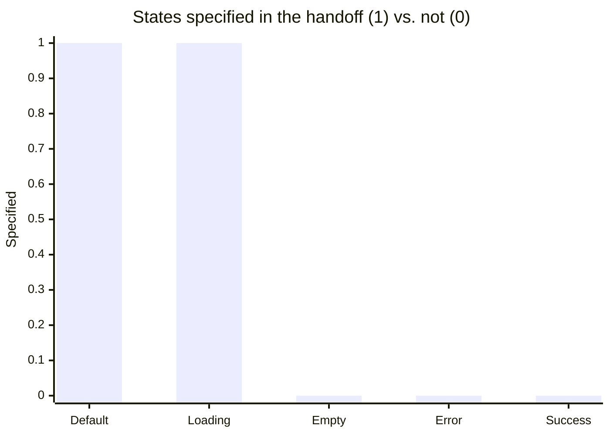
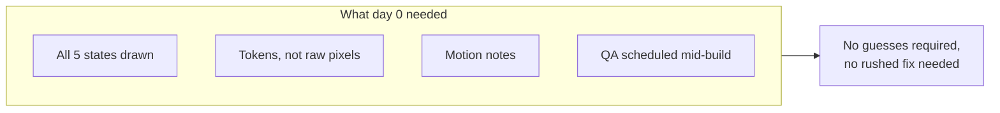

import Scenario from "../../../components/Scenario.astro";
import LevelIntro from "../../../components/LevelIntro.astro";
import Checkpoint from "../../../components/Checkpoint.astro";
import PracticeCheck from "../../../components/PracticeCheck.astro";

export const unit = {
  track: "design",
  unitSlug: "design-engineering-handoff",
};

<Scenario label="The full incident">
  <Fragment slot="facts">
    

      

        Day 28 of 30
        when design QA found the gaps
      

      

        

      

      
28 / 30 = 93% of the way through the build window

    

    
Timeline

    

      
📤 Day 0: one frame, no annotations, "ready to build"

      
🛠️ Day 1 to 27: Sam builds against the visible default state

      
🔎 Day 28: design QA finds the gaps

      
🚑 Day 29 to 30: rushed fixes, one still a guess

    

  </Fragment>

If you ask a friend to bake from a photo, you find out the cake is wrong when it comes out of the oven, and by then the ingredients are gone. The checkout incident is that story with a deadline. This is the full trace from a five-state design to a three-state build, why the fix that finally shipped was itself a guess, and what would have made every step unnecessary.

</Scenario>

<LevelIntro
  items={[
    "Five gaps traced from handoff to hotfix",
    "Why late QA changes the kind of fix",
    "Calibrating spec detail without over-specifying",
  ]}
/>

## What did the day-0 handoff actually transmit?

Priya posted one frame link with "ready to build, let me know if questions." It showed the default state (and a loading variant): an itemized cart, a total, and a confirm button with 24px of padding, produced by an auto-layout setup she had made months earlier.

A single static frame cannot carry the three other states she had sketched on paper, the reason for 24px (it matched a token used on the two screens before checkout), or the success checkmark animation she had described aloud in a design review three weeks earlier.

<Checkpoint question="Sam was in the review where Priya described the success animation aloud, yet three weeks later he built a static checkmark. Why does 'he was told' not close the gap the way a written spec would?">

A verbal mention depends on unaided memory surviving three weeks of other work, with nothing to check against. A spec is durable because it does not rely on anyone's memory: it reads the same on day 27 as on day 0. "He was told" turns a fixable handoff gap into a memory problem, and you can improve a spec on purpose but not someone's recall of a passing detail.

</Checkpoint>

## Which gaps did Sam fill, and with what?

Where the frame showed nothing, Sam made a reasonable call each time, individually fine and wrong in total:

| Gap               | What the frame showed                   | What Sam built                             | Bad guess?                                |
| ----------------- | --------------------------------------- | ------------------------------------------ | ----------------------------------------- |
| Empty-cart state  | Nothing                                 | Cart renders as if it had one item         | No, nothing to build from                 |
| Success animation | Nothing (said aloud weeks ago)          | Static checkmark                           | Reasonable, no durable reference          |
| Error state       | A rough sketch in an old file Sam found | Close, but a hex red that is not the token | Partly: right idea, no token to check     |
| Spacing           | 24px, only by hovering the layer        | 16px, the auto-layout's computed gap       | No: a measurement error, not a judgment   |
| Loading state     | Shown                                   | Shipped correctly                          | N/A: the one extra state the file carried |

Error and the checkmark were attempted, so the zero column is not about effort. What separates "shipped correctly" from "shipped as a guess" is whether a durable, checkable reference existed.

<PracticeCheck
  track={unit.track}
  unitSlug={unit.unitSlug}
  topicId="missing-artifact"
/>

## Why did late design QA change the fix itself?

QA was scheduled, but for the week before launch instead of inside the sprint. By day 28 the flow was reviewed, merged and on the release checklist. Priya triggered an empty cart and the confirm button submitted an order for an item that was not there.

<Checkpoint question="Spacing and empty-cart were both found on day 28. Why did spacing take twenty minutes while empty-cart needed a rushed one-day patch?">

Spacing was a value substitution: swap 16px for the token, no new logic. Empty-cart needed new behaviour (detect the condition, decide what renders, wire it into a flow built on the assumption that a cart always has items), written with a fraction of the usual review. Lateness changes the category of fix, from adjusting a value to shipping new logic under a deadline.

</Checkpoint>

The interactive demo in this level puts numbers on it with an illustrative curve: at 2 days before launch roughly 80 hours of rework, at 14 days roughly 19. The shape matters more than the exact values: cost climbs steeply as the gap to launch shrinks.

<PracticeCheck
  track={unit.track}
  unitSlug={unit.unitSlug}
  topicId="qa-timing"
/>

The hotfix that shipped disabled the confirm button and showed "Your cart is empty." Nobody disagreed, but nobody checked it against Priya's design, which was an illustrated empty state with a "browse products" link. The rushed fix was a smaller version of the original failure: a gap filled with a guess.

## Which missing artifact explains each gap?

None of the five gaps needed more design skill or more care. Each maps to one missing artifact:

| Gap               | Missing artifact                              | What it would have carried                        |
| ----------------- | --------------------------------------------- | ------------------------------------------------- |
| Empty-cart state  | The state itself, drawn                       | A frame to build from                             |
| Success animation | A motion note (a line plus a short reference) | A durable reference instead of a memory           |
| Error colour      | A token reference                             | `color-error` as a named value                    |
| Spacing           | A token reference                             | `spacing-lg = 24px`, read instead of measured     |
| Late QA           | A scheduled mid-build check-in                | Gaps caught while still adjustments, not rewrites |

## How much spec is enough?

Reading this as "spec everything" would be a mistake. A spec that annotates every wrapper element drowns the decisions that matter, and engineers stop reading it closely. The useful question is: **is there a real decision here an engineer could reasonably make differently than I intend?**

| Needs a token or annotation                                 | Does not                                       |
| ----------------------------------------------------------- | ---------------------------------------------- |
| Value repeats across screens (consistency matters)          | Value is local and one-off                     |
| Getting it wrong changes behaviour (disabled versus hidden) | "Close enough" is invisible to a user          |
| A state nobody will think to ask about (empty, error)       | The state already shown and obvious            |
| Discussed once aloud and never written down                 | Self-evident, with no real alternative reading |

<Checkpoint question="A teammate says the incident proves designers should learn to code so nothing is lost in translation. What was the actual gap, and does that fix address it?">

The gap was a set of nameable missing artifacts: undrawn states, no tokens, an unwritten motion note and QA scheduled too late. Each is fixed by changing what is handed off and when, without anyone learning a new skill. Priya coding the flow herself would not have made her draw the empty state sooner, and it would remove the second pair of eyes QA provides.

</Checkpoint>

<PracticeCheck
  track={unit.track}
  unitSlug={unit.unitSlug}
  topicId="spec-calibration"
/>

## A case, not the whole territory

The checkout flow is one incident. Try extending it:

- **What changes if the engineers were a contract team in another timezone** with no shared channel for quick questions? Which gaps get costlier, and does the fix change or only its urgency?
- **What changes if the QA news were worse**, a misread of the whole flow's structure rather than five gaps? Is the answer still "add the missing artifact", or does a bigger gap call for a different response?
- **Which checklist item, checked before day 0, would catch the most gaps for the least work**, and would it be the same item for a data-heavy dashboard?
