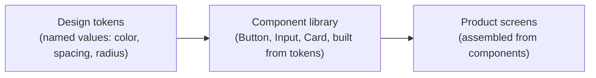

import Scenario from "../../../components/Scenario.astro";
import LevelIntro from "../../../components/LevelIntro.astro";
import PracticeCheck from "../../../components/PracticeCheck.astro";

export const unit = {
  track: "design",
  unitSlug: "design-systems",
};

<Scenario>
  <Fragment slot="facts">
    

      

        6
        shades of "primary blue" across 40 screens
      

      

        

      

    

    

      
📱 40 screens, 3 squads, 2 years, no shared library

      
📐 3 different corner radii among 4 sampled buttons

      
🛒 Checkout button: its own disabled style

    

    
Who's affected

    

      
🎨 Designers: redrawing the same button per file

      
💻 Engineers: guessing which blue is "correct"

      
🛍️ Shoppers: confused by an inconsistent checkout

    

  </Fragment>

Picture four people each asked to paint "the front door" of a street of
houses, none of them allowed to see the others' work. Nobody paints a
bad door, yet the street ends up with four slightly different doors.

Northwind Retail's shopping app started two years ago as three screens
built by one designer and one engineer. It is now 40 screens built by
three squads that rarely talk. Ahead of a rebrand, someone screenshots
the "primary" button on four screens side by side. (The full audit found
six blues; these four are a sample. White-text contrast was computed with
the WCAG relative-luminance formula.)

| Screen                      | Button color | Corner radius | Disabled style              | White text contrast |
| --------------------------- | ------------ | ------------- | --------------------------- | ------------------- |
| Home: "Shop now"            | `#2563EB`    | 8px           | 60% opacity                 | 5.17 : 1            |
| Product page: "Add to cart" | `#1D4ED8`    | 6px           | grey fill                   | 6.70 : 1            |
| Checkout: "Buy now"         | `#3B82F6`    | 4px           | grey fill, no cursor change | 3.68 : 1            |
| Account: "Save changes"     | `#2452C7`    | 8px           | 60% opacity                 | 6.76 : 1            |

</Scenario>

No single screen looks broken on its own. **So if nothing looks wrong in
isolation, why does the audit feel like a real problem?**

Because the differences are not taste, they are symptoms. The checkout
button is the lightest blue, and white text on it measures 3.68 : 1,
below the 4.5 : 1 that WCAG AA asks for normal-size text. Nobody chose
that on purpose; one person copied a blue from memory. Four teams
reinvented the same component, and one reinvention quietly got worse.

<LevelIntro
  items={[
    "Why consistency breaks as screens multiply",
    "Design tokens versus components",
    "What a design system is and is not",
  ]}
/>

## What is the fix, in one picture?

A **design system** is a shared, named, versioned set of visual decisions plus the reusable components built from them, so nobody redraws the button per screen. It has three layers, from raw value to finished screen:

| Term                   | Simple meaning                                                                        |
| ---------------------- | ------------------------------------------------------------------------------------- |
| Design token           | A named, reusable value (a color, a spacing unit, a radius) defined once              |
| Component library      | Reusable, pre-built UI pieces (Button, Input, Card) built from tokens                 |
| Design system          | Tokens + components + the rules and process that keep them the single source of truth |
| Visual drift           | Small, uncoordinated deviations that accumulate into visible inconsistency            |
| Single source of truth | The one place a value is defined; everything else references it, nothing redefines it |

A **token** is a name instead of a value: screens reference `color.primary`, and that name is defined exactly once. A **component** is the layer above: a `Button` that already knows its color, radius and disabled state, so "Add to cart" and "Buy now" share the same piece, not just the same intent.

<PracticeCheck
  track={unit.track}
  unitSlug={unit.unitSlug}
  topicId="what-is-system"
/>

## Why does drift happen at all?

**If every designer and engineer is competent, where does the drift come from?** Not from carelessness. When the value lives in people's heads or in copied hex codes, every new screen is a fresh chance to recall it slightly wrong. More screens and more people mean more chances, so drift grows with both.

| Looks like a system, but is not        | Why it still drifts                                |
| -------------------------------------- | -------------------------------------------------- |
| A style-guide PDF nobody opens         | Nothing forces the code to match it                |
| A design file that drifts from code    | Two sources of truth, and they disagree            |
| A rule enforced by memory and goodwill | Works until the next deadline or the next new hire |

The test is blunt: if it is not what engineers actually import, it is documentation of a design system, not the system. A design system does not remove design decisions; it moves them upstream, from "pick a blue for this button" repeated 40 times to "pick the primary blue" once.

<PracticeCheck
  track={unit.track}
  unitSlug={unit.unitSlug}
  topicId="drift-cause"
/>
