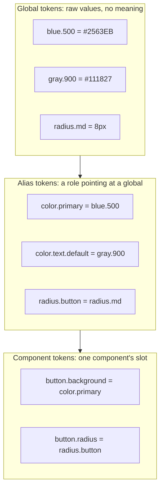
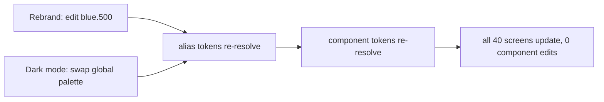

import Checkpoint from "../../../components/Checkpoint.astro";
import LevelIntro from "../../../components/LevelIntro.astro";
import PracticeCheck from "../../../components/PracticeCheck.astro";

export const unit = {
  track: "design",
  unitSlug: "design-systems",
};

L1 showed that Northwind's 40 screens accumulated six blues because nothing
pointed at one shared value. L2 asks what "one shared value" looks like in
practice: tokens are not one flat list, they are layered, and the layering is
what makes a rebrand or a dark mode cheap.

<LevelIntro
  items={[
    "The three token layers and why each exists",
    "How a value resolves down the chain",
    "How a rebrand or dark mode flows through",
  ]}
/>

## Why isn't one flat list of colors enough?

**Suppose everyone agrees the primary button is `#2563EB` and every component hardcodes it. Six months later marketing picks a warmer blue. What now?**

Every file that typed `#2563EB` must be found and edited by hand, across 40 screens. A flat list centralizes the value but not the reference: nothing stops a new component from typing the hex again next sprint. The fix is a naming layer between the raw value and its use, and it splits into three:

**Global tokens** hold the raw palette with no opinion about use. **Alias tokens** attach a role: `color.primary` does not say "this hex", it says "whatever primary means right now". **Component tokens** point one component slot at an alias, never at a raw value.

<Checkpoint question="Marketing wants a warmer primary blue. In a system with all three layers, which single line changes?">

Only the global token's raw value: `blue.500` gets a new hex. Every alias and
component token downstream is a reference to it, not a copy, so
`color.primary` and `button.background` resolve to the new hex automatically.
That is the whole payoff of layering: a rebrand becomes a one-line edit
instead of a search across 40 screens.

</Checkpoint>

<PracticeCheck
  track={unit.track}
  unitSlug={unit.unitSlug}
  topicId="token-layers"
/>

## How does a value resolve, and what do tokens still not stop?

**When the Home screen draws its button, where does the color actually come from?** It follows the chain from the component slot down to the raw value:

| Step | Name looked up      | Points at       | Final value  |
| ---- | ------------------- | --------------- | ------------ |
| 1    | `button.background` | `color.primary` | (keep going) |
| 2    | `color.primary`     | `blue.500`      | (keep going) |
| 3    | `blue.500`          | (raw value)     | `#2563EB`    |

Tools such as Style Dictionary take this chain, authored once as JSON, and compile it for each platform (CSS custom properties for web, native equivalents for mobile). The Northwind audit's four different blues never appear: there is one chain, and every screen asks for `button.background`.

But a token catalog alone still lets engineers hand-assemble a button on every screen, get the radius right on three and forget the disabled state on the fourth, exactly the checkout story. Tokens are the _values_; a component library forces every screen to consume the whole set together, correctly, by construction.

| Layer            | What it defines                                    | Who owns it                                   | Changes how often                   |
| ---------------- | -------------------------------------------------- | --------------------------------------------- | ----------------------------------- |
| Global tokens    | Raw palette, spacing scale, radii, type scale      | Design system team, with design lead sign-off | Rarely (rebrand, major refresh)     |
| Alias tokens     | Named roles (primary, danger, text-default)        | Design system team                            | Occasionally (new use case emerges) |
| Component tokens | One component's specific visual slots              | Component owner, following alias tokens       | Whenever that component is revised  |
| Components       | Assembled, reusable UI built from the tokens above | Design system team, used by product squads    | On a versioned release cadence      |

<Checkpoint question="Northwind publishes tokens but no Button component. A squad under deadline skips the disabled-state token. Which layer failed, and why?">

None of the token layers failed; the gap is the missing component layer.
Tokens only offer values, and using them is still optional and manual. A
shared `Button` removes the choice: the disabled style ships inside the
component, so a screen cannot forget it. Tokens make a correct button
_possible_; components make it the default.

</Checkpoint>

## What happens on a rebrand or a dark mode?

**Does dark mode need a second set of components?** No. It is the rebrand trick again: a second global palette is swapped in (`gray.900` resolves to a light value in the dark theme), and every alias and component token that referenced it resolves differently with no component code changing.

The architectural bet is the same each time: push every decision likely to change (a color, a spacing unit) as far upstream as possible, so the number of places that must change is exactly one.

<PracticeCheck
  track={unit.track}
  unitSlug={unit.unitSlug}
  topicId="rebrand-flow"
/>
