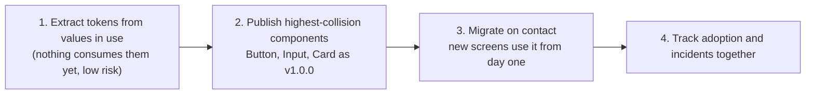
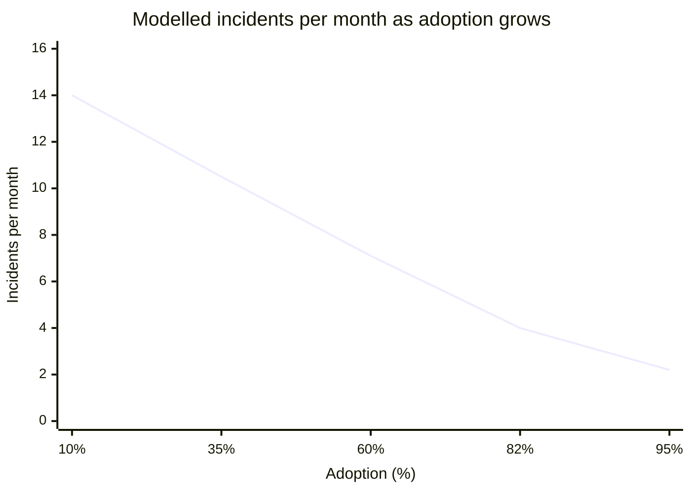

import Scenario from "../../../components/Scenario.astro";
import LevelIntro from "../../../components/LevelIntro.astro";
import Checkpoint from "../../../components/Checkpoint.astro";
import PracticeCheck from "../../../components/PracticeCheck.astro";

export const unit = {
  track: "design",
  unitSlug: "design-systems",
};

<Scenario label="The post-mortem">
  <Fragment slot="facts">
    

      

        +9%
        cart abandonment for 2 weeks (scenario figure)
      

      

        

      

    

    

      
🔘 "Buy now" disabled: grey fill, no cursor change

      
🕵️ Root cause: rebuilt from scratch, no shared Button

      
🔍 Also: white text on it is only 3.68 : 1

    

    
Fix scope

    

      
🧱 Tokens: color, radius, spacing

      
🧩 Components: Button, Input, Card (v1)

      
📜 Governance: RFC process, deprecation policy

    

  </Fragment>

Imagine a school where every class hand-copies the fire-drill route from
memory. One class copies it wrong, and nobody notices until the day it matters.
Fixing that one class's sheet is easy; the real question is why each class
was copying at all.

Northwind's version: checkout's "Buy now" button lost its cursor-change cue
when disabled, because whoever built it never saw the account page's version
and rebuilt the disabled state from memory. For two weeks, shoppers whose
carts were still processing saw a greyed-out button that looked broken, and
(in this scenario) abandonment rose 9%. The fix for this button took an
afternoon. The post-mortem's real question is bigger: **how does Northwind stop
three squads rebuilding the next four components from memory?**

</Scenario>

<LevelIntro
  items={[
    "Diagnosing drift as a process failure",
    "Rolling out without a big-bang rewrite",
    "Governance: ownership, versioning, deprecation",
  ]}
/>

## What did the post-mortem actually find?

The easy, wrong conclusion is "the engineer should have looked harder". The post-mortem asked a structural question instead: **before this bug, was there any single place where "what does a disabled button look like" was defined?** There was not. Four teams had four `Button` implementations, so "looking harder" meant cross-checking three other codebases under a sprint deadline.

| Symptom                      | What it looks like                      | What it is evidence of                             |
| ---------------------------- | --------------------------------------- | -------------------------------------------------- |
| 6 shades of "primary blue"   | Cosmetic inconsistency, easy to dismiss | No single source of truth for the value            |
| 3 radii on 4 sampled buttons | Cosmetic inconsistency                  | Components not built from shared tokens            |
| Checkout disabled-state bug  | A real, costly functional bug           | Components rebuilt from memory, not from a library |

The first two rows look like nitpicks. The third is what they were always one missed detail away from becoming.

<Checkpoint question="A teammate says the fix is a stricter review checklist for disabled states. What does a checklist fix, and what does it leave exactly as fragile?">

A checklist can catch this one failure: a reviewer who remembers to compare
the disabled state with the other screens might stop it before merge. But
four independent `Button` implementations still exist, so a human must re-run
the checklist correctly on every change to every one of them, and it only
covers failures someone thought to write down. A shared component removes the
need on this axis because only one implementation is left to get right. The
fix that scales makes the mistake structurally harder, instead of asking people
to remember not to make it.

</Checkpoint>

<PracticeCheck
  track={unit.track}
  unitSlug={unit.unitSlug}
  topicId="post-mortem"
/>

## How do you roll it out without freezing the roadmap?

**Can Northwind pause three squads for a rewrite?** No. The rollout that worked lands beside normal feature work, in this order:

Tokens go first because shipping a package nothing consumes yet cannot break anything. Components follow where duplication hurt most, versioned and published like any internal package, not copied into each repo. Old screens migrate when a squad is already touching them, never in a dedicated migration sprint.

Step 4 is what funds year two. The table below uses the same model as the demo on this page: a straight line fitted between Northwind's start (10% adoption, 14 incidents a month) and a floor of 1.5. The adoption column per quarter is this scenario's assumption; the incidents column is that model's output (rounded to 0.1), not measured data.

| Quarter          | Adoption (assumed) | Incidents / month (model) |
| ---------------- | ------------------ | ------------------------- |
| Q1 (pre-rollout) | 10%                | 14.0                      |
| Q2               | 35%                | 10.5                      |
| Q3               | 60%                | 7.1                       |
| Q4               | 82%                | 4.0                       |
| Q5               | 95%                | 2.2                       |

Adoption rising while incidents fall is the real argument for the system. A rebrand is a nice-to-have pitch; a measurable drop in bugs like the checkout one is what justifies a dedicated headcount.

<PracticeCheck track={unit.track} unitSlug={unit.unitSlug} topicId="rollout" />

## Governance: who is allowed to change what?

**If five squads can edit the shared `Button` directly, what has been gained?** Nothing: that is the original drift, one repository later. Northwind settled on three rules:

| Rule                                                    | Who                                    | Why it is shaped this way                                               |
| ------------------------------------------------------- | -------------------------------------- | ----------------------------------------------------------------------- |
| Global and alias tokens change only through a short RFC | Design system team owns them           | A global change fans out to everything, so it is slow on purpose        |
| Component tokens and new components can be proposed     | Any squad proposes, system team merges | Keeps the system responsive while keeping one reviewer for every change |
| Breaking changes are deprecated, not swapped            | Design system team announces           | The old API keeps working with a warning for one full release cycle     |

<Checkpoint question="Why does 'any squad proposes, the design system team merges' avoid recreating the original drift instead of just moving it?">

Drift was never about who has opinions; it was about there being no single
place those opinions land. Open proposals keep the system responsive, since
the squad closest to a problem often has the best fix. Routing every merge
through one team keeps the missing property: one owner who sees every change
in context and catches the sixth blue before it ships. The bottleneck is
intentional, the same job the missing shared `Button` was meant to do, done by
a review gate instead of a component boundary.

</Checkpoint>

<PracticeCheck
  track={unit.track}
  unitSlug={unit.unitSlug}
  topicId="governance"
/>

## A worked example: extending the system

Six months in, checkout needs an urgent red "delete saved address" button. Tracing it through the layers from L2:

| Layer     | New token                                   | Existing tokens touched |
| --------- | ------------------------------------------- | ----------------------- |
| Global    | `red.500` = `#DC2626`                       | none                    |
| Alias     | `color.danger` = `red.500`                  | none                    |
| Component | `button.background-danger` = `color.danger` | none                    |

`Button` gains a `variant="danger"` option that resolves to the new slot. The squad did not invent a red, did not touch `color.primary`, and every other `Button` is unaffected. Extension, not modification, is what lets the system grow without re-triggering the audit. (White text on `#DC2626` measures 4.83 : 1, which clears the 4.5 : 1 bar; the new color was checked before it joined the palette.)

**Before moving on:** this example added one alias for one use case. What would change if Northwind acquired a sister brand that needed its own primary color while sharing every component and every alias _name_? Would `color.primary` still point at one global token, or must the alias layer itself become brand-aware? (It must: multi-brand systems resolve the alias layer per brand while component and alias names stay identical.) This example is one case of the hierarchy earning its keep, not the whole territory. A rebrand, a dark mode and a second brand are three more, and none of them require touching a component. Which other change, such as a density mode or a seasonal theme, would you route through which layer?
