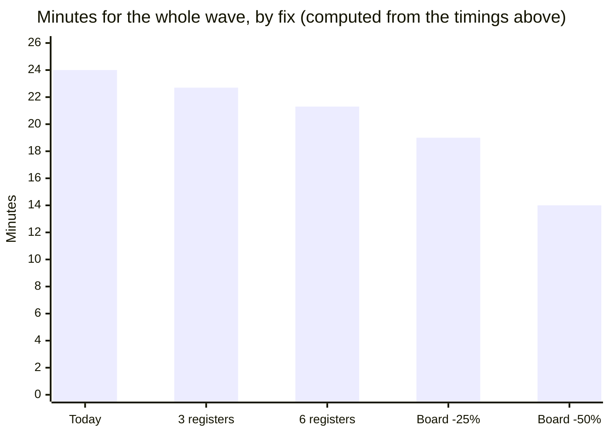
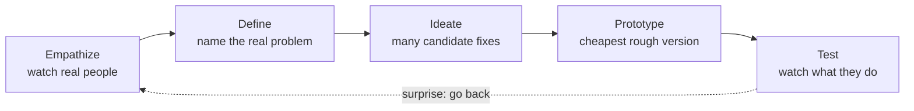

import Scenario from "../../../components/Scenario.astro";
import LevelIntro from "../../../components/LevelIntro.astro";
import PracticeCheck from "../../../components/PracticeCheck.astro";

export const unit = {
  track: "design",
  unitSlug: "design-thinking-process",
};

<Scenario label="The lunch line is 24 minutes long, and the lunch period is 20">
  <Fragment slot="facts">
    

      

        24 min
        to serve one wave, in a 20-min period
      

      

        

      

    

    
Where the 24 minutes go

    

      

        
Deciding at the food station20 min

        

      

      

        
Paying at the 2 registers4 min

        

      

    

  </Fragment>

A school cafeteria serves 60 students per lunch wave, and the line takes 24
minutes to get through. The lunch period is 20. Some students sit down with
six minutes to eat; some never sit down at all. The principal's first
instinct is simple: the line is slow, so buy a third register and hire
a third cashier.

A student council member asks for ten minutes with a stopwatch before any
money is spent. She times two spots in the line.

| What the stopwatch shows                            | Seconds per student |
| --------------------------------------------------- | ------------------- |
| Standing at the register, paying                    | 8                   |
| Standing at the food station, deciding what to take | 40                  |

**Before reading on: if students spend 40 seconds deciding and 8 seconds
paying, what will a third register actually change?**

</Scenario>

Very little. A third register only speeds up the step that was never the
slow one. The line would still stall at the food station, now with an
extra cashier waiting for customers.

<LevelIntro
  items={[
    "Where the time really goes, and why watching finds it",
    "The five stages: Empathize, Define, Ideate, Prototype, Test",
    "Why a problem statement must not contain its own fix",
  ]}
/>

## Why does watching beat guessing?

**The principal's guess and the stopwatch disagree. How big is the gap?**
The numbers come straight from the two timings, so you can check them: 60
students, 2 food lanes feeding the line, 40 seconds each is
`60 x 40 / 2 = 1,200` seconds, or 20 minutes of deciding. Paying is
`60 x 8 / 2 = 240` seconds, or 4 minutes across the 2 registers. Compare what
each fix does to the 24-minute total (computed with the same formulas as the
demo on this page):

| Fix                                  | Deciding | Paying | Whole wave |
| ------------------------------------ | -------- | ------ | ---------- |
| Today                                | 20.0 min | 4.0    | 24.0 min   |
| Third register                       | 20.0     | 2.7    | 22.7 min   |
| Six registers                        | 20.0     | 1.3    | 21.3 min   |
| Menu board cuts deciding time by 25% | 15.0     | 4.0    | 19.0 min   |
| Menu board cuts deciding time by 50% | 10.0     | 4.0    | 14.0 min   |

Doubling the registers from 3 to 6 buys about a minute. Even a modest
menu board beats it, because it attacks the 20-minute part. The two
board rows assume the board really does cut decision time by that much;
that is a guess to be tested, not a fact.

<PracticeCheck
  track={unit.track}
  unitSlug={unit.unitSlug}
  topicId="obvious-fix-trap"
/>

## What are the five stages?

**If the council member's stopwatch was the right first move, what is the
whole habit behind it?** Design thinking is five stages that make sure the
thing you build addresses the problem people actually have, not the first
problem anyone guessed.

| #   | Stage     | The question it answers                             |
| --- | --------- | --------------------------------------------------- |
| 1   | Empathize | What are people actually experiencing?              |
| 2   | Define    | What is the real, human-centered problem?           |
| 3   | Ideate    | What are many possible ways to solve it?            |
| 4   | Prototype | What is the cheapest way to test the riskiest idea? |
| 5   | Test      | What do real people actually do with it?            |

It is a loop, not a checklist. A surprising Test result sends you back to
an earlier stage, sometimes all the way to Empathize.

<PracticeCheck
  track={unit.track}
  unitSlug={unit.unitSlug}
  topicId="five-stages"
/>

## How does a fix sneak into a problem statement?

**Which of these is a problem, and which is a fix wearing a problem's
clothes?** "The line is too slow, so we need a third register" names a
register before anyone has asked where the time goes. "Students stall
deciding what to take" names what happens to people and leaves the
answer open.

| Statement                            | Names a fix already? | Leaves room for ideas? |
| ------------------------------------ | -------------------- | ---------------------- |
| We need a third register             | Yes: a register      | No                     |
| We need a bigger menu board          | Yes: a board         | Barely                 |
| Students stall deciding what to take | No                   | Yes                    |

The most common way to skip design thinking without noticing is to treat
the first proposed fix as if it were already the defined problem, then
build it.

<PracticeCheck
  track={unit.track}
  unitSlug={unit.unitSlug}
  topicId="solution-shaped-problem"
/>
