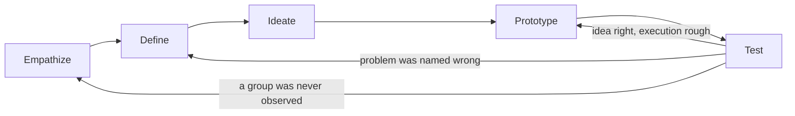
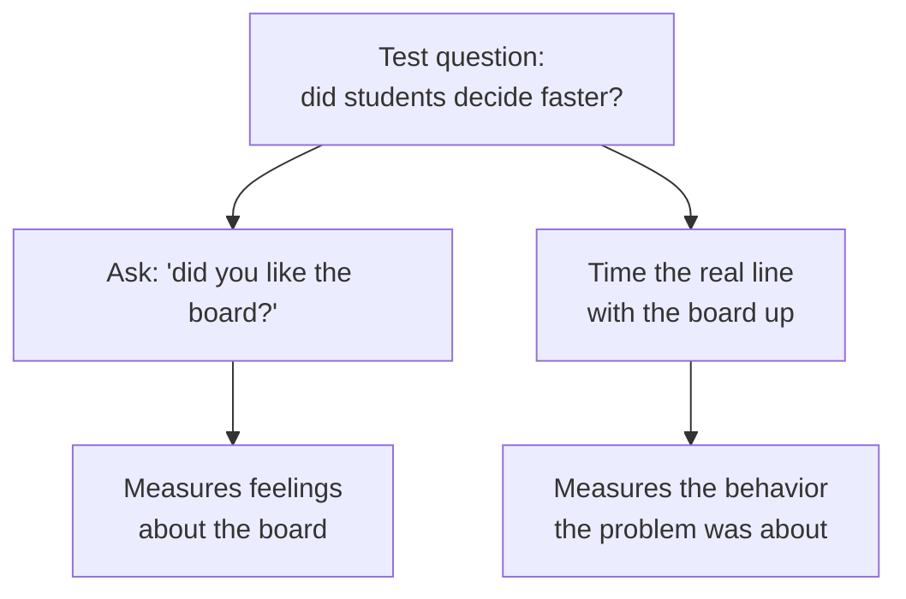

import LevelIntro from "../../../components/LevelIntro.astro";
import Checkpoint from "../../../components/Checkpoint.astro";
import PracticeCheck from "../../../components/PracticeCheck.astro";

export const unit = {
  track: "design",
  unitSlug: "design-thinking-process",
};

L1 named the five stages and showed why watching beat guessing in the
cafeteria. L2 asks what happens after the first fix ships: why the stages
form a loop, what each stage protects against, and what separates real
observation from a survey.

<LevelIntro
  items={[
    "Why Test loops back to three different stages",
    "Observing versus asking",
    "Wide search first, then narrow; cheap build, real behavior",
  ]}
/>

## Why does Test loop back to three different stages?

Suppose the menu board works and the line drops to 14 minutes. Two weeks
later a new combo-meal option appears and the wait creeps back up, this time
at the register, where cashiers keep asking clarifying questions.
**If design thinking were a checklist finished once, what would the team do
next, and what does the loop version say instead?**

The checklist team says "we already did Empathize and Define" and goes
straight to building a fix for the register. The loop team treats the new
symptom as a fresh surprise: it has to earn its own look at what is
happening and its own problem statement before anyone builds anything.

Three arrows leave Test, and which one fires depends on what kind of
surprise the test produced.

| Test result                                                    | Loop back to | Why                                                          |
| -------------------------------------------------------------- | ------------ | ------------------------------------------------------------ |
| The board helped, but students still hesitate on combo meals   | Empathize    | A new moment of friction was never observed                  |
| The board's wording confused students, though the idea works   | Prototype    | The concept is right; only the execution needs another pass  |
| Students read the board fine but still stall, comparing prices | Define       | The problem was named wrong: price anxiety, not menu options |

<Checkpoint question="After a test, students read the new board easily and the line is still just as slow. Which arrow out of Test is that, and why not simply a better-looking board?">

That is the arrow back to Define. Reading is no longer the problem, so a
prettier board would polish a fix aimed at the wrong target. The result says
the team named the problem wrong, and the next job is to look again at what
makes students stall and write a new problem statement from that.

</Checkpoint>

<PracticeCheck
  track={unit.track}
  unitSlug={unit.unitSlug}
  topicId="feedback-loop"
/>

## What separates observing from asking?

Two students both say they "did Empathize" for the register slowdown. One
stood near the line for ten minutes. The other sent a three-question survey.
**Which one is closer to Empathize, and what would the survey miss?**

The observer sees a student re-reading the combo board twice, asking a
friend "is the drink included?", and stepping out of line to check. A survey
only captures what people can already put into words about their own
behavior, and that is rarely where the friction is.

| Stage     | Guiding question                                             | Typical output                             | Sign you skipped it                                         |
| --------- | ------------------------------------------------------------ | ------------------------------------------ | ----------------------------------------------------------- |
| Empathize | What are people doing, not what do they say they do?         | Field notes, direct quotes, timings        | Your "finding" is your own assumption, restated confidently |
| Define    | What is the human-centered problem, with no fix inside it?   | A one-sentence problem statement           | The statement already contains a feature or product noun    |
| Ideate    | What is the widest range of ways to address this?            | A long list, bad ideas included            | The list has one idea, the one somebody already wanted      |
| Prototype | What is the cheapest artifact that tests our riskiest guess? | A rough, disposable mockup                 | The mockup took longer than building the real thing         |
| Test      | What did people do with it, not what did they say about it?  | Observed behavior, a measured before/after | The only evidence is "they said they liked it"              |

A good problem statement fills in this shape without ever naming an
artifact: **[who]** needs a way to **[do something]** because **[the
underlying reason]**. For the cafeteria: "Students at the food station need a
way to decide what to take before reaching the counter, because deciding
with a line behind them is what causes the stall." A dozen different ideas
can answer that sentence, which is the point.

<Checkpoint question="A team writes 'Students need a bigger menu board with better lighting.' What is wrong with it as a problem statement, and how would you rewrite it?">

It names the fix twice, a board and a bigger, brighter one, so the next
stage can only argue about size and wattage. Rewriting it underneath the
fix, "Students at the food station need a way to decide before reaching the
counter, because deciding under time pressure causes the stall," leaves room
for a board, a sample tray, a posted daily special, or anything else the
search turns up.

</Checkpoint>

<PracticeCheck
  track={unit.track}
  unitSlug={unit.unitSlug}
  topicId="observe-vs-ask"
/>

## Why search wide before narrowing?

A facilitator opens Ideate by banning the word "no" for fifteen minutes and
asking for at least twenty ideas, bad ones included.
**Why ask for bad ideas instead of going straight for the best one?**

Judging while generating collapses the search onto whatever is already
familiar, usually a version of the first fix anyone thought of. Volume is a
rough stand-in for coverage: a wider net catches ideas nobody would reach by
reasoning straight from the problem statement. This is why Ideate has two
halves, not one continuous activity.

| Half       | What happens                                           | Rule                            |
| ---------- | ------------------------------------------------------ | ------------------------------- |
| Divergent  | Produce as many candidate ideas as possible            | Defer judgment, quantity first  |
| Convergent | Group, vote, and narrow to a short list worth building | Apply judgment, criteria stated |

Skipping straight to convergent, picking a favorite in the first five
minutes, repeats the mistake of a solution-shaped problem statement: it
closes the search before it started.

<PracticeCheck
  track={unit.track}
  unitSlug={unit.unitSlug}
  topicId="diverge-converge"
/>

## What makes a prototype and a test cheap but honest?

The group picks "a menu board with photos, grouped by how fast each item is
served". **Should they hire a sign shop before lunch tomorrow, or do
something else?**

Something else. A finished sign is expensive to change if the idea is wrong.
A prototype only needs to be real enough to test the riskiest assumption
("will a visible board shorten the time to decide?"), so poster paper taped
up for one lunch period tests it as well as a printed sign, at a fraction of
the cost of being wrong.

Test then means timing the real line with the paper board up, not asking
students in the hallway whether they liked it. A "yes" is weak evidence; a
stopwatch reading measures the exact behavior the problem statement was
about.

<Checkpoint question="Why is a stopwatch reading stronger evidence than 'did you like the new board?', and what does that say about what Test measures?">

The stopwatch measures the thing the problem statement claimed was
broken, how long it takes to decide, while "did you like it?" measures how
someone feels about the board. A student can like a board and decide just as
slowly, or dislike it and decide faster. Only one of those two measurements
can confirm or disprove the claim, so Test checks the behavior the problem
was about, not general satisfaction.

</Checkpoint>

<PracticeCheck
  track={unit.track}
  unitSlug={unit.unitSlug}
  topicId="prototype-and-test"
/>

## The mental model in one line

Each stage guards against one failure: Empathize against solving an assumed
problem, Define against a vague or fix-shaped problem, Ideate against
anchoring on the first idea, Prototype against over-investing before
learning, and Test against trusting opinions over behavior. Skip one and its
failure comes back, which is why the loop keeps circling.
