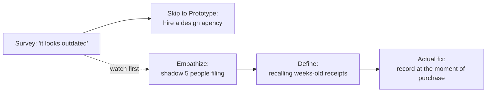
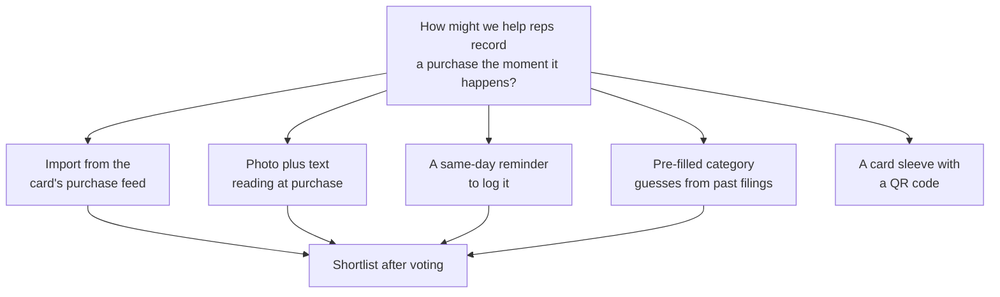
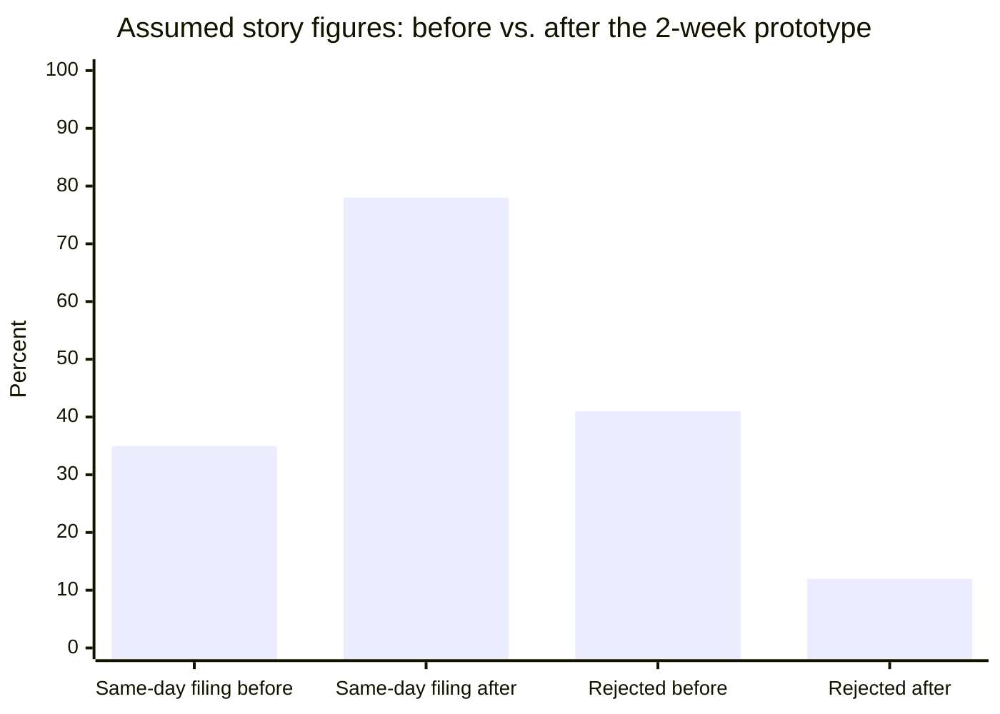

import Scenario from "../../../components/Scenario.astro";
import LevelIntro from "../../../components/LevelIntro.astro";
import Checkpoint from "../../../components/Checkpoint.astro";
import PracticeCheck from "../../../components/PracticeCheck.astro";

export const unit = {
  track: "design",
  unitSlug: "design-thinking-process",
};

<Scenario label="The scenario">
  <Fragment slot="facts">
    

      

        35%
        reports filed same-day (assumed)
      

      

        

      

    

    
The instinct vs. what shipped

    

      
🎨 First instinct: "redesign the look"

      
👀 Shadowed 5 people filing real expenses

      
🎯 Real friction: remembering weeks-old receipts

      
🧪 Tested with a spreadsheet and a person, no code

    

  </Fragment>

Imagine a company whose employees file expense reimbursements in an internal tool
called ExpenseFlow. **Everything here is a made-up case: the company, the
people and every number are assumptions chosen to tell the story, not data
from a real organization.** In it, 41% of submitted reports are rejected, and
the employee survey's top complaint is "the app looks outdated." The product
lead's first instinct is to hire a design agency to modernize the look.
Someone asks for two weeks to watch people file expenses first.

</Scenario>

The survey was not wrong that people were frustrated. It was wrong about
why, because "it looks old" is the easiest thing to blame when you are
annoyed and have no language for the real friction. You do not need to know
expense software to follow this: track who is frustrated, what the team
actually observes, and which behavior changes after the prototype.

<LevelIntro
  items={[
    "All five stages walked on one case",
    "A fix-shaped statement versus a real one",
    "Why a human-run prototype can beat weeks of building",
  ]}
/>

## What did watching show that the survey could not?

**If you had only the survey, what would you have missed by not watching
anyone file a report?** The team shadowed five people and took notes
without asking leading questions.

| Who (invented)           | What they actually did                                           | What they said when asked directly    |
| ------------------------ | ---------------------------------------------------------------- | ------------------------------------- |
| Sales rep Priya          | Kept a shoebox of paper receipts for 3 weeks, filed all at once  | "The form fields are confusing"       |
| Sales rep Marcus         | Photographed receipts at once, forgot which ones he had logged   | "The categories don't match my needs" |
| Engineer Dev, rare filer | Filed once, gave up halfway, asked a colleague to finish         | "It's fine, I just don't do it often" |
| Approver Angela          | Rejected lines whose category differed from the card statement's | "People don't fill it in carefully"   |

Nobody said "I struggle to remember what a three-week-old receipt was for."
Yet that was what happened in every rejected report: the delay between
purchase and filing, not the look of the form, was where the information got
lost.

**Two candidate problem statements are on the table. Which one is usable?**

- **A:** "Employees need a more modern, visually appealing expense form."
- **B:** "Traveling employees need a way to record what a purchase was for at
  the moment it happens, because reconstructing it weeks later from a pile of
  receipts is where accuracy breaks down."

A already names the fix, so the next stage could only argue about fonts and
colors. B names the mechanism of failure (a delay between purchase and
memory) and leaves the how completely open. Angela's pattern is a separate
problem: the category labels employees chose did not match the labels on the
card statement. That became its own narrower statement for a later loop.

<Checkpoint question="Suppose the team had merged Angela's category-mismatch finding into statement B. What would the idea search have struggled to do well?">

It would have had to hunt for ideas that fix two unrelated failure
mechanisms at once: forgetting purchase details weeks later, and category
labels not matching the card statement. Ideas that help with same-day
logging do nothing for label mismatch, and the reverse. A merged statement
would have produced a muddled shortlist doing both jobs half-well instead of
two clean shortlists, each aimed at one real problem.

</Checkpoint>

<PracticeCheck
  track={unit.track}
  unitSlug={unit.unitSlug}
  topicId="shadow-findings"
/>

## Why prototype with a person before writing code?

Working from statement B, the team ran a 20-minute divergent session with one
rule: no idea is discussed or dismissed until the list is done.

The shortlist kept three ideas: a same-day reminder (cheapest to test),
pre-filled category guesses (aimed at Angela's pattern), and reading text
from a photo, called OCR (highest potential, most expensive to build).
"How might we..." is a prompt format that turns a problem statement into an
open design question.

**The OCR idea sounded best in the room. Should the team start building it?**
No, not before testing the assumption underneath all three ideas: that
recording at the moment of purchase, instead of batching later, actually
improves accuracy. Building OCR first would test that assumption inside a
feature that could also fail for unrelated reasons, such as blurry photos.

So the prototype was a shared spreadsheet and a person. For two weeks, five
volunteers texted a photo of each receipt to a teammate, who logged it by
hand with a category guess based on the merchant. This is called a **Wizard
of Oz** prototype: a human quietly does what software would automate later.

| Prototype option          | Build time (assumed) | What it tests                                 | Risk of a misleading result       |
| ------------------------- | -------------------- | --------------------------------------------- | --------------------------------- |
| Spreadsheet plus a person | A day                | Does same-day logging change behavior at all? | Low: nothing else can fail        |
| Reminder messages         | A few days           | The same question, via nudges                 | Medium: reminders can be ignored  |
| OCR from a photo          | Weeks                | The question plus whether the OCR reads well  | High: two things can fail at once |

<Checkpoint question="Suppose the two-week test had shown no improvement in same-day filing. What would that say about the OCR idea, and which stage would the team go back to?">

It would say the assumption behind all three shortlisted ideas, that logging
at the moment of purchase improves accuracy, is not true. It would not say
this prototype was clumsy. Building OCR would have automated a mechanism a
spreadsheet had just shown does not help. The team would go back to Define,
because the problem framing itself turned out wrong, not just its
execution.

</Checkpoint>

<PracticeCheck
  track={unit.track}
  unitSlug={unit.unitSlug}
  topicId="wizard-of-oz"
/>

## What did the test measure, and when is the full loop worth it?

The test compared submission timestamps and approval outcomes for the five
volunteers. **The figures below are assumed values for the story, not real
measurements.**

In the story, same-day filing rises from 35% to 78% and rejections fall from
41% to 12%. Three of the five volunteers, asked directly, said the process
"felt about the same," even though the timestamps showed their behavior had
changed. Self-report and observed behavior can disagree for the same person.
The test also surfaced something new: cash purchases had no receipt photo to
trigger logging. That became an Empathize question for the next loop, not a
flaw in the current fix.

| Stage     | What it caught in this case                                                      |
| --------- | -------------------------------------------------------------------------------- |
| Empathize | The survey's "looks outdated" framing, which would have funded a visual refresh  |
| Define    | Statement A's hidden fix, and Angela's separate label-mismatch problem           |
| Ideate    | Anchoring on OCR before testing the cheaper assumption underneath it             |
| Prototype | Weeks of engineering spent validating something a spreadsheet validates for free |
| Test      | Trusting "felt about the same" over the timestamps                               |

**Does every change deserve this much process?** No. Running the full loop on
a change everyone already understands is a failure mode of its own.

| Situation                                                                     | Call                                                                     |
| ----------------------------------------------------------------------------- | ------------------------------------------------------------------------ |
| High uncertainty about the problem, many affected groups, costly to reverse   | Run the full loop; this is what ExpenseFlow needed                       |
| A well-understood problem with clear precedent, like a broken link            | Skip the ceremony; no ambiguity is left to uncover                       |
| A trivial change for one user that takes five minutes                         | A quick conversation replaces formal Empathize and Define                |
| A redesign touching thousands of users, with contractual or compliance stakes | Close to mandatory; the cost of misreading the problem scales with users |

  

    ⚠️
    
      <strong>Jumping from complaint to Prototype.</strong> Hiring the agency on
      day one would have shipped a modern-looking copy of the same broken
      workflow.
    
  

  

    ⚠️
    
      <strong>A problem statement that names the fix.</strong> Statement A
      closed off every idea except fonts and colors.
    
  

  

    ⚠️
    
      <strong>Prototyping the flashiest idea.</strong> OCR was the most exciting
      and the most expensive way to learn whether the premise held.
    
  

  

    ⚠️
    
      <strong>Grading Test on opinions.</strong> "Felt about the same" said one
      thing and the timestamps said another.
    
  

<PracticeCheck
  track={unit.track}
  unitSlug={unit.unitSlug}
  topicId="scale-the-process"
/>

## Beyond this example

ExpenseFlow is one case, not the whole territory. Try these to see whether
the model transferred, not just the story's numbers:

- If ExpenseFlow were a product used by thousands of customers instead of a
  tool used by dozens of employees, which stage would change the most, and would
  a five-person Wizard of Oz test still be defensible?
- The team had two weeks for Empathize. With one day instead, what would you
  cut first, the number of people shadowed or the depth of observation, and
  what is the risk of each cut?
- What would have gone wrong if the team had tried to solve Angela's problem
  and the receipt-delay problem with one statement and one prototype?
