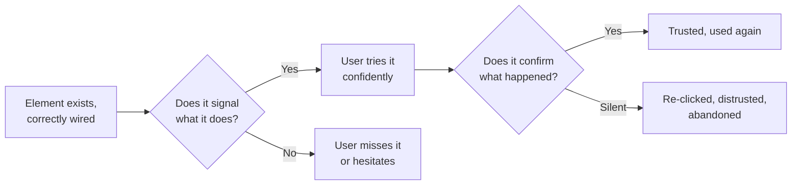

import Scenario from "../../../components/Scenario.astro";
import LevelIntro from "../../../components/LevelIntro.astro";
import PracticeCheck from "../../../components/PracticeCheck.astro";

export const unit = {
  track: "design",
  unitSlug: "interaction-design-patterns",
};

<Scenario label="A flat metal plate on a door">
  <Fragment slot="facts">
    

      
🚪 <strong>The door</strong> — opens perfectly when pulled

      
▭ <strong>The handle</strong> — a flat plate, no label, no grip

      
🙋 <strong>What people do</strong> — push first, then try pulling

    

    

      

        
Illustrative test: never tried "Archive"6 of 10

        

      

    

  </Fragment>

A door opens smoothly when pulled, but its handle is a flat metal plate with no
label. Most people push first, feel it not budge, and only then try pulling. The
door is not broken. It just never said which way it opens.

Now the same thing on a screen: an inbox row has a perfectly wired "Archive"
label, styled as plain gray text with no border or icon. In an **illustrative**
usability test (numbers invented for this lesson), 6 of 10 people never try
clicking it. Of the 4 who do, 3 click it twice or more, because nothing visibly
changes in the first instant. **The code has no bug. So why did the button fail?**

</Scenario>

Nothing here is broken code. What failed sits upstream of the code: the button
never looked clickable, and once clicked it never confirmed anything happened.

<LevelIntro
  items={[
    "Affordance versus signifier",
    "The feedback loop after an action",
    "Interaction patterns as borrowed knowledge",
  ]}
/>

## What are the three ideas the door and the button share?

| Term                | Plain meaning                                            | Door version               | Archive version                   |
| ------------------- | -------------------------------------------------------- | -------------------------- | --------------------------------- |
| Affordance          | What the thing can actually do                           | It can be pulled           | It can be clicked                 |
| Signifier           | The visible cue that says the affordance exists          | A "pull" label or a handle | A border, an icon, a hover change |
| Feedback loop       | The visible confirmation that your action landed         | The door swings toward you | The row animates out right away   |
| Interaction pattern | A reusable solution users already know from other places | A grab bar means "pull"    | A button shape means "click"      |

- An **affordance** can exist with no signal at all. The plate door and the gray
  "Archive" label both had a real affordance and no signifier.
- A **signifier** is the fix that costs the least. It changes how the element
  announces itself, not what it does.
- A **feedback loop** is silence versus confirmation. Roughly 400 ms of nothing
  after a click reads as "did that work?", and people click again.
- A **pattern** lets earlier experience do the explaining. A checkbox needs no
  tutorial because the user has seen a thousand of them.
- **Predictable is not boring.** Color, motion, icon style and copy can carry
  personality. The rules of the interaction stay familiar.

<PracticeCheck
  track={unit.track}
  unitSlug={unit.unitSlug}
  topicId="affordance-signifier"
/>

<PracticeCheck
  track={unit.track}
  unitSlug={unit.unitSlug}
  topicId="feedback-loop"
/>

| Failure in the scenario                 | What it is actually missing          |
| --------------------------------------- | ------------------------------------ |
| Plain gray text, no border or hover cue | A signifier for a real affordance    |
| No visible change right after the click | A feedback loop confirming the click |
| A hand-rolled label instead of a button | An established interaction pattern   |

The skill this unit builds is **noticing the gap between what an element can do
and what it visibly says it can do**. A correctly coded interaction that never
signals itself, or never confirms itself, fails its user as badly as a real bug.

<PracticeCheck
  track={unit.track}
  unitSlug={unit.unitSlug}
  topicId="interaction-pattern"
/>
