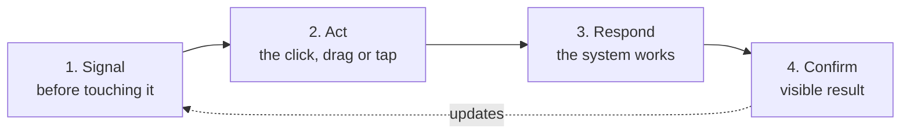

import Scenario from "../../../components/Scenario.astro";
import LevelIntro from "../../../components/LevelIntro.astro";
import Checkpoint from "../../../components/Checkpoint.astro";
import PracticeCheck from "../../../components/PracticeCheck.astro";

export const unit = {
  track: "design",
  unitSlug: "interaction-design-patterns",
};

L1 showed that a correctly coded element can fail if it never signals what it
does or never confirms what happened. L2 builds the model behind that: every
interaction has a "before" half and an "after" half, and a pattern lets you
skip reinventing either one.

<LevelIntro
  items={[
    "The four moments of one interaction",
    "Which signifier covers which user",
    "The promise a familiar pattern makes",
  ]}
/>

## What would go wrong if each part of one click were skipped?

A click is not one event. It is a small round trip. Before writing any part of
it off as "just styling", ask what breaks if it is silently missing.

| Moment  | Question it answers               | Skipped, it looks like                             |
| ------- | --------------------------------- | -------------------------------------------------- |
| Signal  | Can I do something here?          | The plain-text "Archive" label from L1             |
| Act     | Did my input register?            | A button with no pressed state, so it feels dead   |
| Respond | Is the system doing what I asked? | A slow request with no spinner, so it feels frozen |
| Confirm | Did it work, and what changed?    | A row vanishing with no transition and no message  |

<Checkpoint question="A 'Save' button has a visible press animation and a spinner while the request runs, but at rest it looks exactly like body text. Is the interaction fully fixed?">

No. Two of the four moments are solid, Act (the press) and Respond (the
spinner). The first, Signal, is still missing: nothing about the resting
appearance says "clickable". On a touch screen there is no hover at all, so
those users get no cue until they stumble onto it. Each moment has to hold on
its own, and a strong second and third do not make up for an absent first.

</Checkpoint>

<PracticeCheck
  track={unit.track}
  unitSlug={unit.unitSlug}
  topicId="four-moments"
/>

## Which signifier covers which person?

Norman's distinction still holds: an **affordance** is a real possibility, a
**signifier** is the perceivable cue for it. A small `div` with a click handler
affords clicking whether or not it looks clickable. Different signifiers reach
different people, so which one is missing decides who loses out.

| Signifier               | Moment it covers | Who loses it if missing                |
| ----------------------- | ---------------- | -------------------------------------- |
| Pointer cursor on hover | Signal           | Mouse and trackpad users               |
| Hover style change      | Signal           | Mouse and trackpad users               |
| Visible resting shape   | Signal           | Touch users, who have no hover at all  |
| Pressed-state change    | Act              | Everyone: it confirms the press landed |
| Keyboard focus ring     | Signal           | Keyboard-only and screen-reader users  |
| Loading state           | Respond          | Everyone, on any slower request        |

The click handler, the request and the row removal never change between the
broken and the fixed version of the Archive button. Only the signifiers change.
That is why a hover-only fix quietly leaves a whole group of users behind.

<PracticeCheck
  track={unit.track}
  unitSlug={unit.unitSlug}
  topicId="signifier-coverage"
/>

## What does a familiar pattern promise, and when does it break that promise?

A brand-new interaction must teach itself from nothing. A known pattern borrows
the user's earlier experience for free: a checkbox signals "binary choice" and
shows its own state, with no custom styling needed. But each pattern also makes
an **implied promise**, and using it where the promise is false breaks trust.

| Pattern         | Implied promise                        | Breaks when                                         |
| --------------- | -------------------------------------- | --------------------------------------------------- |
| Toggle switch   | The change takes effect instantly      | A separate Save button is needed afterward          |
| Checkbox        | A choice you can change before sending | Ticking it acts immediately with no way back        |
| Modal dialog    | An interruption that needs a decision  | It opens for information that needs no decision     |
| Swipe-to-delete | A quick, reversible removal on touch   | There is no undo and nothing shows the swipe exists |

<Scenario label="Quick check: the slow toggle">
  <Fragment slot="facts">
    

      
👆 Tap: the switch shows "on" at once

      
⏳ Server applies the setting about 3 seconds later

      
❗ Nothing on screen covers the gap

    

  </Fragment>

A toggle flips to "on" the moment it is tapped, but the setting takes about 3
seconds to apply on the server and nothing shows that gap. Which moment is
broken, and why is this worse than the same delay behind a Save button?

It is **Confirm**: the switch claims success before it is real, so it lies if
the server call later fails. It is worse behind a toggle because a toggle
promises instant effect. A Save button never promised that.

</Scenario>

<Checkpoint question="A settings page uses toggle-style switches, but nothing changes until the user presses a Save button at the bottom. Which part of the toggle pattern is being misused?">

Its implied promise. The switch shape tells people the effect is immediate, so
they flip it and walk away. The pattern was recognised correctly, and then it
lied. Either apply the change on flip, or use a pattern that does not promise
immediacy, such as checkboxes with an explicit Save.

</Checkpoint>

<PracticeCheck
  track={unit.track}
  unitSlug={unit.unitSlug}
  topicId="pattern-promise"
/>
