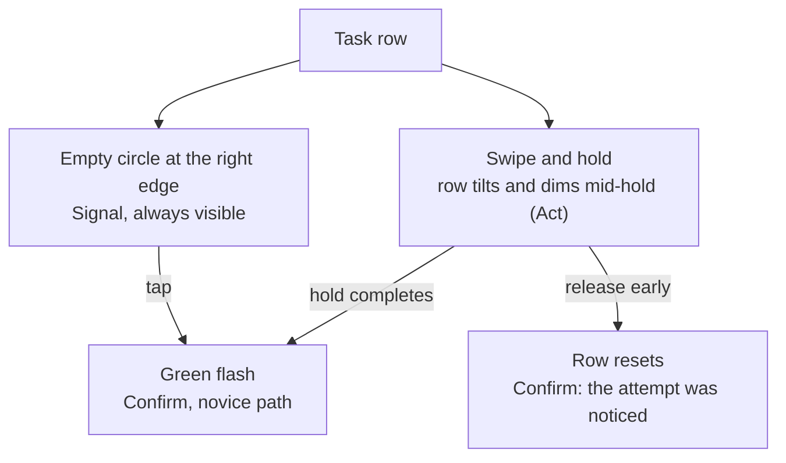

import Scenario from "../../../components/Scenario.astro";
import LevelIntro from "../../../components/LevelIntro.astro";
import Checkpoint from "../../../components/Checkpoint.astro";
import PracticeCheck from "../../../components/PracticeCheck.astro";

export const unit = {
  track: "design",
  unitSlug: "interaction-design-patterns",
};

<Scenario label="The hidden swipe">
  <Fragment slot="facts">
    

      
📱 Task list, "mark done" action

      
👆 Shipped as: swipe left, hold 400 ms, release

      
🎯 No icon, no handle, no hint on the row

    

    

      

        
Illustrative: found the gesture unprompted12%

        

      

    

  </Fragment>

A task app team wants a light, uncluttered list: no checkboxes, no icons, just
the task text. To mark a task done you swipe a row left, hold for 400 ms and
release; it flashes green. The gesture is smooth, and the team loves it once
they know it is there. In an **illustrative** first-time-user test (numbers
invented for this lesson), only 12% discover it unprompted, and the most
common spoken line is "how do I mark this done?"

**Nothing crashed. Using the four moments from L2, which one is missing, and is
it one moment or more than one?**

</Scenario>

<LevelIntro
  items={[
    "Auditing a gesture moment by moment",
    "A visible fallback with the gesture kept as an accelerator",
    "When a novel interaction earns its place",
  ]}
/>

## Which moment breaks first, and does fixing it fix the rest?

Discoverability failures rarely have one cause, but they do have an order. An
early moment gates whether later ones are ever exercised.

| Moment  | What happens today                          | What is missing                                         |
| ------- | ------------------------------------------- | ------------------------------------------------------- |
| Signal  | Row shows nothing interactive at rest       | Any hint that a swipe or hold exists                    |
| Act     | Nothing moves until the full 400 ms is done | Partial feedback during the hold                        |
| Respond | The hold plays out silently                 | A sense that something is building toward an outcome    |
| Confirm | Green flash after the hold completes        | Present, but only the rare successful user ever sees it |

With 88% of first-time users never getting past Signal, Act, Respond and
Confirm are almost never exercised. A toggle at least has a visible shape to
tap. This gesture has nothing on the row to interact with at all.

<Checkpoint question="The team's first instinct is to make the green flash brighter and longer so the payoff is more satisfying. Is Confirm the right moment to fix first?">

No. About 88% of people never complete the gesture, so they never reach Confirm.
A better flash rewards only the 12% who already succeeded. The bottleneck is
Signal: nobody tries because nothing says a gesture exists. Fixing a later
moment before an earlier one is solid improves a step most users never reach.

</Checkpoint>

<PracticeCheck
  track={unit.track}
  unitSlug={unit.unitSlug}
  topicId="gap-ordering"
/>

## What does the fix actually change?

The "mark done" request is untouched. Only what the row communicates before,
during and after changes.

| Fix                                 | Moment it repairs | Why it matters                                             |
| ----------------------------------- | ----------------- | ---------------------------------------------------------- |
| Permanent empty circle on each row  | Signal            | Visible at rest, and its shape hints at what a tap does    |
| Circle is tappable, swipe stays     | Signal + Respond  | Novice path plus expert accelerator, not one hidden way    |
| Row tilts and dims during the hold  | Act               | Releasing early visibly resets instead of failing silently |
| Same green flash after a likely tap | Confirm           | Now confirms an action first-time users actually reach     |

The same pairing appears in the usability-heuristics unit: a visible, guessable
path for someone new, and a faster shortcut underneath for someone fluent.

The interactive demo below this unit models the trade: more signifier raises
discovery quickly at first, then levels off, while the row gets less quiet. It
is an illustrative model, not a measurement.

<Checkpoint question="A different team adds a one-time coach mark ('Swipe left to mark tasks done') on first open, but keeps the swipe as the only way in, with no permanent circle. Does that solve the problem?">

Not fully. A coach mark helps only the person who reads it at that exact moment
and remembers it later. Someone who dismisses it, is interrupted, or forgets a
week later is back to a row with no ongoing signifier. A permanent circle is
always there to fall back on. A coach mark is a fine addition to one, and a
weak replacement for one.

</Checkpoint>

<PracticeCheck
  track={unit.track}
  unitSlug={unit.unitSlug}
  topicId="visible-fallback"
/>

## When should a novel, less discoverable interaction win on purpose?

If discoverability always won, nothing new would ever ship. So when is a
departure from the familiar pattern actually the right trade?

| Situation                                                  | Holds up? | Why                                                      |
| ---------------------------------------------------------- | --------- | -------------------------------------------------------- |
| Used daily; gesture layered on top of a visible default    | Yes       | Learning cost is paid once, speed gain repeats           |
| New capability introduced with a one-time guide plus a cue | Yes       | The novelty is paired with an explicit, temporary Signal |
| Chosen because it "feels more polished", no way to find it | No        | Locks out most first-time users from a core action       |
| The only path to a core action for an occasional audience  | No        | They never use it often enough to stumble onto it        |

The original mistake was not inventing the swipe. It was making the swipe the
**only** way in for an audience that includes people who will never use the app
often enough to find it.

<PracticeCheck
  track={unit.track}
  unitSlug={unit.unitSlug}
  topicId="novelty-tradeoff"
/>

## This is a case, not the whole territory

The redesign above fits one audience: a casual consumer app on a touch screen
with short sessions. Other audiences change the answer.

**Extend it yourself.** Suppose the same problem, a core action reachable only
through an undiscoverable gesture, appeared in a professional tool that a small
group of experts uses for hours a day, such as an admin console or a video
editing timeline. What would you keep from the fix above, and what would you
deliberately drop? What changes if the audience is children, or if the screen
is a car dashboard where looking away is dangerous? As a hint on scope: the
permanent visible fallback probably still belongs there for new starters, but
the screen space it deserves relative to expert accelerators shifts hard
toward the accelerator once usage is measured in hours per day.

| Question to ask about any interaction | If the answer is no                         |
| ------------------------------------- | ------------------------------------------- |
| Does anything at rest say it exists?  | Add a signifier before polishing anything   |
| Does it acknowledge input mid-action? | Add partial feedback                        |
| Does it show work in progress?        | Add a loading state                         |
| Does it confirm the outcome?          | Add visible confirmation                    |
| Is a known pattern available?         | Use it, or justify the departure in writing |
