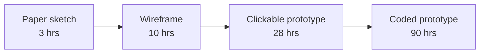

import Scenario from "../../../components/Scenario.astro";
import LevelIntro from "../../../components/LevelIntro.astro";
import PracticeCheck from "../../../components/PracticeCheck.astro";

export const unit = {
  track: "design",
  unitSlug: "prototyping-feedback-loops",
};

<Scenario label="Three weeks of building, or one afternoon of drawing, to find out if a guess is right?">
  <Fragment slot="facts">
    
Hours to build, by fidelity

    

      

        
📝 Paper sketch3 hrs

        

      

      

        
🖼️ Wireframe10 hrs

        

      

      

        
🖱️ Clickable prototype28 hrs

        

      

      

        
💻 Coded prototype90 hrs

        

      

    

    
The actual question

    
Does moving the shipping-address step after payment reduce cart abandonment?

  </Fragment>

A product team thinks that moving the shipping-address step _after_ payment
will stop people abandoning their cart. Nobody knows if that is true: it is a
guess. Building the new flow for real, wired into the live checkout, would take
about 90 hours of engineering, roughly three calendar weeks once reviews and
deploys are included (an assumption for this scenario).

**Before reading on: does the team need to spend those three weeks to find out
whether the guess is right?**

No. Spending them before anyone has evidence the idea works is the exact
mistake this unit is about.

</Scenario>

"Test the idea" and "build the real thing" are two separate steps with very
different costs. Confusing them is where a lot of wasted engineering time comes
from.

<LevelIntro
  items={[
    "The fidelity spectrum, paper to coded",
    "What each rung can and cannot tell you",
    "One prototype, one question",
  ]}
/>

## What is a prototype, and how real does it need to be?

**If the team could show someone _something_ this afternoon, what could that
something be?** Anything that lets a person react to an idea before it is built
for real. That ranges from a pencil sketch to a throwaway working version.

- A **prototype** is a stand-in for the real thing, built to get a reaction
  before committing.
- **Fidelity** is how closely the stand-in resembles the finished product, in
  look, behavior and speed.

Fidelity is not one dial. A gorgeous static mockup can be completely fake in
behavior; an ugly gray-box screen can behave exactly like the real thing.

Each rung tells you something the one below it cannot:

| Fidelity            | What it is                                 | Good at testing                                  | Cannot tell you                            |
| ------------------- | ------------------------------------------ | ------------------------------------------------ | ------------------------------------------ |
| Paper sketch        | Hand-drawn screens, flipped by hand        | Is the overall order right? Is anything missing? | How real text, data or motion feels        |
| Wireframe           | Static screens, no links                   | Layout, hierarchy, wording                       | Whether the flow between screens works     |
| Clickable prototype | Linked screens you can tap through         | Whether the flow makes sense end to end          | How a drag, swipe or animation feels       |
| Coded prototype     | Running code scoped to answer one question | Real interaction feel, real data, real speed     | Little, but it is close to "just build it" |

<PracticeCheck
  track={unit.track}
  unitSlug={unit.unitSlug}
  topicId="fidelity-spectrum"
/>

## What is the prototype's job?

**The team's question is about the order of two steps. Which rung do they need?**
The prototype's entire job is to answer one question as cheaply as possible.
"Does reordering reduce abandonment?" is about the _order and structure_ of a
flow, not about how a button animates. A paper sketch or a clickable prototype
answers that in a day or two; nothing about it requires 90 hours.

A **feedback loop** is show it, watch or ask, decide what to change, repeat.
Cheap prototypes make that loop fast, so you get several tries in the time one
coded build would take.

| Term          | Simple meaning                                          |
| ------------- | ------------------------------------------------------- |
| Prototype     | A stand-in for the real thing, built to get a reaction  |
| Fidelity      | How closely the stand-in resembles the finished product |
| Feedback loop | Show it, watch or ask, decide what to change, repeat    |

A team that skips straight to "build it for real" is not being more rigorous.
It is skipping the step where a wrong idea is still cheap to catch.
