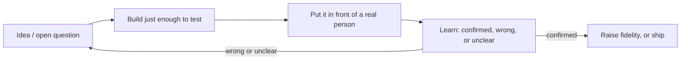
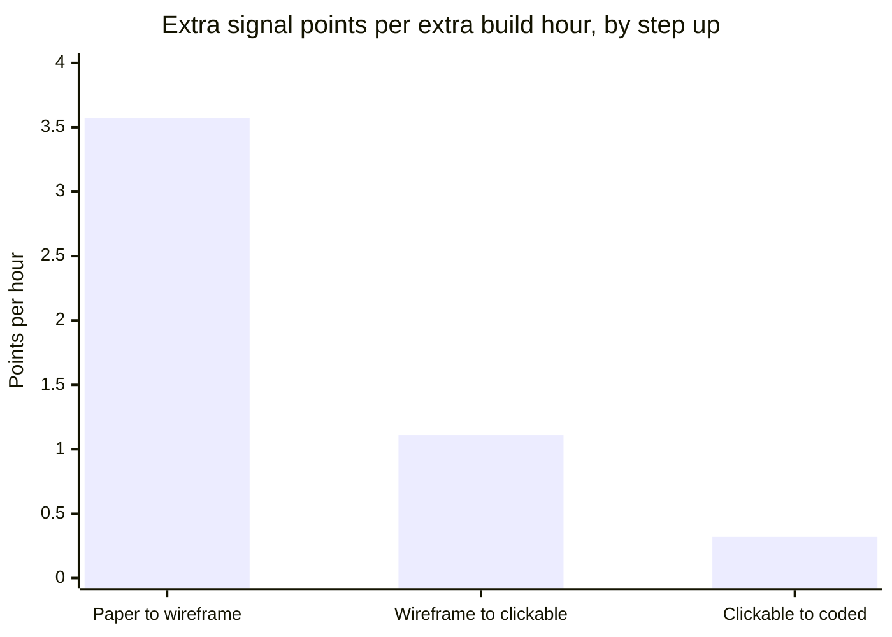

import LevelIntro from "../../../components/LevelIntro.astro";
import Checkpoint from "../../../components/Checkpoint.astro";
import PracticeCheck from "../../../components/PracticeCheck.astro";

export const unit = {
  track: "design",
  unitSlug: "prototyping-feedback-loops",
};

L1 established that fidelity is a spectrum and that a prototype's job is to
answer one question cheaply. L2 works out how to pick the _right_ point on that
spectrum, because picking wrong is its own failure mode in both directions.

<LevelIntro
  items={[
    "Loop length and how many tries fit a deadline",
    "Diminishing returns of higher fidelity",
    "Structural, feel and performance questions",
  ]}
/>

## How many chances to be wrong can you afford?

**A team has a four-week window (28 days) before a launch decision. If one
test cycle takes three weeks, how many cycles fit? What if it takes three
days?** Count them.

The loop only stops feeding itself once an answer is confirmed enough to justify
the next, more expensive step. The number of loops that fit is the window
divided by the loop length, rounded down, with a floor of one (this is the same
formula the demo below uses).

| Days per loop | Loops in 28 days |
| ------------- | ---------------- |
| 1             | 28               |
| 3             | 9                |
| 5             | 5                |
| 7             | 4                |
| 14            | 2                |
| 21            | 1                |

A 21-day loop and a 28-day loop both leave exactly one try: whatever you learn
at the end has no time left to be acted on. Loop length is what you are really
buying, not just the build hours.

<Checkpoint question="With a 28-day window, a team's loop takes 10 days. How many full loops fit, and what does the leftover time suggest?">

Two full loops fit, since 28 divided by 10 is 2.8 and you round down. The 8
leftover days are not a third loop, but they are enough to act on what the second
loop taught, so shortening the loop slightly (to 9 days gives 3) would buy a whole
extra try. Because the count steps down in whole numbers, small cuts to loop
length matter most right before a step boundary.

</Checkpoint>

<PracticeCheck
  track={unit.track}
  unitSlug={unit.unitSlug}
  topicId="loop-length"
/>

## Does more fidelity always buy proportionally more trust?

**If a coded prototype costs 90 hours and a clickable one 28, is the coded one
about three times more trustworthy?** No. The demo for this unit uses these
numbers for build hours and for how well the result predicts real behavior:

| Rung      | Hours | Signal quality (%) | Extra hours | Extra signal (pts) | Extra points per extra hour |
| --------- | ----- | ------------------ | ----------- | ------------------ | --------------------------- |
| Paper     | 3     | 30                 | -           | -                  | -                           |
| Wireframe | 10    | 55                 | 7           | 25                 | 3.57                        |
| Clickable | 28    | 75                 | 18          | 20                 | 1.11                        |
| Coded     | 90    | 95                 | 62          | 20                 | 0.32                        |

Going from clickable to coded costs 3.21 times the hours (90 / 28) but buys 20
more points, the same as the previous step that cost 18 hours. Most of the
achievable confidence was available several rungs down, which is why "just
build it for real to be sure" is usually the wrong default.

<PracticeCheck
  track={unit.track}
  unitSlug={unit.unitSlug}
  topicId="diminishing-returns"
/>

## Which kind of question are you asking?

**Two teams both say "we want to know if this works." Why might they need
completely different prototypes?** Because they are not asking the same _kind_
of question.

| Type of question                          | Needs at least                      | Why lower fidelity fails it                       |
| ----------------------------------------- | ----------------------------------- | ------------------------------------------------- |
| Structural (flow, order, wording)         | Paper sketch or clickable prototype | The answer does not depend on motion or data      |
| Interaction feel (drag, swipe, animation) | Real, running interaction           | A click-through fakes the destination, not motion |
| Performance and scale                     | A real or near-real build           | Real latency and data volume cannot be faked      |

- Testing a structural question with a coded prototype wastes weeks confirming
  what a sketch shows in an hour.
- Testing a feel question with only a click-through risks a confident "users
  liked it" that the real version does not back up, because the thing that
  mattered was never tested.

<Checkpoint question="A team wants to know whether people will notice a new 'Save for later' link under each cart item. Which kind of question is that, and which rung is enough?">

It is a structural question: whether the link is findable and understood depends
on placement and wording, not on motion or load. A wireframe or clickable
prototype is enough. Going up to a coded prototype would only be justified if
the worry were something like how fast the saved list loads, which is a
different kind of question.

</Checkpoint>

<PracticeCheck
  track={unit.track}
  unitSlug={unit.unitSlug}
  topicId="question-types"
/>

L3 works through a real version of both failures: a loop that was too slow, and
a test that could not reach the risk.
