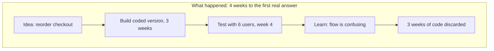
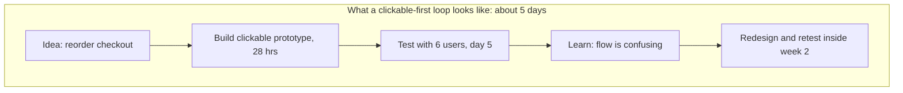

import Scenario from "../../../components/Scenario.astro";
import LevelIntro from "../../../components/LevelIntro.astro";
import Checkpoint from "../../../components/Checkpoint.astro";
import PracticeCheck from "../../../components/PracticeCheck.astro";

export const unit = {
  track: "design",
  unitSlug: "prototyping-feedback-loops",
};

<Scenario label="The checkout team built first and tested last. What did that cost?">
  <Fragment slot="facts">
    
Checkout redesign

    

      
💻 Built a coded, live-wired flow first

      
⏳ About 3 weeks of engineering before any user saw it

      
❌ Six of six test users got lost at the same step

      
💸 The 3 weeks of code were shelved

    

    

      
Loops that fit in 28 days1 vs 5

    

  </Fragment>

The checkout team from L1 believed the reordered flow so strongly that they
went straight to a coded, live-wired version, reasoning that a sketch or
click-through "wouldn't tell them anything real." They tested it with six users
in week four. Every one of them got lost at the same step, reading the new order
as a mistake in the site. The code was shelved. The question the team needed
answered, _does this order make sense to someone seeing it for the first time_,
was a structural question, exactly the kind a clickable prototype answers.

**Before reading on: what would a clickable version of this same test have
looked like, and what would it have cost if the answer had come back wrong
then?**

</Scenario>

The reordered flow, once redesigned properly, later did reduce abandonment. The
team did not fail by building something bad. They picked a fidelity that made
being wrong as expensive as possible, for a question that did not need it.

<LevelIntro
  items={[
    "A slow loop: the expensive answer first",
    "A false-confidence loop: a test that missed the risk",
    "Naming the question type before building",
  ]}
/>

## Failure one: why was the loop too slow?

**Every extra week between "we have an idea" and "we know" is a week of
investment in a direction that may already be wrong. What does that look like on
a timeline?**

Same result, "the flow is confusing", in about 5 days instead of 4 weeks. The
cheap loop leaves time to run again after fixing the problem, still inside the
original window. The coded loop has no time left to recover in a normal sprint.

| Measure                   | Coded-first (what happened) | Clickable-first              |
| ------------------------- | --------------------------- | ---------------------------- |
| Time to first real answer | About 4 weeks               | About 5 days                 |
| Cost of being wrong       | About 90 build hours        | About 28 build hours         |
| Loops in the same 28 days | 1                           | 5 (28 / 5, rounded down)     |
| Question actually tested  | Structural                  | The same structural question |

<Checkpoint question="A teammate says: 'the coded version was still useful, because now we know exactly what to fix in the real code.' Is that a fair defense?">

It is true but beside the point, because it defends the wrong comparison. Almost
any build produces some useful information. The question is whether that
information was worth its cost compared to the cheaper way of getting the same
information. A clickable prototype would have shown the same confusion without
the extra 62 hours (90 minus 28) of engineering. "It was useful" is true of
nearly every prototype at any fidelity, so it cannot justify one.

</Checkpoint>

<PracticeCheck
  track={unit.track}
  unitSlug={unit.unitSlug}
  topicId="too-slow-loop"
/>

## Failure two: how can a positive test still lie?

**The checkout team reached too high. What happens when a team reaches too low,
so the test cannot even touch the thing they are worried about?**

A different team wanted users to reorder items in a saved list by dragging them.
Having heard the checkout lesson, they did not want to over-build. They made a
clickable prototype where tapping a drag handle instantly swapped an item to its
new position, with no drag motion at all. Eight users said the reordering
"worked great." They shipped the coded version two weeks later, and real users
abandoned the drag mid-gesture: the real version had a slight lag before an item
picked up, and the drop overshot its target on a slow connection. None of that
existed in the click-through, which can fake destinations but not motion.

| What the test showed            | What the real risk was                  | Could the test have caught it?  |
| ------------------------------- | --------------------------------------- | ------------------------------- |
| An item lands in a new position | The pickup lag while dragging           | No, there was no drag           |
| Users said it "worked great"    | The drop overshoot on a slow connection | No, no real timing existed      |
| Eight honest positive reactions | Abandoning the gesture mid-drag         | No, the failure was not present |

**Which kind of question was "will this drag feel good": structural, feel, or
performance?** It was an interaction-feel question tested with a fidelity built
for structural ones. The eight reactions were honest and meaningless at once,
because they described a version that could not fail the way the real one did.

<Checkpoint question="What is the minimum change to this team's test that would have caught the problem without building the full live feature?">

Raise fidelity on exactly the one dimension the question depends on, real
interaction, and leave everything else cheap. A throwaway prototype that
implements the actual drag gesture with its real timing, using placeholder items
and no backend, would have reproduced the lag and the overshoot. It is a smaller
build than the full feature but a bigger one than a click-through. Fidelity does
not need to go up everywhere at once; it needs to go up on the axis the question
is about.

</Checkpoint>

<PracticeCheck
  track={unit.track}
  unitSlug={unit.unitSlug}
  topicId="test-that-lied"
/>

## This is a case, not the whole territory

Both teams made the same mistake in opposite directions: neither named the _type_
of question before picking how real the prototype needed to be. These two cases
are about one flow and one gesture, so they are only a sample.

**Try extending it yourself.** What if the thing being tested were a redesigned
pricing page and the question were "will it increase signups"? That depends on
traffic, timing and who happens to see the page, not on whether the page is
clear. Which of structural, feel and performance does it fit? If none, what
would you use instead of a prototype? (A live experiment, a real page shown to a
real slice of traffic, is the usual answer.) And what changes if the checkout
team had only two days instead of 28: would a paper sketch have been enough?

Recognizing where prototyping stops being the right tool is part of matching the
test to the question.
