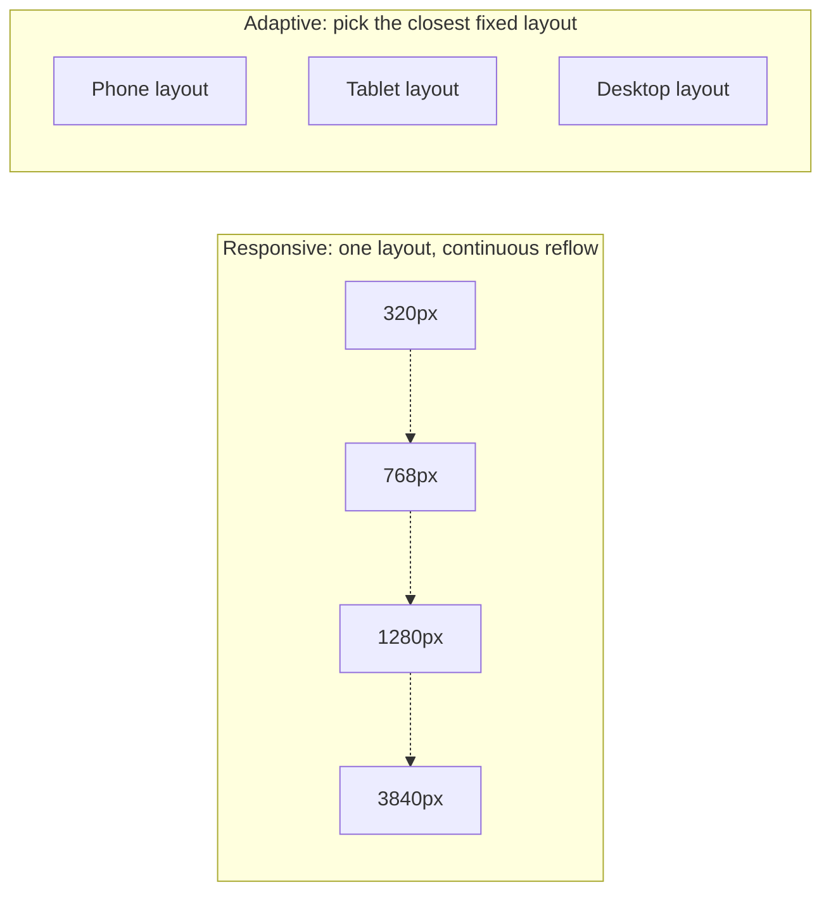
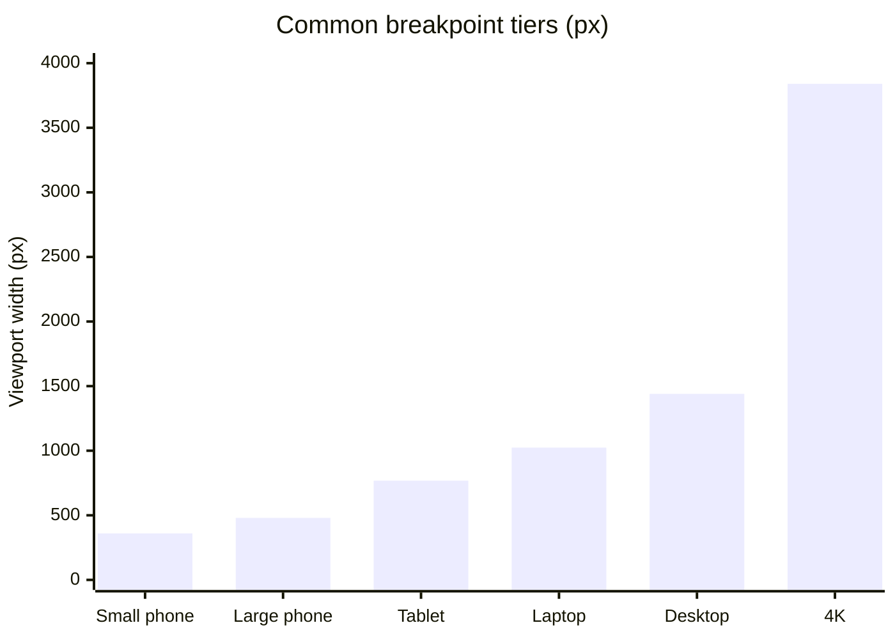

import Scenario from "../../../components/Scenario.astro";
import LevelIntro from "../../../components/LevelIntro.astro";
import PracticeCheck from "../../../components/PracticeCheck.astro";

export const unit = {
  track: "design",
  unitSlug: "responsive-adaptive-design",
};

<Scenario>
  <Fragment slot="facts">
    

      
📱 Phone — 375px wide, one column, thumb-reachable

      
📟 Tablet — 768px wide, room for two columns

      
🖥️ Laptop — 1280px wide, sidebar + content

      
🖵 4K monitor — 3840px wide, same layout stretched thin if nothing changes

    

    
Same page, same HTML, four viewports

    
One design decision — "does the layout notice its own width?" — separates a page that works everywhere from one that only works on the screen it was built for.

  </Fragment>

A product page built and tested only on a 1280px laptop screen ships. Two bug reports land the same week: on a phone, the three-column layout squeezes into columns 90px wide, with text wrapping one word per line. On a 4K monitor, that same layout keeps its fixed 1280px width and floats in a sea of empty space, with a single line of body text stretching almost the full screen.

  

    

      ✗ Phone (375px)
    

    

      

        Col
      

      

        Col
      

      

        Col
      

    

    
Columns crushed to ~90px

  

  

    

      ✓ Laptop (1280px)
    

    

      

        Col
      

      

        Col
      

      

        Col
      

    

    

      Built and tested here only
    

  

  

    

      ✗ 4K monitor (3840px)
    

    

      

        Col
      

      

        Col
      

      

        Col
      

      

    

    

      Fixed 1280px layout, rest is empty space
    

  

**Nothing about the content changed between these three screenshots — only the width of the glass it's displayed on. So what has to change in the design so the same page holds up at every width, not just the one it happened to be designed on?**

</Scenario>

Two different strategies answer that question, and knowing which one you are using (or need) is the actual skill.

<LevelIntro
  items={[
    "Responsive vs. adaptive: two strategies",
    "Breakpoints as layout decision points",
    "Fluid sizing that needs no breakpoint",
  ]}
/>

## Which strategy is "one layout that stretches" and which is "pick a template"?

- **Responsive design**: one flexible layout that keeps reflowing as the width changes, using relative sizes (`%`, `fr`, `clamp()`) plus a few `@media` breakpoints where the structure changes. The browser does the adapting.
- **Adaptive design**: a small, fixed set of layouts, each built for a known device class. Something (a server, an app) picks the closest one; nothing flows in between.

| Question                           | Responsive                                   | Adaptive                                         |
| ---------------------------------- | -------------------------------------------- | ------------------------------------------------ |
| How many layouts exist?            | One flexible layout                          | Several fixed layouts (often 3 to 6)             |
| What decides the layout?           | The browser, continuously, from actual width | A device match, chosen once                      |
| New device width (e.g. a foldable) | Reflows automatically                        | Needs a new fixed layout or falls back awkwardly |
| Typical cost                       | Design once, more CSS complexity             | Design and maintain N layouts separately         |
| Common use                         | Most modern websites                         | Legacy sites, kiosks, print, email templates     |

The phone/laptop/4K bug reports at the top are what happens with **neither** strategy: one fixed layout, no breakpoints, no fluid sizing. Responsive design fixes it by reflowing continuously; adaptive design fixes it by swapping in a different pre-built layout.

<PracticeCheck
  track={unit.track}
  unitSlug={unit.unitSlug}
  topicId="responsive-vs-adaptive"
/>

## What are breakpoints and fluid sizing, and where do they fit?

- **Breakpoint**: a width where the _arrangement_ changes (three columns become two, a sidebar becomes a menu). Structure is discrete, so it jumps.
- **Fluid sizing**: a value written as a formula of the viewport width (`clamp()` is the modern tool), so it changes smoothly with no jump. Type size and spacing are the usual candidates.

These are common reference points, rounded from real device widths, not a law. Most sites use them as starting guesses, then move each breakpoint to where their own content strains (L2 covers how).

Most production sites today are responsive-first and reach for adaptive only for very different experiences (a print layout, a kiosk, an email client with poor CSS support). L2 and L3 build the mechanics and the judgment call.
