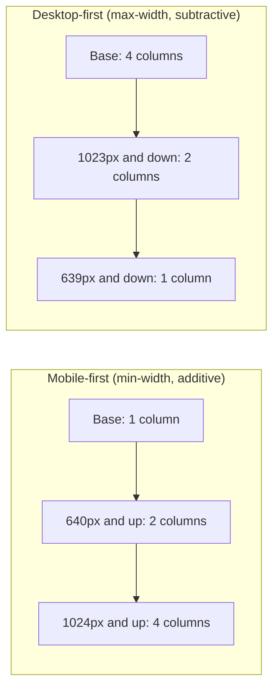
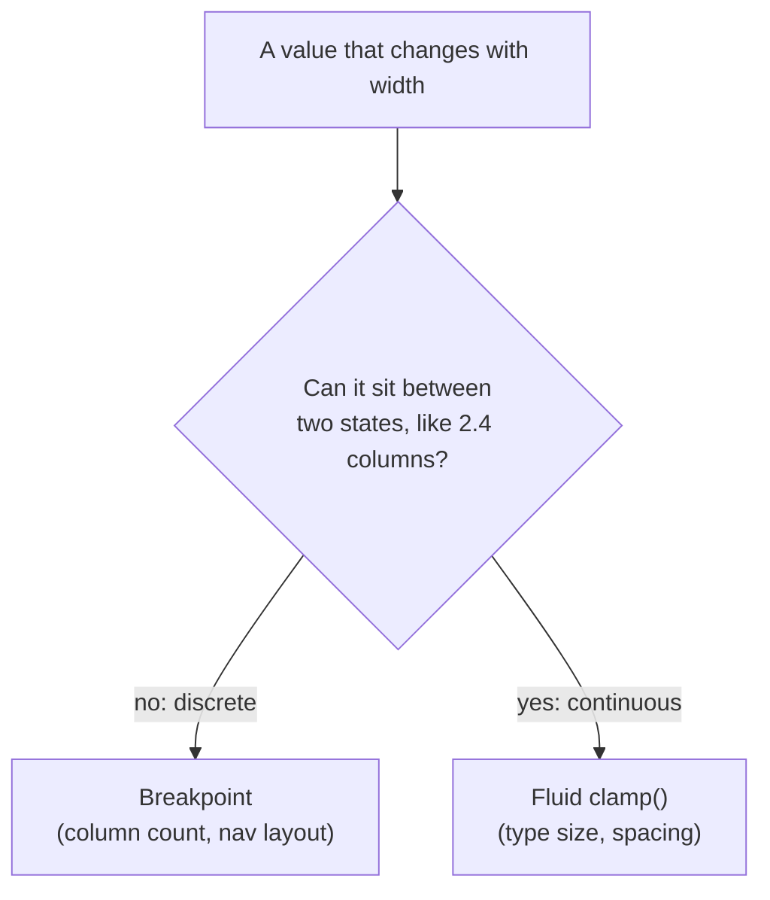

import Scenario from "../../../components/Scenario.astro";
import LevelIntro from "../../../components/LevelIntro.astro";
import Checkpoint from "../../../components/Checkpoint.astro";
import PracticeCheck from "../../../components/PracticeCheck.astro";

export const unit = {
  track: "design",
  unitSlug: "responsive-adaptive-design",
};

<Scenario label="The breakpoint in the wrong place">
  <Fragment slot="facts">
    <div class="not-prose flex flex-col gap-1.5 text-sm text-slate-700 dark:text-slate-300">
      <div>📏 <strong>Breakpoint</strong>: a `@media` width where structure changes</div>
      <div>📱 <strong>Mobile-first</strong>: base styles for narrow, `min-width` adds up</div>
      <div>〰️ <strong>Fluid value</strong>: `clamp(min, preferred, max)` instead of a jump</div>
      <div>🧩 <strong>Content-driven</strong>: break where the content strains, not at a device width</div>
    </div>
    <p class="not-prose mt-3 text-xs text-slate-500 dark:text-slate-400">A breakpoint and a fluid value solve different problems, structure versus scale, and most real layouts need both.</p>
  </Fragment>

A designer switches a three-column grid to one column at 768px because "that is a tablet". On a real tablet held sideways at 820px the grid is still three columns, and each is crushed so narrow that prices wrap onto two lines. The breakpoint existed; it was just in the wrong place.

**So what actually decides where a breakpoint should sit, and how does fluid sizing avoid needing one at all?**

</Scenario>

<LevelIntro
  items={[
    "Where a breakpoint goes (content, not devices)",
    "Mobile-first cascade order",
    "Fluid sizing with clamp() instead of jumps",
  ]}
/>

## What should decide where a breakpoint goes?

**If breakpoints should not match specific devices, what should?** The content. A breakpoint is a viewport width written into CSS as a `@media` condition: below it one set of rules applies, at or above it another takes over. The right width is the one where the layout _starts to strain_.

A worked case from the listing page: a card is comfortable at 280px wide, the gap is 16px, and the page has 16px of padding on each side. Two columns first fit at:

| Part                | Width |
| ------------------- | ----- |
| Two cards           | 560px |
| One gap between     | 16px  |
| Padding, both sides | 32px  |
| **Total**           | 608px |

So the 2-column breakpoint belongs near 608px, and 640px is a sensible round number with a little air. No device chart produced that figure; the card did.

| Approach      | How the breakpoint is chosen                                   | Risk                                                                          |
| ------------- | -------------------------------------------------------------- | ----------------------------------------------------------------------------- |
| Device-based  | Match common device widths (375, 768, 1024...)                 | Breaks at the wrong point for _this_ content; new devices do not fit the list |
| Content-based | Resize the browser until the layout strains, break right there | Requires actually testing across widths instead of picking numbers upfront    |

<Checkpoint question="The grid is crushed at 820px but the breakpoint sits at 768px. Where, between which widths, does a visitor see the crushed columns, and what should have been done?">

Between 768px and about 820px: the switch to three columns happens before there is room for them. The fix is to find the strain point by dragging the browser width and put the breakpoint there, not to trust a device list. A content-based breakpoint stays correct when new devices ship, because it was tied to where this exact layout breaks.

</Checkpoint>

<PracticeCheck
  track={unit.track}
  unitSlug={unit.unitSlug}
  topicId="breakpoint-placement"
/>

## Does it matter whether you write base styles wide or narrow?

**Which direction should the cascade point?** CSS applies rules in source order when specificity is equal, so `min-width` and `max-width` give genuinely different mental models.

- **Mobile-first** (`min-width`): base rules target the narrowest case with no media query; each breakpoint _adds_ layout as space appears.
- **Desktop-first** (`max-width`): base rules target the widest case; each breakpoint _overrides_ what came before as space shrinks.



Mobile-first is the dominant convention because the common narrow case needs no overriding, and because rules that only turn things _on_ are easier to reason about than rules that undo earlier ones as breakpoints multiply. One trap: if a media block is written _before_ the base rule it should override, the later base rule wins at equal specificity, so order must be deliberate.

<PracticeCheck
  track={unit.track}
  unitSlug={unit.unitSlug}
  topicId="mobile-first"
/>

## Can a value scale without a jump at all?

**A heading is 24px on a phone and 48px on a wide screen. Does it need a breakpoint to get from one to the other?** No. CSS `clamp(min, preferred, max)` returns the preferred value unless it falls outside the bounds, and the preferred value can be a formula using `vw` (1% of the viewport width), so it tracks width continuously:

```css
h1 {
  font-size: clamp(1.5rem, 1rem + 3vw, 3rem);
}
```

With a 16px root size: at 800px wide the middle term is 16 + 24 = 40px, inside the bounds, so 40px renders. At 1200px it is 52px, above the 48px ceiling, so it clamps to 48px. Narrow enough, it drops below 24px and clamps to the floor. No breakpoint, no jump. The interactive demo on this page lets you drag the width and watch the same behaviour.

|                              | Breakpoint-only sizing                        | Fluid sizing (clamp)                                   |
| ---------------------------- | --------------------------------------------- | ------------------------------------------------------ |
| Value between breakpoints    | Constant, then jumps                          | Changes continuously                                   |
| Number of values to maintain | One per breakpoint                            | One formula                                            |
| Best for                     | Structural changes (column count, nav layout) | Continuous scale changes (font size, spacing, padding) |



<Checkpoint question="A three-column grid and a heading both change as the window widens. Why can the heading use clamp() but the grid cannot?">

A heading can sensibly be any size between its floor and ceiling, so a formula can slide through every value. A grid cannot be "2.4 columns": column count has discrete states, so it needs a breakpoint to switch between them. Most real pages use both, each on the kind of value it suits.

</Checkpoint>

<PracticeCheck
  track={unit.track}
  unitSlug={unit.unitSlug}
  topicId="fluid-clamp"
/>
