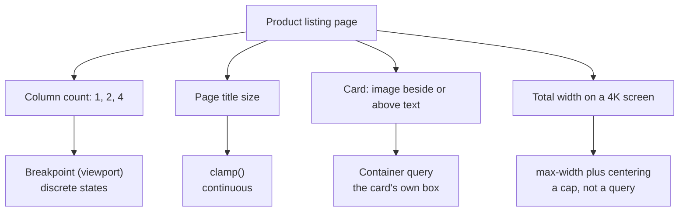
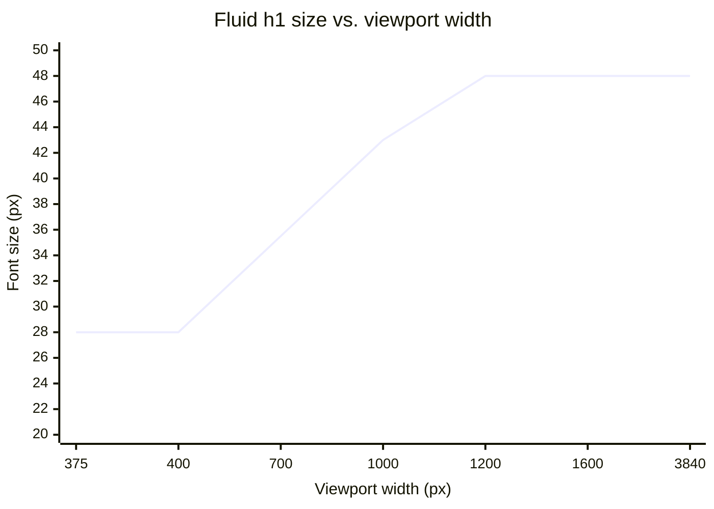
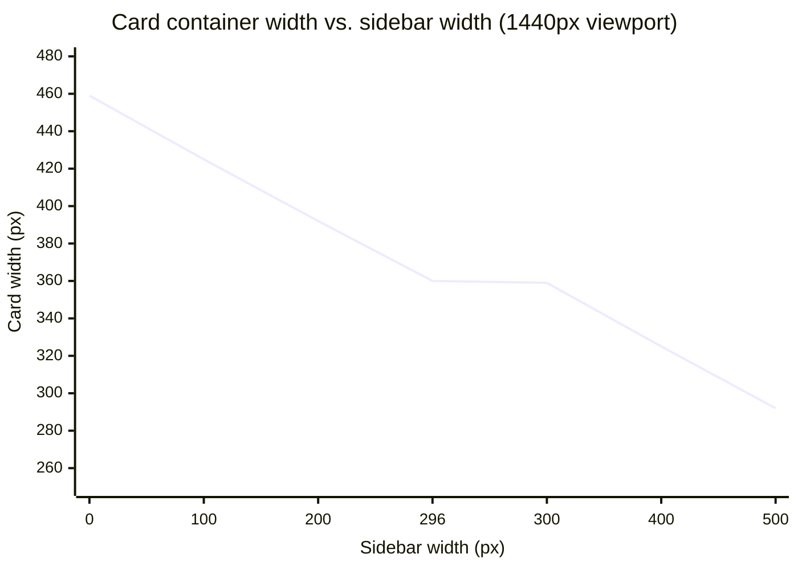

import Scenario from "../../../components/Scenario.astro";
import LevelIntro from "../../../components/LevelIntro.astro";
import Checkpoint from "../../../components/Checkpoint.astro";
import PracticeCheck from "../../../components/PracticeCheck.astro";

export const unit = {
  track: "design",
  unitSlug: "responsive-adaptive-design",
};

<Scenario label="The product listing">
  <Fragment slot="facts">
    <div class="not-prose flex flex-col gap-1.5 text-sm text-slate-700 dark:text-slate-300">
      <div>📦 Listing: image, title, price, "Add to cart"</div>
      <div>📱 Under 640px: 1 column</div>
      <div>📟 640px and up: 2 columns</div>
      <div>🖥️ 1024px and up: 4 columns plus a sidebar</div>
      <div>🖵 3840px: same layout, capped width, centered</div>
    </div>
    <p class="not-prose mt-3 text-xs text-slate-500 dark:text-slate-400">The card also has to respond to its own box width, not just the viewport. That is the container-query problem below.</p>
  </Fragment>

A shop is rebuilding its product listing so it works from a 375px phone to a 3840px monitor. It needs a filter sidebar that only appears once there is room, cards whose price never wraps awkwardly, and a page title that feels proportionate at every size without a designer picking a dozen font sizes.

**Given breakpoints for structure and `clamp()` for scale, how do these pieces combine into one working page, and where does the design still need a genuinely different layout?**

</Scenario>

<LevelIntro
  items={[
    "Assembling breakpoints and clamp() into one page",
    "Container queries: a box's width, not the viewport's",
    "When adaptive wins, and the accessibility floor",
  ]}
/>

## Which tool decides which part of the page?

**Before writing anything, who answers each question?** Sorting every decision by the kind of change it is keeps the stylesheet small:



The width cap answers the 4K half of the L1 bug report: without it a responsive grid keeps stretching as the viewport grows. For a 3840px viewport, four equal columns with 16px gaps and 16px of side padding come out about 940px each (3840 minus 32 minus 48, divided by 4), far wider than any product photo was designed for. Capped at 1600px, the same four columns are about 380px each. "Responsive" has to mean "adapts within a sensible range", not "fills whatever the monitor offers".

## How does "28px to 48px" become a clamp() line?

**The title should grow from 28px at 400px wide to 48px at 1200px wide. What numbers go in the formula?** Fit a straight line through two points:

| Step                | Arithmetic               | Result                                   |
| ------------------- | ------------------------ | ---------------------------------------- |
| Slope               | (48 - 28) / (1200 - 400) | 0.025px per px                           |
| Slope in `vw`       | 0.025 x 100              | 2.5vw                                    |
| Intercept at 0 wide | 28 - 0.025 x 400         | 18px (1.125rem)                          |
| Result              | floor, formula, ceiling  | `clamp(1.75rem, 1.125rem + 2.5vw, 3rem)` |



The line holds at 28px up to 400px, climbs on the exact segment between the two target points, then holds at 48px. That is a general recipe for "A at width W1, B at width W2", not a formula particular to this title.

<Checkpoint question="The same recipe is applied to body text going from 15px at 375px wide to 15px at 3840px wide (min equals max). What happens, and was clamp() the right tool?">

With equal floor and ceiling the formula's slope never matters: the value is 15px at every width. That is not a bug, but clamp() was the wrong tool, because a fixed `font-size: 15px` gives the identical result with nothing to misread or accidentally edit into unwanted scaling. Fluid sizing earns its complexity only when a value is meant to differ across the range.

</Checkpoint>

<PracticeCheck
  track={unit.track}
  unitSlug={unit.unitSlug}
  topicId="fluid-math"
/>

## When is the viewport the wrong thing to measure?

**The card should turn vertical when it gets narrow. It can get narrow because the viewport shrank, or because a sidebar opened on a wide viewport. Does `@media` see the second case?** No: `@media` only measures the viewport. A **container query** measures a named parent box instead:

```css
.card-slot {
  container-type: inline-size;
  container-name: card;
}
@container card (min-width: 360px) {
  .card {
    flex-direction: row;
  }
}
```

Worked numbers, using the demo's setup (1440px viewport, 64px of gutters, three cards across): with no sidebar each card's box is (1440 - 64) / 3, about 459px, so the row layout holds. A 300px sidebar leaves (1440 - 300 - 64) / 3, about 359px, just under the 360px threshold, so the card flips to vertical. The viewport never changed; only the card's own box did. The flip happens as soon as the sidebar passes 296px, the point where the card is exactly 360px.



|                                   | `@media` (viewport query)                | `@container` (container query)                 |
| --------------------------------- | ---------------------------------------- | ---------------------------------------------- |
| Measures                          | The browser viewport                     | A specific containing element's box            |
| Reacts to sidebar opening/closing | No, the viewport did not change          | Yes, the card's own box did change             |
| Best for                          | Page-level structure (nav, overall grid) | Reusable components placed in varying contexts |

Container queries do not replace breakpoints. The page grid (1, 2 or 4 columns) is still a viewport decision, while the card's inside is a container decision, since the same card sits in a sidebar grid, a full-width row, and a narrow modal on one viewport.

<Checkpoint question="A card uses `@container card (min-width: 360px)` but nobody added container-type to its parent. What does the card do?">

The query never matches, because there is no container to measure, so the card simply keeps its base (vertical) layout at every width. The rule is not an error and does not fall back to the viewport, which makes it an easy bug to miss: nothing visibly breaks until the card has room to be horizontal and stays vertical.

</Checkpoint>

<PracticeCheck
  track={unit.track}
  unitSlug={unit.unitSlug}
  topicId="container-queries"
/>

## When does adaptive still win, and what is the accessibility floor?

**Is responsive always the answer?** No. Adaptive is right when the _experience_, not just the layout, should differ:

- **Email clients**: many have poor or no support for `@media`, `@container` or `clamp()`, so templates ship as a few fixed, table-based layouts. The platform forces the choice.
- **A kiosk or point-of-sale screen**: different information density and touch targets, closer to a different product than the same content reflowed.
- **A print stylesheet**: `@media print` strips navigation and interactive parts instead of reflowing them, an adaptive swap built with the responsive toolset.

Both strategies share an accessibility floor: WCAG 1.4.10 (Reflow) requires content to stay usable without sideways scrolling at 400% zoom on a viewport equivalent to 320 CSS pixels wide. A 1280px-wide window zoomed to 400% is exactly that width (1280 / 4 = 320), so a fixed-width layout can look fine at 100% and fail here.

| Check                                                     | Why it catches real bugs                                 |
| --------------------------------------------------------- | -------------------------------------------------------- |
| Drag the browser width continuously, not to fixed presets | Finds the exact range where a breakpoint is wrong        |
| Zoom to 200% and 400% at a narrow viewport                | Tests Reflow, not only raw device width                  |
| Put a component in its narrowest and widest real slot     | Catches container-query bugs a viewport-only test misses |
| Check the widest realistic viewport (4K)                  | Catches a missing `max-width`                            |
| Use real content lengths (long title, empty state)        | Catches overflow that placeholder text hides             |

<PracticeCheck
  track={unit.track}
  unitSlug={unit.unitSlug}
  topicId="reflow-and-testing"
/>

## Where does this worked example stop being the whole story?

This listing page is one case, not the whole territory. **What changes if the same page also had to serve a warehouse-floor tablet used by staff, with larger tap targets, fewer decorative images, and a persistent barcode-scan button? Would more breakpoints solve it, or is the content and interaction model now different enough that it wants a deliberately separate template?** Try the same question for a page whose main user is on a slow connection, or one printed for a customer. The mechanics here answer "how do I hold one design together across sizes"; the harder judgment is noticing when it is no longer one design.
