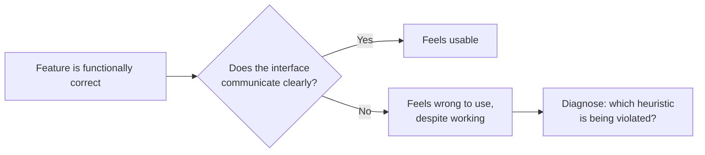

import Scenario from "../../../components/Scenario.astro";
import LevelIntro from "../../../components/LevelIntro.astro";
import PracticeCheck from "../../../components/PracticeCheck.astro";

export const unit = {
  track: "design",
  unitSlug: "usability-heuristics",
};

<Scenario label="The silent machine">
  <Fragment slot="facts">
    

      
🪙 Coin goes in — no light, no sound

      
🔘 Button pressed — nothing visibly changes

      
🥤 Drink drops 20 seconds later (if you are still there)

    

    

      
✅ Every part works exactly as built

      
😕 People press the button again and again, or walk away

    

  </Fragment>

A vending machine is built perfectly: the coin slot reads coins, the motor turns, the drink drops. A technician tests it and finds nothing wrong. But people stand in front of it pressing the button three times, unsure whether the first press registered. Some walk away without their drink. Some kick the machine.

| What the machine does                 | What the person experiences                     |
| ------------------------------------- | ----------------------------------------------- |
| Accepts the coin and starts the motor | No sign that anything was accepted              |
| Drops the drink after a 20 s delay    | Long silence that feels like a broken machine   |
| Refuses a bent coin and returns it    | A clunk, with no hint of what was wrong with it |

**Before reading on: nothing is broken, so a test would pass. What is wrong with this machine?**

</Scenario>

Nothing crashed and nothing failed a test. What failed is the _conversation_ between the machine and the person using it: it never said what was happening, what would happen, or what had already happened. Software screens fail the same way: a settings page can save correctly and still leave the person wondering whether anything happened.

<LevelIntro
  items={[
    "Correctness vs. usability as separate axes",
    "Nielsen's 10 heuristics, grouped into 5 questions",
    "Naming which heuristic a bad interface violates",
  ]}
/>

## Why can a working feature still fail the person using it?

Correctness asks "does it do what it was built to do?" Usability asks "can the person tell what it is doing, and recover when they slip?" A test suite checks the first. Only watching (or reasoning about) a person using it checks the second.

**Usability heuristics** are broad, evidence-based rules of thumb for judging whether an interface communicates clearly. They are not a style guide and not a checklist of specific widgets. They are diagnostic lenses, like the standard questions a doctor asks before naming a problem: the questions do not replace judgment, but they keep obvious causes from being missed.

<PracticeCheck
  track={unit.track}
  unitSlug={unit.unitSlug}
  topicId="correctness-vs-usability"
/>

## What are Nielsen's 10 heuristics, and how do they group?

Jakob Nielsen published the list in 1994 and it is still the most widely used version. Ten names are hard to hold in mind, so group them by what each one protects, as five questions:

| Question                                   | Heuristics                                                           |
| ------------------------------------------ | -------------------------------------------------------------------- |
| Does the system talk to the user?          | Visibility of system status; match between system and the real world |
| Does the user stay in control?             | User control and freedom; flexibility and efficiency of use          |
| Does the interface stay predictable?       | Consistency and standards; recognition rather than recall            |
| Does the system protect against mistakes?  | Error prevention; help users recognize, diagnose, and recover        |
| Is it no more complex than it needs to be? | Aesthetic and minimalist design; help and documentation              |

Heuristics are not laws. An interface may break one on purpose (a delete confirmation adds friction deliberately) as long as that is a conscious trade-off and not an oversight.

## How do you name the heuristic a bad screen violates?

Return to the machine. Each complaint maps to a specific heuristic, which is what turns "this feels clunky" into a fixable change:

| Failure in the machine                      | Heuristic it violates                       |
| ------------------------------------------- | ------------------------------------------- |
| No sign the coin or button press registered | Visibility of system status                 |
| No way to cancel and get the coin back      | User control and freedom                    |
| Bent-coin clunk with no explanation         | Help users recognize, diagnose, and recover |

The same mapping works on screens. A settings page that saves silently, deletes with no undo, and shows only `ERR_402` after a failed payment breaks the same three heuristics. The skill this unit builds is **noticing** that gap and naming which heuristic is involved.

<PracticeCheck
  track={unit.track}
  unitSlug={unit.unitSlug}
  topicId="naming-the-heuristic"
/>
