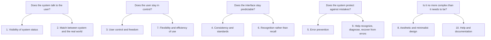
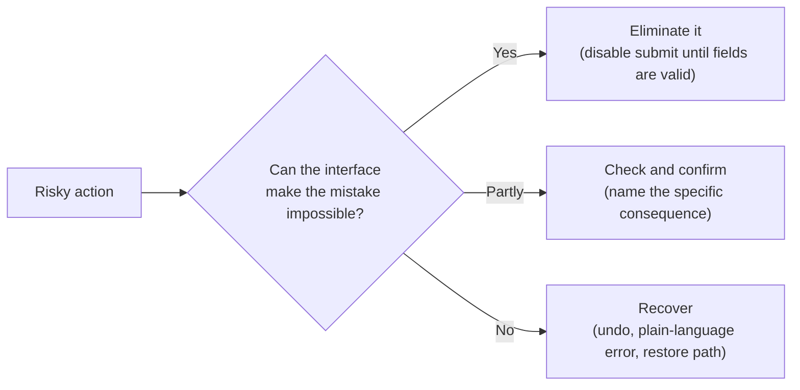

import Scenario from "../../../components/Scenario.astro";
import LevelIntro from "../../../components/LevelIntro.astro";
import Checkpoint from "../../../components/Checkpoint.astro";
import PracticeCheck from "../../../components/PracticeCheck.astro";

export const unit = {
  track: "design",
  unitSlug: "usability-heuristics",
};

L1 established that a feature can be functionally correct and still fail its user, and that Nielsen's 10 heuristics name the specific ways that failure happens. L2 works out how those 10 group into a model you can hold in your head, and how the two groups that matter most, talking to the user and protecting them from mistakes, fit together.

<LevelIntro
  items={[
    "The 5 categories the 10 heuristics group into",
    "How feedback and error handling work as a pair",
    "Prevention first, recovery as the fallback",
  ]}
/>

## Ten rules, or five questions?

Ten heuristics is a lot to hold while reviewing a screen. If you had to compress them into a handful of questions you could run through in a design critique, what would the categories be?

Grouped by **what each one protects**, they collapse into five questions:

| Category                                   | Heuristics                                                              | The question it answers                                            |
| ------------------------------------------ | ----------------------------------------------------------------------- | ------------------------------------------------------------------ |
| Does the system talk to the user?          | 1. Visibility of system status · 2. Match between system and real world | Does the user always know what state things are in?                |
| Does the user stay in control?             | 3. User control and freedom · 7. Flexibility and efficiency of use      | Can the user recover from a wrong turn, and go faster once fluent? |
| Does the interface stay predictable?       | 4. Consistency and standards · 6. Recognition rather than recall        | Does a pattern learned once keep working everywhere else?          |
| Does the system protect against mistakes?  | 5. Error prevention · 9. Help recognize, diagnose, recover from errors  | Does the interface stop mistakes, and explain the ones it can't?   |
| Is it no more complex than it needs to be? | 8. Aesthetic and minimalist design · 10. Help and documentation         | Is every element on screen earning its place?                      |

Some terms that appear in the official wording, in plain form:

| Technical phrase                | Simple question                                                    |
| ------------------------------- | ------------------------------------------------------------------ |
| Mental model                    | What does the user already think is happening?                     |
| Accelerator                     | What shortcut helps an experienced user move faster?               |
| Platform/industry convention    | What pattern have users already learned somewhere else?            |
| Recognition rather than recall  | Can the screen show the choice instead of making them remember it? |
| Aesthetic and minimalist design | Is this element useful right now, or is it stealing attention?     |

Two groupings share a premise even though they look opposite. "Stay in control" has safety nets for uncertainty (undo, cancel) and shortcuts for fluency (keyboard accelerators); both assume the interface should not treat every user as the same single kind. "Stay predictable" attacks one cost from two sides: making the user relearn a pattern (consistency) or remember something the screen could have shown (recognition).

<PracticeCheck
  track={unit.track}
  unitSlug={unit.unitSlug}
  topicId="five-questions"
/>

## How do feedback and error handling work together?

An interface that never reports back asks the user to trust a black box. Is the cost of silence just annoyance, or does it compound?

- **Visibility of system status** keeps the user informed within reasonable time: a spinner during a slow request, a checkmark after a save, a progress bar during an upload.
- **Match between system and the real world** means speaking the user's language. A shopping cart is called a "cart," not a "session-scoped order buffer."
- **Help users recognize, diagnose, and recover from errors** means plain language (no codes), the precise problem, and a suggested next step. A bare `ERR_402` fails all three parts.

All three are the interface owing the user a model of what is happening that matches the user's own, not the engineer's. Silence and jargon fail the same way: they leave the user substituting a guess for information the system actually has.

<Checkpoint question="A settings page saves instantly in the background, with no spinner and no confirmation message. The save always succeeds. Is this a visibility-of-system-status violation, given that nothing ever actually goes wrong?">

Yes. Visibility of system status is not conditional on failure. It is about the user always knowing what state things are in, whether that state is good or bad. A save that always succeeds still needs to say so, because the person clicking has no other way to know the click registered. "It always works" is a fact about the backend, not something visible from the screen. The fix can be light, such as a brief checkmark or a changed button label, but leaving it out asks the user to trust silence.

</Checkpoint>

<PracticeCheck
  track={unit.track}
  unitSlug={unit.unitSlug}
  topicId="feedback-and-errors"
/>

## Prevent first, then recover: which comes first?

A well-worded error message is a recovery from a failure that already happened. Which heuristic tries to stop the mistake before it happens at all?

**Error prevention** is the cheaper heuristic to satisfy but cannot cover everything: a payment can still fail for reasons outside the interface's control. So **recovery** is the fallback for whatever prevention could not stop. They are not redundant; they are two layers in order.

The same ordering explains why a generic confirmation often fails.

<Checkpoint question="A delete button shows a confirmation dialog that just says 'Are you sure?' with Yes/No. It technically gives the user a chance to back out. Why might it still fail in practice?">

Because a generic confirmation only works if the user actually reads it, and a dialog that appears before every action, with no information beyond the fact that it is asking, trains people to click through on reflex. Satisfying the letter of the heuristic (there is a confirmation step) is not the same as satisfying its intent (a real chance to catch a mistake). A confirmation that names the specific, non-obvious consequence of this particular action gives the user something new to notice; a generic one gets clicked through as fast as no confirmation at all.

</Checkpoint>

<PracticeCheck
  track={unit.track}
  unitSlug={unit.unitSlug}
  topicId="prevent-then-recover"
/>

## Is it no more complex than it needs to be?

Aesthetic and minimalist design says an interface should not carry information that is irrelevant or rarely needed, because every extra unit competes with the relevant ones. Help and documentation says the system should be usable without docs, but any docs it has should be searchable, task-focused and short.

These two are the heuristics most often invoked as an excuse ("it's cluttered, remove it" or "we'll just document the weird part") instead of as a genuine trade-off. L3 covers exactly that misapplication.

<Scenario label="Quick check">
  <Fragment slot="facts">
    

      
1️⃣2️⃣ Talk to the user

      
3️⃣7️⃣ Stay in control

      
4️⃣6️⃣ Stay predictable

      
5️⃣9️⃣ Protect against mistakes

      
8️⃣🔟 No more complex than needed

    

  </Fragment>

A form silently accepts a save, then two minutes later the tab shows a generic "Something went wrong" banner with no indication of what to fix. Which two heuristics does this violate, and which categories do they belong to?

It is **visibility of system status** (no immediate feedback, so the failure surfaced late) and **help users recognize, diagnose, and recover from errors** (the banner names no field, no cause, no fix). They sit under "does the system talk to the user?" and "protect against mistakes." Naming both, not just "this is confusing," is the skill this unit teaches.

</Scenario>
