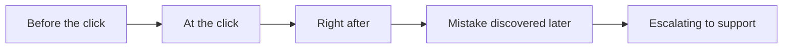
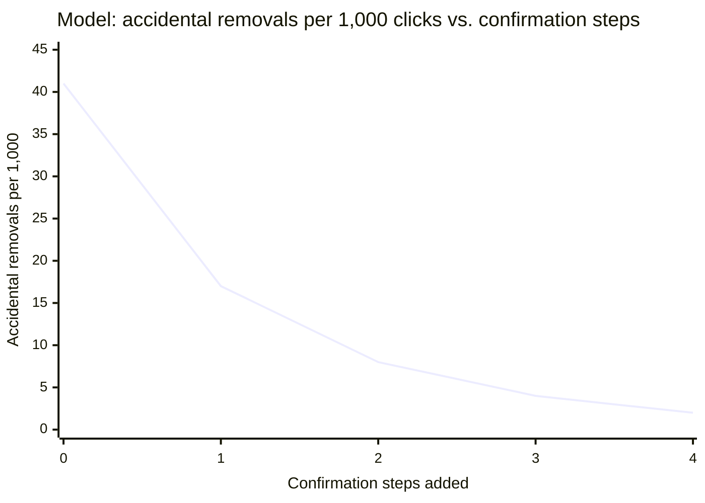

import Scenario from "../../../components/Scenario.astro";
import LevelIntro from "../../../components/LevelIntro.astro";
import Checkpoint from "../../../components/Checkpoint.astro";
import PracticeCheck from "../../../components/PracticeCheck.astro";

export const unit = {
  track: "design",
  unitSlug: "usability-heuristics",
};

<Scenario label="The interface">
  <Fragment slot="facts">
    <div class="not-prose flex flex-col gap-1 text-sm text-slate-700 dark:text-slate-300">
      <div class="flex items-center gap-1.5"><span>👥</span> Team Settings, Members tab, in a business admin panel</div>
      <div class="flex items-center gap-1.5"><span>🎯</span> User: a team admin (not an engineer) removing a departed contractor</div>
      <div class="flex items-center gap-1.5"><span>⚠️</span> Hypothetical incident: wrong row clicked, billing admin removed</div>
    </div>
    <p class="not-prose mt-3 mb-1 text-xs font-semibold tracking-wide text-slate-400 uppercase">Layout (as shipped)</p>
    <pre class="not-prose rounded border border-slate-300 bg-slate-50 p-2 text-[11px] leading-tight dark:border-slate-600 dark:bg-slate-900">
Members (14)
------------------------------
[avatar] Priya Shah      Admin   [Remove]
[avatar] Jon Alcott       Member  [Remove]
[avatar] dev-bot-3        Bot     [Remove]
------------------------------
    </pre>
  </Fragment>

A business product has a **Team Settings, Members** page. An admin uses it to manage who has access. It looks like this:

```
Members (14)
------------------------------
[avatar] Priya Shah       Admin    [Remove]
[avatar] Jon Alcott        Member   [Remove]
[avatar] dev-bot-3         Bot      [Remove]
------------------------------
```

Clicking **[Remove]** immediately deletes that person's access: no confirmation, no undo, no toast. The row just disappears. In this hypothetical incident, an admin meant to remove a departed contractor, clicked the row above by mistake, and revoked the company's own billing admin instead. Restoring access took days of back-and-forth with support.

**Before reading the audit below: this single click touches at least three heuristics at once. Which three, and in what order would you fix them?**

</Scenario>

<LevelIntro
  items={[
    "Auditing one click against several heuristics",
    "Fixing each violation without over-fixing",
    "Where strict heuristic compliance backfires",
  ]}
/>

The risk is familiar outside business software: removing a contractor is like removing someone from a shared class document or group folder. The action may be correct, but it is serious enough that the interface must make status, consequences and recovery obvious.

## Auditing the click, heuristic by heuristic

A misclick should not cost days. Walking backward from the incident: at which exact point could it have been stopped, and which heuristic governs that point?



| Point in the flow                | What happens today                             | Heuristic violated                                               |
| -------------------------------- | ---------------------------------------------- | ---------------------------------------------------------------- |
| Before the click                 | No warning that this action is destructive     | Error prevention                                                 |
| At the click                     | No "are you sure?" — action is instant         | User control and freedom                                         |
| Right after the click            | Row vanishes, no confirmation of what happened | Visibility of system status                                      |
| After the misclick is discovered | No way to reverse it from the UI               | User control and freedom (again — recovery, not just prevention) |
| While escalating to support      | No log entry the admin can point to            | Help users recognize, diagnose, and recover from errors          |

Five failures from one button. This is normal: a bad interaction is rarely one heuristic violated once. The same missing design decision, never asking "what if this is a mistake?", breaks several at the same point.

<Checkpoint question="The table lists 'user control and freedom' twice, once for the click itself and once for recovery after the misclick is discovered. Is that a mistake in the audit, or is there a real reason the same heuristic shows up at two points?">

It is not a mistake. User control and freedom is a standing requirement that must hold at every point where the user might need a way out: before the mistake (a confirmation that can prevent it) and after it is made and discovered later (an undo or restore path). A fix covering only one moment still leaves the user stuck if they miss the other: the confirmation does not help if they clicked through it, and having a confirmation does not make a restore path optional for the case where a deliberate removal later turns out to be wrong.

</Checkpoint>

## The fix, one heuristic at a time

Walking through the fixes individually shows why each does its own job, rather than "make it feel safer."

| Step | Heuristic                    | Fix                                                                        | What it catches                                      |
| ---- | ---------------------------- | -------------------------------------------------------------------------- | ---------------------------------------------------- |
| 1    | Error prevention             | Separate [Remove] from neutral actions; require a second deliberate step   | Clicking the wrong row without looking               |
| 2    | User control, at the action  | Confirmation naming the specific consequence                               | Removing someone whose role matters                  |
| 3    | Visibility of system status  | Toast: "Removed Jon Alcott from Members. [Undo]", live for several seconds | Not knowing what just happened; instant regret       |
| 4    | User control, for recovery   | "Recently removed" list with one-click restore, kept for a fixed period    | Regret after the undo window closes                  |
| 5    | Recognize, diagnose, recover | Admin-visible audit log: who removed whom, and when                        | "I think I did something" turned into a clear record |

The confirmation in step 2 should surface the one fact that would have stopped the incident:

```
Remove Priya Shah from this team?
She'll lose access to all workspaces immediately.
This account is currently the billing admin.
                                  [Cancel]  [Remove]
```

A generic "Are you sure?" would be clicked through as fast as the original button. The fix is not "add a confirmation" but "add one that says something the user did not already know."

None of the five fixes need new logic in the underlying "remove access" operation, only an audit table and a soft-delete window. What changes is how the interface communicates around the operation.

Hover-only controls deserve care: they disappear for keyboard users, touch screens, and anyone who does not know where to point first. If hiding an action helps, the design still needs a visible path such as a "Manage access" menu or a labelled action row.

<PracticeCheck
  track={unit.track}
  unitSlug={unit.unitSlug}
  topicId="stacked-audit"
/>

## Where strict compliance backfires

Every fix above added a step, a message or a delay. If "more confirmations and more messages" were free, every interface would already be maximally cautious. What actually stops teams from doing that everywhere?

The interactive demo below models the trade-off. It is an **illustrative model, not a measured study**: accidental removals fall steeply with the first added confirmation steps, then flatten, while the time for a routine, intended removal grows by a fixed amount per step.

| Confirmation steps | Accidental removals per 1,000 clicks | Seconds per routine removal |
| ------------------ | ------------------------------------ | --------------------------- |
| 0                  | 41                                   | 3                           |
| 1                  | 17                                   | 7                           |
| 2                  | 8                                    | 11                          |
| 3                  | 4                                    | 15                          |
| 4                  | 2                                    | 19                          |



The first step removes 24 accidents per 1,000 clicks for 4 extra seconds; the fourth removes only 2 per 1,000 for the same 4 seconds. Each step costs the same time but saves less. That is the shape behind two real tensions:

- **Confirmation fatigue vs. error prevention.** A confirmation is only as good as the rate of genuine "wait, no" moments it catches. If every action gets the same "Are you sure?", including reversible ones like renaming a tag, users learn to click through without reading and the dialog prevents nothing. Reserve confirmation for actions that are both destructive _and_ hard to reverse.
- **Minimalism vs. status visibility.** Heuristic 8 says do not clutter; heuristic 1 says keep the user informed. A toast on every field of a twenty-field form violates minimalism in the name of visibility. Visibility scales with the stakes and reversibility of the action: silent auto-save for a draft is fine; silent removal of a person's access is not.

**The heuristics are not independent dials to max out. They trade against each other, and the right setting depends on the stakes and reversibility of the specific action**, not a rule applied uniformly across a product.

<Checkpoint question="A team reads the confirmation-fatigue point and removes the confirmation from every action except account deletion, to avoid habituating users to warnings. Does this apply the trade-off correctly?">

It misses something. The trade-off is not "confirmations are bad, minimize their count"; it is that confirmation should scale with an action's stakes and reversibility. If the product also has an irreversible "remove team member" or "delete workspace" action, stripping confirmation from those applies the letter of "don't overuse confirmations" while ignoring the actual criterion for when one is warranted. The fix is auditing each action's own stakes and reversibility, not picking one arbitrary exception.

</Checkpoint>

<PracticeCheck
  track={unit.track}
  unitSlug={unit.unitSlug}
  topicId="proportional-friction"
/>

## Common misapplications

- **Citing a heuristic as a veto without naming the user cost.** "This violates minimalism" is not an argument until it says what gets worse: slower scanning, more misclicks, more support load.
- **Applying heuristics uniformly regardless of stakes.** Giving a rename and an irreversible deletion the identical confirmation UI "follows" user control and freedom while missing its point, which is proportioning friction to consequence.

## Extending the audit

The Members-page audit is built around one population: an admin with reasonable fluency, on a desktop screen, in a tool where mistakes have organizational consequences. That is one case, not the whole territory.

**Before moving on: if the same "remove a person" pattern appeared in a consumer social app, such as removing a follower, aimed at a less technical, often mobile-only audience, which of the five fixes would you keep as-is, which would you change, and why? What would change if the action were reversible by default, or if the news (a wrong removal) were worse?** A hint on scope, not the full answer: an audit log makes little sense when the "admin" and the "removed person" are in the same trust tier, but the confirmation step arguably matters _more_ on a small touchscreen where misclicks are physically easier.

## Reference table

| Heuristic                                        | One-line test                                                            |
| ------------------------------------------------ | ------------------------------------------------------------------------ |
| 1. Visibility of system status                   | Does the user always know what state things are in?                      |
| 2. Match between system and the real world       | Does the interface speak the user's language, not the system's?          |
| 3. User control and freedom                      | Is there a clear way out of a wrong turn?                                |
| 4. Consistency and standards                     | Does the same word/color/pattern always mean the same thing?             |
| 5. Error prevention                              | Could this mistake have been made impossible, not just recoverable?      |
| 6. Recognition rather than recall                | Is the needed information visible, or does the user have to remember it? |
| 7. Flexibility and efficiency of use             | Can an experienced user go faster without the novice path getting worse? |
| 8. Aesthetic and minimalist design               | Is every element on screen earning its place?                            |
| 9. Help recognize, diagnose, recover from errors | Plain language, specific problem, suggested fix — no bare codes?         |
| 10. Help and documentation                       | If needed, is it searchable and scoped to the actual task?               |
