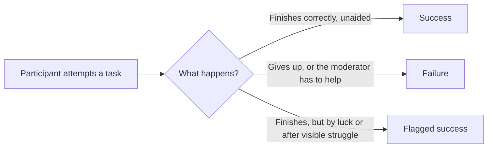

import Scenario from "../../../components/Scenario.astro";
import LevelIntro from "../../../components/LevelIntro.astro";
import PracticeCheck from "../../../components/PracticeCheck.astro";

export const unit = {
  track: "design",
  unitSlug: "usability-testing",
};

<Scenario>
  <Fragment slot="facts">
    

      

        2 of 6
        strangers finished the checkout task unaided
      

      

        

      

    

    

      
🗳️ Team vote before testing: 5 of 5 said "obviously intuitive"

      
🖱️ 4 of 6 strangers tapped the wrong icon first

      
🗣️ "I guess this is... a trash can? Or save?"

    

  </Fragment>

A five-person design team spent a sprint agreeing that the new icon-only
checkout button was obvious: everyone in the room understood it
instantly. Before shipping, they handed the prototype to six strangers and
asked each one to buy a shirt.

| What the team believed           | What happened when a stranger tried it                     |
| -------------------------------- | ---------------------------------------------------------- |
| "It's obviously a checkout icon" | 4 of 6 tapped it expecting "save" or "delete"              |
| "Nobody will get confused here"  | Only 2 of 6 completed the purchase without help            |
| "We all agreed it looked clean"  | Looking clean and being understandable are different tests |

**Before reading on: the team's confidence and the strangers' confusion are both real. Which should the team have trusted, and why did agreeing in a room fail to predict what happened outside it?**

</Scenario>

The team tested the wrong thing. They tested whether _they_ understood the
design, and of course they did, they built it. What they never tested was
whether someone who didn't build it, and doesn't already know what it means,
could figure it out cold.

<LevelIntro
  items={[
    "Why a team's own confidence isn't evidence",
    "Watching real people attempt real tasks",
    "Task success rate and what counts as a pass",
  ]}
/>

## Why can't the team just agree it works?

**If five experts all see the button as obvious, what extra information could a sixth, ignorant person possibly add?** Exactly the information the experts can't produce: what it looks like without the knowledge. Once you know what an icon means, you cannot easily imagine not knowing it. This is the **curse of knowledge**, and it is why a team's opinion of its own work is not evidence.

**Usability testing** replaces opinion with observation: a small number of realistic people attempt real tasks, without being told how, while someone watches or records. It is not a survey and not a focus group, because what people say they would do and what they actually do reliably diverge.

| Method         | What you collect                  | What it can tell you                                |
| -------------- | --------------------------------- | --------------------------------------------------- |
| Team review    | Opinions of people who know it    | Whether the team likes it                           |
| Survey         | What people say they would do     | Stated preferences, not behaviour                   |
| Focus group    | What a group says to each other   | Attitudes, shaped by whoever speaks first           |
| Usability test | What individuals do, task by task | Where real people get stuck, and often why they did |

<PracticeCheck
  track={unit.track}
  unitSlug={unit.unitSlug}
  topicId="opinion-vs-observation"
/>

## What counts as a pass?

**Two of the six strangers eventually bought the shirt. Does "eventually" count?** Only if they did it correctly and unaided. A task's outcome is one of three things, and only one is a clean pass:

**Task success rate** is the share of participants who completed a given task correctly on their own: 2 of 6 is 33%. The number turns "seems fine" into something you can compare across rounds. The third outcome is the trap: a task that got done can still be hiding the exact confusion the test exists to catch. That is why participants are asked to **think aloud**, narrating what they expect and why. The narration is what tells a lucky guess from understanding.

| Term                 | Simple meaning                                                              |
| -------------------- | --------------------------------------------------------------------------- |
| Task success rate    | Share of participants who completed a task correctly and unaided            |
| Think-aloud protocol | Participants narrate their thoughts while working, out loud                 |
| Moderator            | Gives the task, then stays quiet and watches                                |
| Curse of knowledge   | Once you know what something means, you can't easily imagine not knowing it |

<PracticeCheck
  track={unit.track}
  unitSlug={unit.unitSlug}
  topicId="success-rate"
/>
