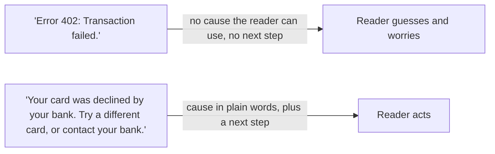

import Scenario from "../../../components/Scenario.astro";
import LevelIntro from "../../../components/LevelIntro.astro";
import PracticeCheck from "../../../components/PracticeCheck.astro";

export const unit = {
  track: "design",
  unitSlug: "ux-writing-microcopy",
};

<Scenario label="Two signs on a shop door">
  <Fragment slot="facts">
    

      

        
Door A

        
"Closed."

      

      

        
Door B

        
"Closed for lunch. Back at 2:00."

      

    

    

      
🚪 Same fact: the shop is shut right now

      
❓ Door A: shut for a minute, or for good?

      
🕑 Door B: cause and next step in six words

    

  </Fragment>

You walk up to a shop. Door A says **"Closed."** Door B says **"Closed for lunch. Back at
2:00."** Both signs are true. At Door A you wonder whether the shop is gone for good. At Door B
you go and get a coffee.

Software has the same two doors. Your card is declined at checkout. App A says **"Error 402:
Transaction failed."** App B says **"Your card was declined by your bank. Try a different card,
or contact your bank to find out why."**

**Both messages are accurate and neither lies. So why does one feel like the app is on your
side and the other like it is shrugging at you?**

</Scenario>

The failure is identical in both apps. What differs is the handful of words between the system's
internal state and a person staring at a screen. Those words are the subject of this unit.

<LevelIntro
  items={[
    "What microcopy and UX writing are",
    "Cause and next step in every error",
    "Blame versus neutral wording",
  ]}
/>

## What is microcopy, and who writes it?

**Who decided that App A would say "Error 402"?** Usually nobody did. A developer typed a string
into an error branch so the code would have something to show, and it shipped.

Microcopy is the small functional text inside an interface: error messages, button labels, empty
states, field hints, confirmation dialogs, loading messages. It is read at the exact moment
someone is trying to do something. UX writing is the practice of writing that text on purpose
instead of letting a placeholder string reach production.

## What makes a message feel helpful?

**Two messages describe the same failure. What did App B add that App A left out?** Compare them
part by part.

| Part of the message          | App A                  | App B                                        |
| ---------------------------- | ---------------------- | -------------------------------------------- |
| What happened                | "Transaction failed"   | "Your card was declined by your bank"        |
| Whose side of the screen     | System log wording     | Plain words about the reader's card          |
| What to do next              | Nothing                | "Try a different card, or contact your bank" |
| Reader's likely next thought | "Was I charged twice?" | "I will use my other card"                   |

The pattern repeats in almost every well-written message:

1. **What happened**, stated as a fact.
2. **A next step** the reader can take.
3. **Why**, only when knowing it changes what they do.

A message with no next step is App A: true, and a dead end.

<PracticeCheck
  track={unit.track}
  unitSlug={unit.unitSlug}
  topicId="error-anatomy"
/>

## Does the wording point a finger?

**"You entered an invalid value" and "That format is not quite right" describe the same typo.
Why do they land differently?** The first names the reader as the culprit. The second names the
thing that went wrong.

| Blaming                        | Neutral                                         |
| ------------------------------ | ----------------------------------------------- |
| "You entered an invalid date." | "Dates need the form 31/12/2026."               |
| "Your upload was too large."   | "Files can be up to 10 MB. This one is larger." |

Neutral wording keeps the subject on the rule or the system, so the reader spends their effort
fixing the problem rather than defending themselves. The second column also gives the rule, so
it carries its own next step.

<PracticeCheck
  track={unit.track}
  unitSlug={unit.unitSlug}
  topicId="blame-vs-cause"
/>

## The habit to keep

Before shipping any error string, ask two questions: what exactly happened, in words the reader
would use? And what can they do about it? L2 turns these into a repeatable checklist and adds
the third axis, tone matched to how much is at stake.
