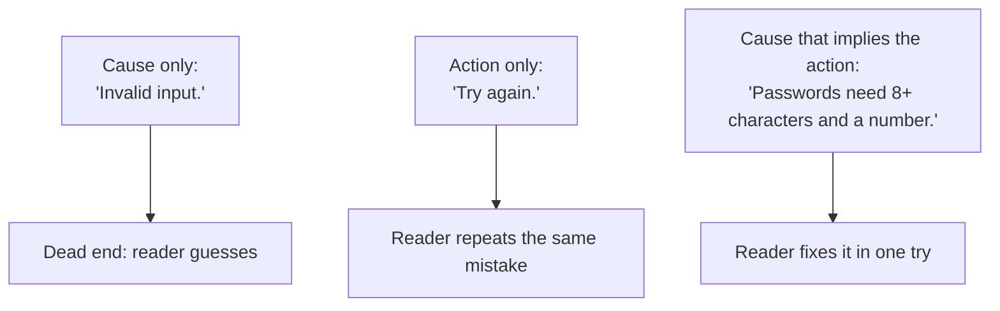

import Scenario from "../../../components/Scenario.astro";
import LevelIntro from "../../../components/LevelIntro.astro";
import Checkpoint from "../../../components/Checkpoint.astro";
import PracticeCheck from "../../../components/PracticeCheck.astro";

export const unit = {
  track: "design",
  unitSlug: "ux-writing-microcopy",
};

<Scenario label="One field, two error messages">
  <Fragment slot="facts">
    

      

        
Password field

        
"Invalid input."

      

      

        
Same field, rewritten

        

          "Passwords need at least 8 characters, including one number."
        

      

    

    

      
🔁 Both fire on the same failed check

      
❓ "Invalid input" repeats what the red border already said

      
🎯 The rewrite names the rule that was broken

    

  </Fragment>

L1 showed that good messages state what happened and what to do. But "be helpful" is not
something a writer can apply sentence by sentence. A red border already tells the reader the
field is wrong. "Invalid input" adds nothing to that, while the rewrite adds the rule.

**If you had one question to ask of every error string before it ships, what would it be?**

</Scenario>

The question is: _what does the reader know after reading this that they did not know from the
red border alone?_ This level breaks that into three parts a message can answer, then adds the
second axis: how the message sounds.

<LevelIntro
  items={[
    "The cause / impact / action triad",
    "Voice: a person, not a system log",
    "Tone that falls as stakes rise",
  ]}
/>

## Which three questions can an error message answer?

**A message has room for maybe twelve words. Which questions deserve them?** There are three, and
each has a rule for when to spend words on it.

| Question                               | Spend words when                                              | Leave it out when                             |
| -------------------------------------- | ------------------------------------------------------------- | --------------------------------------------- |
| **What happened?** (cause)             | Nearly always, briefly                                        | The context makes it obvious                  |
| **What does it mean for me?** (impact) | The consequence is non-obvious or costly: lost data, a charge | The consequence is obvious ("field is empty") |
| **What do I do next?** (action)        | Always, even if the action is "try again"                     | Never: a message with no action is a dead end |

Each single-question message fails in its own way:

The strongest messages name a cause specific enough that the action is nearly self-evident, so
no separate action sentence is needed.

<Checkpoint question="A teammate proposes 'Try again.' as the whole message for a failed file upload. What is wrong with shipping it?">

It gives an action but no information to act on differently. If the upload failed because the
file was too large, trying again produces the same failure. A bare retry helps only when the
cause is temporary, such as a dropped connection. When the cause is something the reader can
change, such as file size or type, the message must name it, or "try again" just postpones the
same dead end by one click.

</Checkpoint>

<PracticeCheck track={unit.track} unitSlug={unit.unitSlug} topicId="triad" />

## Does it sound like a person or a log line?

**Why does "Transaction failed. Error 402." feel cold even when it is correct?** Because it
describes what the _server_ experienced, not what the _reader_ needs. A log line is written for
an engineer debugging the system. An interface message is one person telling another what
happened.

| System voice (avoid)              | Human voice (prefer)                         |
| --------------------------------- | -------------------------------------------- |
| "Request failed with status 402." | "Your card was declined by your bank."       |
| "Null reference in save handler." | "We could not save your changes. Try again." |

The translation step is always the same: swap "what broke in our system" for "what this means
for you and what you can do".

## How should tone change as the stakes change?

**A bouncy "Oops!" feels friendly on a mistyped search. Why does it feel wrong on a deleted
account?** Because tone is judged against what the reader stands to lose. Warmth is a resource:
spend it where failures are small and frequent, and drop it as consequences grow.

| Moment                      | Stakes for the reader | Fitting tone                  |
| --------------------------- | --------------------- | ----------------------------- |
| Typo in a search box        | Almost none           | Light, even a little warm     |
| Required field left empty   | Low                   | Plain and brief               |
| File upload failed          | Moderate: redo work   | Plain, calm, specific         |
| Payment declined            | High: money, trust    | Plain, calm, no jokes         |
| Account permanently deleted | Irreversible          | Precise and serious, no cheer |

The ordering in the table is a judgement, not a measurement. The point is the direction: as the
cost of a mistake goes up, the writing gets plainer and more exact, not friendlier.

<Checkpoint question="A designer wants an exclamation mark and a friendly emoji on the dialog that says 'This will permanently delete your account and all data.' What do you tell them?">

Do not. This is the irreversible end of the stakes scale, where warmth should fall. The reader
is about to make a decision they cannot undo, and the writing's job is to make the consequence
unmistakable and the way out obvious. Cheerful punctuation signals that the product is relaxed
about something the reader should take seriously, which undercuts the one thing the dialog
exists to do: prevent an accident.

</Checkpoint>

<PracticeCheck
  track={unit.track}
  unitSlug={unit.unitSlug}
  topicId="tone-stakes"
/>

## Putting the two axes together

The triad decides _what_ the message says. Voice and tone decide _how_ it says it. A message can
cover the triad and still fail on tone (a coldly worded deletion warning), or sound perfect and
still fail the triad (a warm message that never says what to do). L3 runs both axes through
full rewrites.
