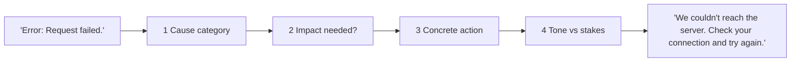
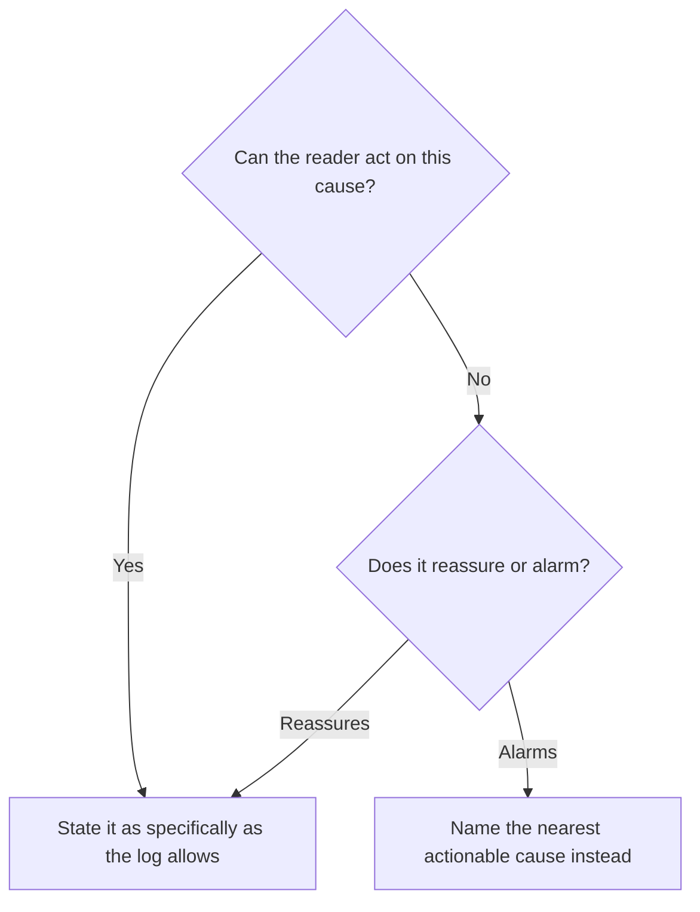

import Scenario from "../../../components/Scenario.astro";
import LevelIntro from "../../../components/LevelIntro.astro";
import Checkpoint from "../../../components/Checkpoint.astro";
import PracticeCheck from "../../../components/PracticeCheck.astro";

export const unit = {
  track: "design",
  unitSlug: "ux-writing-microcopy",
};

<Scenario label="A string left over from a catch block">
  <Fragment slot="facts">
    

      

        
Original

        
"Error: Request failed."

      

      

        
After rewrite

        

          "We couldn't reach the server. Check your connection and try again."
        

      

    

    

      
🐛 The original is a developer placeholder

      
🧭 The rewrite gives a cause category and a next step

      
⚖️ It deliberately does not name the exact failure

    

  </Fragment>

L1 and L2 gave you the shape of a good message and two axes, content and tone. Each was shown on
a single sentence. What does the process look like on a real string, step by step, and what
happens when the axes pull against each other?

</Scenario>

The rewrite above followed a repeatable procedure. This level walks it end to end, applies it to
destructive actions, rate limits, and permission errors, and then looks at the one place where
being fully specific is the wrong call.

<LevelIntro
  items={[
    "A four-step rewrite of a network error",
    "Naming what a destructive action destroys",
    "When the most specific cause is the wrong one to show",
  ]}
/>

## How do you rewrite a raw error string?

**The exception might be a timeout, a failed DNS lookup, or a server error. Which one should the
message name?** None of them. The reader cannot tell them apart and would act the same way on
all three. Name the category that changes what the reader does: is this their connection, or us?

The four steps, applied to "Error: Request failed.":

| Step                   | Question                                  | Result for this string                                                        |
| ---------------------- | ----------------------------------------- | ----------------------------------------------------------------------------- |
| 1. Cause               | Which category changes the reader's move? | "We couldn't reach the server." Neutral: does not say "you are offline"       |
| 2. Impact              | Is the consequence non-obvious?           | No: the screen visibly did not load, so skip it                               |
| 3. Action              | What can the reader do?                   | "Check your connection and try again." A retry is reasonable for this failure |
| 4. Tone against stakes | How much is at risk?                      | A failed page load is annoying, not costly: plain and calm, no warmth needed  |

<Checkpoint question="Run the same four steps on a different failure: the request failed because the reader's session expired while they were filling in a form. How do the cause and impact sentences differ from the network case?">

The connection was fine, so the cause is different: the honest wording is something like "You
were signed out due to inactivity." Step 2 also changes. In the network case the impact was
obvious and skipped. Here, whatever the reader typed may be lost, which is exactly the
non-obvious, costly consequence the triad says to state. The action then depends on the truth: if
progress was saved, say so and ask them to sign in; if it was not, the message must warn them
before they close the tab.

</Checkpoint>

<PracticeCheck
  track={unit.track}
  unitSlug={unit.unitSlug}
  topicId="rewrite-steps"
/>

## What must a destructive-action confirmation say?

**"Are you sure?" asks for a decision. What does the reader need in order to make it?** Two
facts: what exactly will be destroyed, and whether it can be undone.

| Version           | Copy                                                               | Problem or strength                                          |
| ----------------- | ------------------------------------------------------------------ | ------------------------------------------------------------ |
| Generic default   | "Are you sure?"                                                    | Names nothing, states nothing about reversibility            |
| Overly casual     | "Whoops, about to nuke this project! Cool with that? 😅"           | Cheerful tone undersells an irreversible act                 |
| Specific and calm | "Delete 'Q3 Planning' and its 14 documents? This can't be undone." | Names the target, states irreversibility, no blame, no cheer |

(The project name and the count of 14 are made-up example copy, not data.) The good version is
longer because it answers the two questions that matter, not because more words are better.
Rate limits and permission errors work the same way: the cause is nearly the whole message.

| Failure          | Vague                | Better                                                                              |
| ---------------- | -------------------- | ----------------------------------------------------------------------------------- |
| Rate limit       | "Too many requests." | "You have reached the limit of 100 searches per hour. It resets in 12 minutes."     |
| Permission error | "Access denied."     | "Only project admins can delete this board. Ask an admin, or request admin access." |

The permission case shows that an action is not always a button. When the reader cannot fix
the problem alone, the action becomes "who to talk to".

<PracticeCheck
  track={unit.track}
  unitSlug={unit.unitSlug}
  topicId="destructive-confirm"
/>

## When is the most specific cause the wrong one to show?

**Suppose the payment processor reports "suspected fraud: card issuer flagged this transaction".
It is accurate and specific. Should the message say it?** Usually not, and this is the one real
tension in the model.

For a legitimate customer, "Your bank flagged this as possible fraud" reads as an accusation,
which is the hostile failure this unit started with. It is also not actionable: the reader cannot
clear a fraud flag from a checkout page. The better wording keeps the action just as concrete:
"Your bank declined this card. Contact them, or try a different card."

The rule: state the most specific cause the reader can _act on or take comfort from_, not the
most technically complete one in the logs. The softer wording must still be true. Replacing a
cause with an invented one is dishonest, not kind.

| Rule          | Prefer                            | Avoid                           |
| ------------- | --------------------------------- | ------------------------------- |
| Truth         | A shorter true cause              | A comforting false one          |
| Actionability | A cause the reader can respond to | Internal detail they cannot use |

How much does specificity matter? The interactive demo for this unit sketches a deliberately
simplified, illustrative model (not measured data): with a bare "invalid" about 30% of readers
fix the problem alone, rising to about 85% when the message names the exact rule.

<Checkpoint question="A teammate says 'always show the exact error code, it is the most accurate cause'. Using the fraud example, how do you answer?">

Accuracy for the engineer and usefulness for the reader are different goals. The code is the
most complete cause, but the reader cannot act on it and, in the fraud case, may read it as an
accusation. Keep the code available for support (for example, in a small reference line), and
lead with the cause the reader can use. The message is for the person on the screen first.

</Checkpoint>

<PracticeCheck
  track={unit.track}
  unitSlug={unit.unitSlug}
  topicId="cause-choice"
/>

## This is a case, not the whole territory

Everything above used a person reading a screen. **Try extending it:** how would the rate-limit
rewrite change if the reader were a script calling an API? What does "action" mean for a caller
that cannot read prose, and what matters more than a friendly tone, such as the exact reset time
in a machine-readable form? And how would the destructive-confirmation copy change for a
reader on a phone, where the dialog has room for far fewer words?
