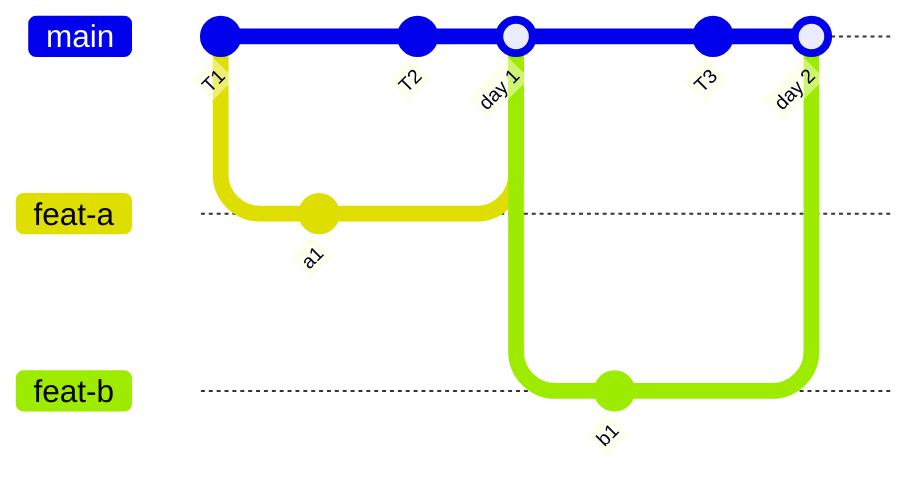
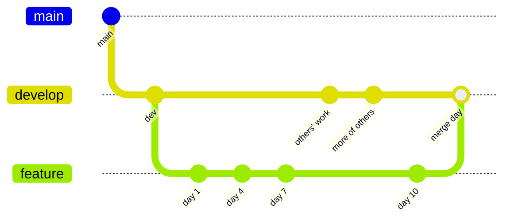
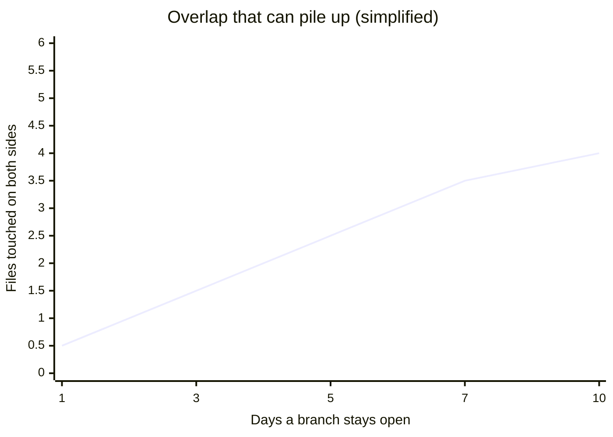
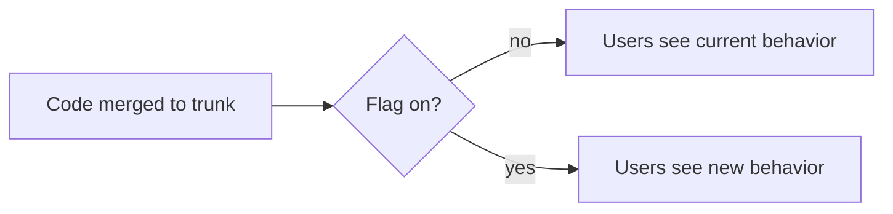

import Scenario from "../../../components/Scenario.astro";
import LevelIntro from "../../../components/LevelIntro.astro";
import PracticeCheck from "../../../components/PracticeCheck.astro";

export const unit = {
  track: "git-teamwork",
  unitSlug: "branching-strategies",
};

<Scenario label="Same 10-day sprint, same 6 hot files, wildly different merge day">
  <Fragment slot="facts">
    

      
🌿 <strong>Team Gitflow</strong> — one feature branch, open the whole 10-day sprint

      
🌳 <strong>Team Trunk</strong> — merges to trunk every day, no branch lives past 24 hours

      
💥 <strong>Merge day</strong> — Team Gitflow hits 4 conflicting files at once; Team Trunk hit none all sprint

    

  </Fragment>

Two teams work on the same 6 frequently-touched files over the same
10-day sprint. Team Gitflow opens one feature branch on day 1 and does
not merge it until day 10. Team Trunk merges to the shared trunk every
day. On merge day, Team Gitflow faces 4 files that were changed on both
sides, a multi-hour conflict-resolution session. Team Trunk never hit
one. **Both teams wrote about the same amount of code in the same files.
What made one integration painless and the other painful?**

</Scenario>

<LevelIntro
  items={[
    "Trunk-based vs. gitflow, defined",
    "Why conflicts track time open, not code volume",
    "Feature flags as the enabler of frequent merges",
  ]}
/>

## Two ways to answer "how long may work stay apart?"

Trunk is the shared line everyone treats as the current integrated
version. A branch is a temporary line of work off it. The only real
question is how long a branch is allowed to live before it is checked
against everyone else's work.

_Trunk-based: each branch lives about a day, so every merge is small._

_Gitflow: the feature branch lives the whole sprint, so everything
others did on `develop` meets it in one merge. Gitflow also adds release
and hotfix branches around `main`, which this picture leaves out._

|                   | Trunk-based                 | Gitflow                     |
| ----------------- | --------------------------- | --------------------------- |
| Branch lifetime   | Hours to a day              | Days to weeks               |
| Conflicts surface | Early, in small pieces      | Late, all at once           |
| Unfinished work   | Hidden behind feature flags | Hidden by the branch itself |

<PracticeCheck
  track={unit.track}
  unitSlug={unit.unitSlug}
  topicId="trunk-vs-gitflow"
/>

## Why did merge day hurt?

Every unmerged branch is a bet that nobody else will touch the same
files before it lands, and the bet worsens each day it is held. Branch
divergence is how much trunk and branch have each changed independently
since they last matched. The cost of a merge follows that divergence,
which grows with time, not with the number of lines written.

Strictly, "both sides touched the same file" is not always a literal Git
conflict, because Git can combine edits in different regions. In this
unit it means integration attention is more likely needed; the `merge`
unit covers the exact rules.

<PracticeCheck
  track={unit.track}
  unitSlug={unit.unitSlug}
  topicId="branch-divergence"
/>

## How can unfinished work live on trunk?

If trunk gets merges every day, half-built features land there too. A
feature flag is a runtime switch that keeps merged code inactive for
users. The code is integrated; the behavior is not released. Without
flags, trunk-based just means shipping unfinished work.

<PracticeCheck
  track={unit.track}
  unitSlug={unit.unitSlug}
  topicId="feature-flags"
/>

## What the next levels cover

L2 works through why delayed discovery makes conflicts costly and how to
pick a strategy for a given team. L3 compares both teams' sprints in a
simple model and finds where the gap stops growing.
