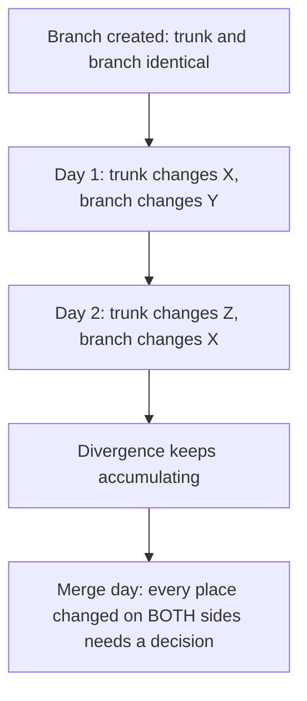
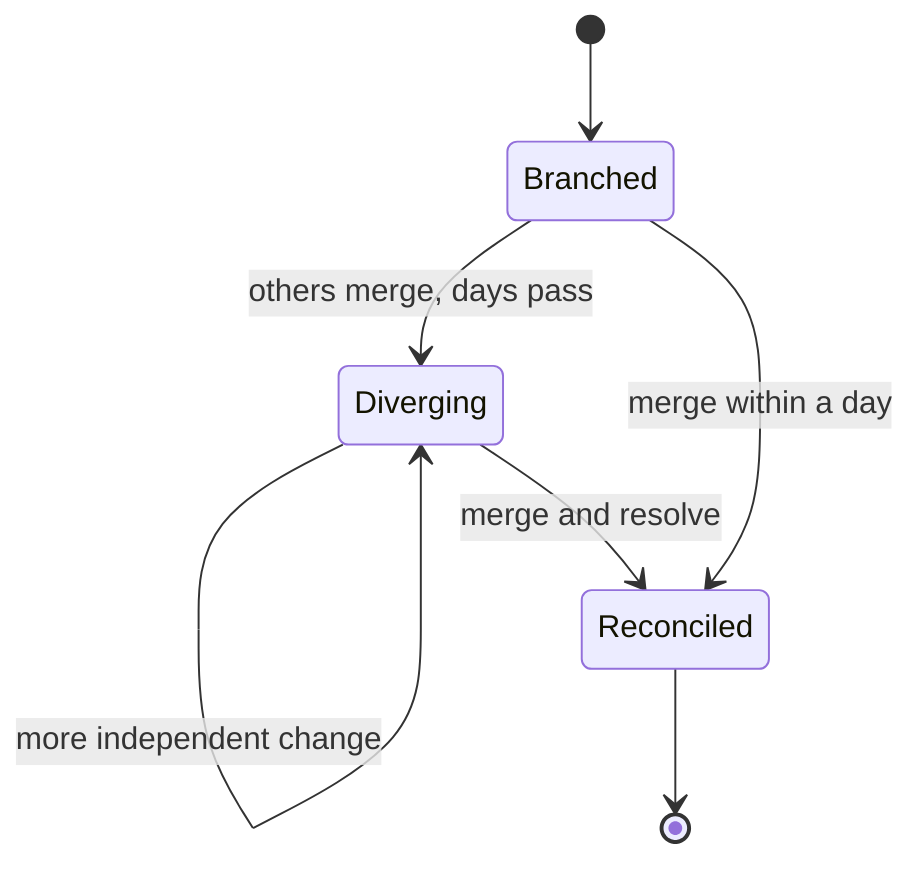

import LevelIntro from "../../../components/LevelIntro.astro";
import Checkpoint from "../../../components/Checkpoint.astro";
import PracticeCheck from "../../../components/PracticeCheck.astro";

export const unit = {
  track: "git-teamwork",
  unitSlug: "branching-strategies",
};

L1 named trunk-based development and gitflow as two answers to how long work may stay unreconciled. L2 works out why that choice moves conflict cost, and what each strategy trades away to get its result.

<LevelIntro
  items={[
    "What accumulates while a branch stays open",
    "Trunk-based vs. gitflow, trait by trait",
    "Choosing a strategy for a given team",
  ]}
/>

## What actually grows while a branch is open?

**If a branch and trunk both keep changing while the branch is
unmerged, what is accumulating?** Not lines of code. It is the set of
places each side has independently changed since they last matched.

The overlap on `X` already exists by day 2. It is only _discovered_ when
the merge happens. A long-lived branch does not create more conflicts by
existing longer; it delays discovery and lets more of them pile up
first.

<Checkpoint question="The overlap on file X was already live by day 2, but nobody found out until merge day. Does merging more often mean fewer conflicts happen, or just that they are found sooner?">

Mostly found sooner, and smaller. Two people can still touch the same
file on the same day whatever the merge cadence. What changes is the
batch size of reconciliation: a conflict found the next day involves one
day of change on each side, fresh in both heads, while the same event
found after ten days has compounded with nine more days of independent
edits. Cadence controls how big each reconciliation is, not whether any
is ever needed.

</Checkpoint>

<PracticeCheck
  track={unit.track}
  unitSlug={unit.unitSlug}
  topicId="delayed-discovery"
/>

## Trunk-based vs. gitflow: what is being traded?

**If trunk-based gives small, early conflicts, why would anyone choose
gitflow?** Because each strategy buys something with what the other
spends.

| Property                 | Trunk-based                            | Gitflow                               |
| ------------------------ | -------------------------------------- | ------------------------------------- |
| Typical branch lifetime  | Hours to a day                         | Days to weeks                         |
| When conflicts are found | Immediately, in small pieces           | At merge time, in one batch           |
| Cost of one merge        | Low: small diff, fresh context         | High: large diff, stale context       |
| Hiding unfinished work   | Needs feature flags                    | The branch itself hides it            |
| Release control          | Release from trunk, often continuously | Dedicated release and hotfix branches |

One naming detail: in classic gitflow, feature branches merge into a
`develop` branch, not straight into `main`; `main` only receives
releases. The divergence problem is the same, just measured against
`develop`.

<Checkpoint question="A teammate says 'our feature branch was huge, that is why merging it hurt.' Is branch size the right diagnosis?">

Not quite. Size correlates with pain but is not the driver. What hurt
was the amount of independent, overlapping change accumulated on both
sides while the branch was open, and that follows time and traffic, not
line count. An enormous branch in files nobody else touches merges
painlessly; a tiny branch left open for three weeks on hot files can
merge badly. The lever is how long code sits unreconciled, not how much
code you write per branch.

</Checkpoint>

<PracticeCheck
  track={unit.track}
  unitSlug={unit.unitSlug}
  topicId="trunk-gitflow-tradeoffs"
/>

## Which strategy fits which team?

**Neither column is correct in the abstract, so what decides?** The
constraints around the team: how reliable its automation is, how
controlled its releases must be, and whether some work must stay hidden.

| Team situation                                        | Usually fits                      | Reason                                                |
| ----------------------------------------------------- | --------------------------------- | ----------------------------------------------------- |
| Strong CI, small PRs, frequent deploys, feature flags | Trunk-based                       | Integrates often without exposing unfinished behavior |
| Release trains, regulated approvals, long QA windows  | Gitflow or release branches       | Needs a stable branch for certification               |
| Major rewrite that must not touch trunk yet           | Longer-lived branch               | Isolation may beat the later reconciliation cost      |
| Many people editing the same modules daily            | Trunk-based, if discipline exists | Keeps overlap small and recent                        |
| People rarely touch the same files                    | Either                            | Little conflict risk to avoid in the first place      |

<PracticeCheck
  track={unit.track}
  unitSlug={unit.unitSlug}
  topicId="strategy-fit"
/>

## What the next level covers

L3 puts numbers on the 10-day scenario with a small model and asks where
the advantage of merging daily stops growing.
