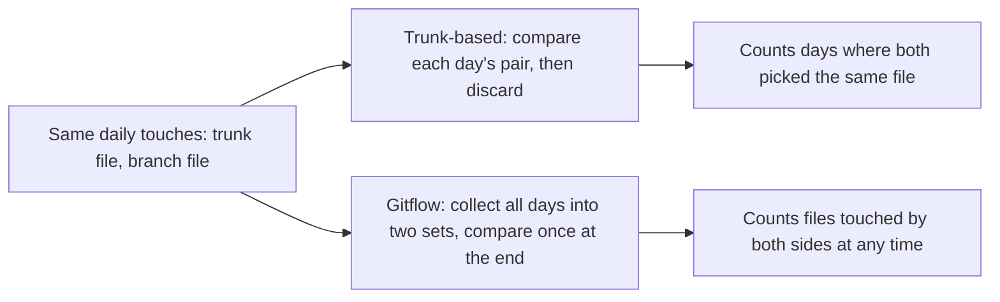
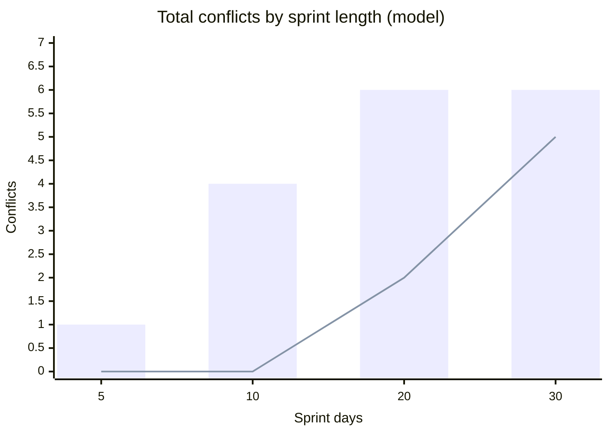

import Scenario from "../../../components/Scenario.astro";
import LevelIntro from "../../../components/LevelIntro.astro";
import Checkpoint from "../../../components/Checkpoint.astro";
import PracticeCheck from "../../../components/PracticeCheck.astro";

export const unit = {
  track: "git-teamwork",
  unitSlug: "branching-strategies",
};

<Scenario label="Same file set, same sprint length, two different merge cadences">
  <Fragment slot="facts">
    

      
🌳 <strong>Trunk-based</strong> — merges daily; each merge risks only that day's overlap

      
🌿 <strong>Gitflow</strong> — one merge at the end; risks the whole sprint's overlap at once

      
🎯 <strong>Goal</strong> — run the identical sprint through both and count conflicts

    

  </Fragment>

Both teams draw from the same 6 hot files. Each day, trunk and the
feature work each touch one file. If trunk-based merges daily and
gitflow merges once at the end, **which accumulates more total
conflicted files over 10 days, and why might the answer change with
sprint length?**

</Scenario>

<LevelIntro
  items={[
    "A daily file-touch model of overlap risk",
    "Same events, different detection windows",
    "Where the gap stops growing",
  ]}
/>

## What does the model count?

This is not a simulator of Git's line-merge algorithm. It is a small
model of overlap risk and merge cadence: how often do both sides touch
the same few hot files before they reconcile? Real Git may merge some
same-file edits cleanly, so read the counts as relative pressure, not
predictions. The `interactives.json` demo on this unit runs the exact
model (fixed random seed, 6 files, one touch per side per day), and
you can drag the sprint length to reproduce every number below.

The two teams see the identical sequence of random file touches. Only
the detection window differs:

<Checkpoint question="Both teams saw exactly the same random file touches. Why does the model give trunk-based 0 conflicts and gitflow 4 over 10 days?">

They count different things from the same raw events. Trunk-based
compares each day's trunk touch only with that day's branch touch, so it
scores a conflict only when the two random picks land on the same one of
6 files that day, a 1-in-6 chance. Gitflow pools every touch from all 10
days into two sets and compares them at the end, so a trunk touch on day
1 and a branch touch on day 7 can still collide even though they were
never compared on any single day. The events are identical; the window
used to detect overlap is what differs.

</Checkpoint>

<PracticeCheck
  track={unit.track}
  unitSlug={unit.unitSlug}
  topicId="detection-window"
/>

## Does the gap keep widening as sprints get longer?

**If longer branches are worse, should the gap grow forever?** No, and
the reason is in how each total is built.

| Sprint days | Trunk-based conflicts | Gitflow conflicts |
| ----------- | --------------------- | ----------------- |
| 5           | 0                     | 1                 |
| 10          | 0                     | 4                 |
| 20          | 2                     | 6                 |
| 30          | 5                     | 6                 |

_Bars: gitflow. Line: trunk-based._

Gitflow's count is capped at the number of hot files, 6, because it
counts distinct files. Trunk-based sums independent daily checks, so it
has no ceiling and keeps climbing. By 30 days the totals are nearly
equal (5 vs. 6). The advantage is large at realistic sprint lengths and
fades once a long branch has already touched nearly every hot file.
That fade belongs to the model's simplification (a fixed small file
set), not a law about real repositories: with hundreds of hot files the
ceiling would sit far away.

<Checkpoint question="At 30 days the model shows 5 vs. 6 conflicts. Does that mean long branches are fine?">

No. The model counts conflicted files, and gitflow saturates because
there are only 6 files to conflict on. It says nothing about how hard
each conflict is to resolve, and a conflict from a month-old change is
far harder to untangle than five found one day after the edit. The
count converging while the per-conflict cost diverges is exactly the
kind of thing a single metric hides.

</Checkpoint>

<PracticeCheck
  track={unit.track}
  unitSlug={unit.unitSlug}
  topicId="gap-ceiling"
/>

## Failure modes

| Failure mode                                 | What it gets wrong                                                                                             |
| -------------------------------------------- | -------------------------------------------------------------------------------------------------------------- |
| Assuming trunk-based means zero conflicts    | It means small, early conflicts, a different distribution of the same overlap                                  |
| Trunk-based without feature flags            | Unfinished code on trunk with no way to keep it inactive is just shipping broken code                          |
| Blaming branch size alone                    | Two branches of equal size differ wildly in risk depending on how long they stayed open and where they touched |
| Treating gitflow's isolation as always worse | Security-sensitive work or a major rewrite may need real isolation                                             |
| Ignoring the team's actual overlap pattern   | Where people rarely touch the same files, neither strategy buys much                                           |

## The worked example is a case, not the whole territory

The 10-day, 6-file sprint is one point in a large space. Try extending it
yourself:

- What changes if there are 60 hot files instead of 6? Where would
  gitflow's ceiling move, and would the trunk-based advantage last
  longer?
- What if the team merges every 3 days instead of daily or never? Where
  does that land between the two extremes?
- What if one of the files is touched by trunk every single day, such as
  a shared config? How does that change which strategy hurts more?
- What if the two sides' work is coordinated, so they avoid each other's
  files? Does the model still say anything useful?
