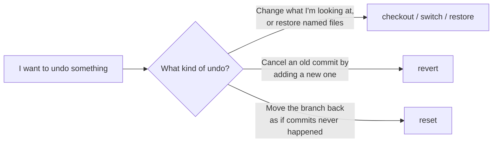

import Scenario from "../../../components/Scenario.astro";
import LevelIntro from "../../../components/LevelIntro.astro";
import PracticeCheck from "../../../components/PracticeCheck.astro";

export const unit = {
  track: "git-teamwork",
  unitSlug: "checkout",
};

<Scenario>
  <Fragment slot="facts">
    

      

        1 file
        intended to touch
      

      

        

      

      

        2 files
        actually wiped
      

      

        

      

    

    

      
🎯 Wanted: undo <code>config.json</code> only

      
💥 Ran a whole-directory command instead

      
😱 Three hours of uncommitted <code>feature.js</code> work: gone

    

    
The three verbs

    

      
🔀 <code>checkout</code> — move HEAD, or restore files

      
⏪ <code>revert</code> — new commit, history untouched

      
⚠️ <code>reset --hard</code> — overwrites, no undo

    

  </Fragment>

You broke `config.json` with a bad edit. `feature.js`, sitting right next to
it in the same working directory, has three hours of good, uncommitted work
you haven't touched yet. You want to undo _just_ `config.json`.

You type `git checkout .` — a dot for "the current directory" — expecting it
to restore the one broken file. Instead, both files snap back to their
last-committed state. `feature.js`'s three hours are gone, with no
confirmation prompt and no undo.

| What you meant          | What you typed   | What actually happened                             |
| ----------------------- | ---------------- | -------------------------------------------------- |
| Undo `config.json` only | `git checkout .` | Every uncommitted change in the directory reverted |

**The command did exactly what it says — restore everything in the current directory to its last-committed state. The mistake wasn't the tool malfunctioning; it was not knowing that `checkout .` is scoped to the whole directory, not the one file you had in mind. What exact file path, used instead of the dot, would have saved `feature.js`?**

</Scenario>

The fix (`git checkout -- config.json`, naming the file) was one path away.
The danger wasn't the command family; it was not knowing which of three
genuinely different operations you were invoking, or how wide its scope was.
Note that `--` only tells Git "what follows is a path". It does not make `.`
safe: `git checkout -- .` still means "restore everything under this
directory."

<LevelIntro
  items={[
    "Three undo verbs: checkout, revert, reset",
    "History that is rewritten vs. history that grows",
    "Scope: the pause before any undo",
  ]}
/>

## Why does "undo" have three different commands?

Because "undo" hides three different questions: _where am I standing?_,
_what does the branch say happened?_, and _what do my files look like right
now?_ Each verb answers a different one.

- **`checkout`** moves your working position (HEAD), or restores specific
  files from a commit. History is untouched.
- **`revert`** creates a _new_ commit that cancels an old one. History only
  grows.
- **`reset`** moves the branch pointer backward, optionally rewriting the
  staging area and working directory too. This is the one that _rewrites_
  history.
- Rewriting vs. adding matters the moment a branch is shared: rewritten
  history that others already pulled creates conflicts for everyone.

<PracticeCheck
  track={unit.track}
  unitSlug={unit.unitSlug}
  topicId="three-verbs"
/>

## What is the pause that would have saved `feature.js`?

The scenario's mistake wasn't recklessness, it was an unread scope. The
habit is four short steps, in this order:

1. Run `git status` and read which files are at risk.
2. If you do not understand the output, do not use `--hard`, `.`, or any
   whole-directory restore.
3. If the mistake is already pushed or shared, prefer `revert`.
4. If you mean one file, name that exact file.

| Command                          | What it moves                | Rewrites history? | Recoverable if wrong?                     |
| -------------------------------- | ---------------------------- | ----------------- | ----------------------------------------- |
| `checkout <branch>`              | HEAD, working directory      | No                | Yes, just check out the other branch back |
| `checkout -- <file>` / `restore` | One or more named files      | No                | Only if the file was previously committed |
| `revert <commit>`                | Nothing, adds a new commit   | No (append-only)  | Yes, revert the revert                    |
| `reset --soft` / `--mixed`       | Branch pointer (+ staging)   | Yes (locally)     | Yes, via `reflog`                         |
| `reset --hard`                   | Branch pointer + working dir | Yes (locally)     | Only for already-committed content        |

The most dangerous cell in that table is the last row. `git reset --hard` on
a working directory with uncommitted changes discards them silently, with no
prompt and no undo. Everything else here has a recovery path; that
combination often does not.

<PracticeCheck
  track={unit.track}
  unitSlug={unit.unitSlug}
  topicId="file-scope-restore"
/>
