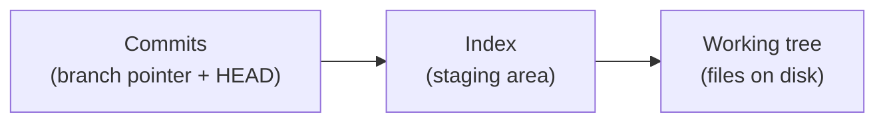
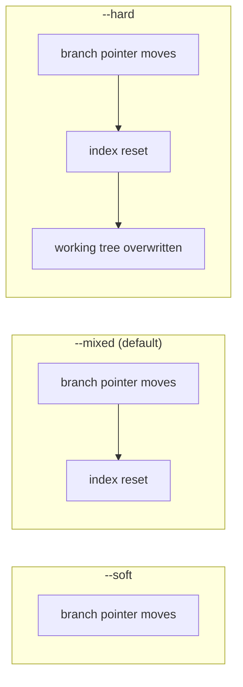
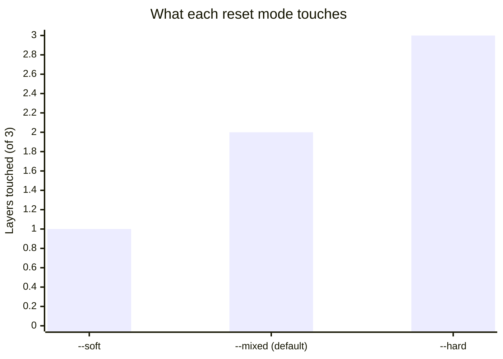
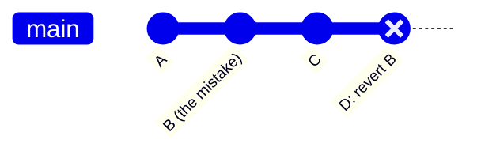

import LevelIntro from "../../../components/LevelIntro.astro";
import Checkpoint from "../../../components/Checkpoint.astro";
import PracticeCheck from "../../../components/PracticeCheck.astro";

export const unit = {
  track: "git-teamwork",
  unitSlug: "checkout",
};

L1 named the three verbs and the one mistake that conflates them:
`checkout .` silently restoring a whole directory instead of the one file
you meant. L2 works out precisely what each command moves, so "which one am
I actually invoking" stops being a guess.

<LevelIntro
  items={[
    "What each verb moves: HEAD, index, working tree",
    "checkout's three look-alike behaviors",
    "The sharing question: reset vs. revert",
  ]}
/>

## Three places state lives: which verb touches which?

Before any diagram, a question: if "undo" can mean putting your files back,
putting your staged changes back, or putting the branch back, how many
separate places is Git keeping state in?

Three, and every undo command is defined by how far along that chain it
reaches. Vocabulary for the rest of the page:

| Word           | Plain meaning                                                            |
| -------------- | ------------------------------------------------------------------------ |
| `HEAD`         | The commit your working copy is currently looking at                     |
| Branch pointer | The movable label, like `main`, that says which commit is the branch tip |
| Index          | The staging area: the prepared set of changes for the next commit        |
| Working tree   | The actual files on disk, including uncommitted edits                    |
| Reflog         | Git's local diary of where `HEAD` and branch pointers recently moved     |

| Command                  | Moves branch pointer / HEAD  | Rewrites index | Overwrites working tree | Safe on shared history? |
| ------------------------ | ---------------------------- | -------------- | ----------------------- | ----------------------- |
| `checkout <branch>`      | HEAD moves, branch unchanged | Yes            | Yes (to that branch)    | Yes                     |
| `checkout -- <file>`     | No                           | No             | Only that file          | Yes                     |
| `reset --soft <commit>`  | Yes                          | No             | No                      | No                      |
| `reset --mixed <commit>` | Yes                          | Yes            | No                      | No                      |
| `reset --hard <commit>`  | Yes                          | Yes            | Yes                     | No                      |
| `revert <commit>`        | Adds a new commit            | Yes            | Yes (applies inverse)   | Yes                     |

`reset` moves where the branch label points. History before that point
doesn't vanish, it just becomes unreachable from the branch (still in the
object store until garbage collected, which is why `reflog` recovery often
works). `revert` never moves anything backward: it looks at what an old
commit changed and creates a brand-new commit that changes it back.
`checkout` moves _your working position_, not history at all.

<PracticeCheck
  track={unit.track}
  unitSlug={unit.unitSlug}
  topicId="what-each-verb-moves"
/>

## `checkout` does three unrelated-looking things: what tells them apart?

Only the argument that follows it, which is exactly why `checkout .` and
`checkout -- config.json` behave so differently despite looking similar:

| What follows `checkout`    | What it actually does                                         | Modern equivalent              |
| -------------------------- | ------------------------------------------------------------- | ------------------------------ |
| A branch name              | Moves HEAD to that branch, updates working dir                | `git switch <branch>`          |
| A commit hash              | Moves HEAD to that commit, detached (no branch)               | `git switch --detach <commit>` |
| `-- <file>` or a bare path | Restores that file from the index (or from a commit you name) | `git restore <file>`           |

Git 2.23 split `checkout` into `switch` (branches and commits) and `restore`
(files) because one verb with three different-shaped behaviors was a real,
common source of the exact mistake in L1.

<Checkpoint question="Given that checkout's behavior depends entirely on what argument follows it, why did Git 2.23 introduce switch and restore instead of just documenting checkout's three behaviors more clearly?">

Better documentation doesn't remove the actual risk, which is that the
same typed word can mean three structurally different things depending on
an argument that's easy to get wrong under pressure. That is what happened
in L1, where `.` was meant as "nothing in particular" but Git read it as
"every file in this directory." `switch` only ever moves HEAD between
branches or commits, and `restore` only ever touches file contents, so
splitting the verb makes it impossible to cross from one category of
mistake into the other, which no documentation on a single overloaded
command can guarantee.

</Checkpoint>

<PracticeCheck
  track={unit.track}
  unitSlug={unit.unitSlug}
  topicId="checkout-three-behaviors"
/>

## Reset's three modes: how far down the chain does each one reach?

`--mixed` is the default because it's a middle ground: useful (it unstages
what you staged by mistake) without touching file contents on disk, which is
why bare `git reset <commit>` feels safe in practice while `--hard` never
does. Each mode is a strict superset of the previous one's effect.

In practice: after `--soft`, your changes are still staged and ready to
recommit (handy to squash recent commits). After `--mixed`, the same edits
are still on disk but unstaged. After `--hard`, they are gone from disk too.

<Checkpoint question="A teammate has already pulled a commit you now want to undo with reset --mixed. Does --mixed being the 'safer, non-destructive-to-files' default mean it's also safe to use on that shared commit?">

No. `--mixed` only promises that _your own_ working-directory files stay
untouched. It says nothing about the branch pointer itself, and moving the
branch pointer backward is exactly what rewrites history. Once a teammate
has already pulled the commit you're moving away from, their copy and your
rewritten branch disagree, regardless of which reset mode got you there.
"Safer to your files" and "safe to run on shared history" are two different
guarantees, and only the first one is true of `--mixed`.

</Checkpoint>

<PracticeCheck
  track={unit.track}
  unitSlug={unit.unitSlug}
  topicId="reset-modes"
/>

## Why is `revert` the safe default once history is shared, when `reset` feels simpler?

`reset` feels simpler because it's one step. The cost only shows up once
someone else already has a copy of the history being erased. What happens to
their copy?

After `revert`, the mistake (B) is still visibly there: D is a new commit
whose diff is the exact inverse of B's. Anyone who already pulled A, B, C
keeps working with no conflict, because nothing they already have was
rewritten. Compare `reset`ting the branch back to A: anyone who already
pulled B and C now has commits their remote no longer has any record of, and
the next sync produces exactly the "diverged history" mess that gives
force-pushing its bad reputation.

The deciding question is not "how destructive is the command" in the
abstract. It is "has anyone else possibly already seen this commit?"

| Is the target commit already pushed/shared?               | Safe choice                          | Why                                                   |
| --------------------------------------------------------- | ------------------------------------ | ----------------------------------------------------- |
| No, only on your local branch                             | `reset` (any mode) is fine           | Nobody else has a copy of the history you're changing |
| Yes, others may have already pulled it                    | `revert`                             | Adds new history instead of rewriting shared history  |
| Yes, but the team explicitly coordinated a rewrite (rare) | `reset` + force-push, with agreement | The exception, not the default; everyone must re-sync |

One caveat: `reset --hard` on a purely local commit is safe for _history_,
yet still unsafe for your _files_ if the working tree holds uncommitted
work. Run `git status` first. Try the demo below: as the number of teammates
who've already pulled a commit grows, watch what a `reset` + force-push
costs in cleanup time compared to `revert`, which stays flat.

<PracticeCheck
  track={unit.track}
  unitSlug={unit.unitSlug}
  topicId="revert-vs-reset-shared"
/>
