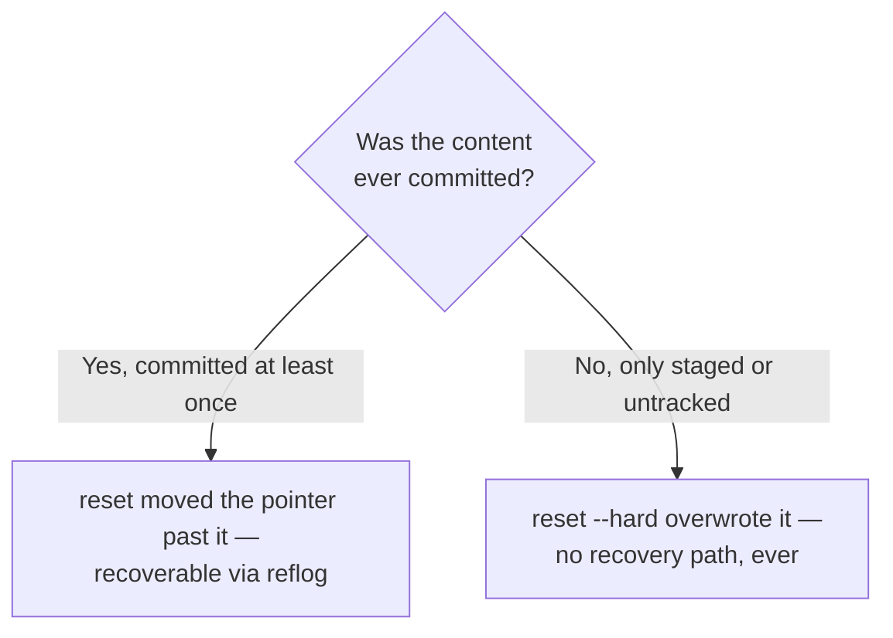
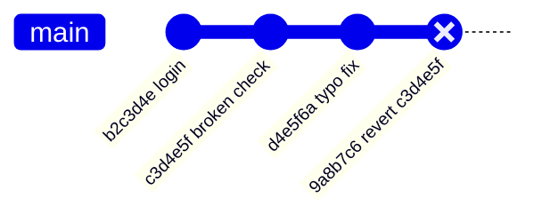

import Scenario from "../../../components/Scenario.astro";
import LevelIntro from "../../../components/LevelIntro.astro";
import Checkpoint from "../../../components/Checkpoint.astro";
import PracticeCheck from "../../../components/PracticeCheck.astro";

export const unit = {
  track: "git-teamwork",
  unitSlug: "checkout",
};

<Scenario label="The scenario">
  <Fragment slot="facts">
    <div class="not-prose flex flex-col gap-1.5 text-sm text-slate-700 dark:text-slate-300">
      <div class="flex items-center gap-1.5"><span>1️⃣</span> File-scoped restore — one broken file, one good file nearby</div>
      <div class="flex items-center gap-1.5"><span>2️⃣</span> <code>reset --hard</code> — a staged, never-committed file, deleted for good</div>
      <div class="flex items-center gap-1.5"><span>3️⃣</span> <code>revert</code> on a shared branch — the mistake stays visible, teammates unaffected</div>
    </div>
    <p class="not-prose mt-3 mb-1 text-xs font-semibold tracking-wide text-slate-400 uppercase">Recoverable?</p>
    <div class="not-prose grid grid-cols-2 gap-2 text-xs">
      <div class="rounded border border-emerald-300 bg-emerald-50 p-1.5 dark:border-emerald-800 dark:bg-emerald-950">
        <p class="font-semibold text-emerald-600 dark:text-emerald-400">Committed, then reset</p>
        Reflog can usually recover it
      </div>
      <div class="rounded border border-rose-300 bg-rose-50 p-1.5 dark:border-rose-800 dark:bg-rose-950">
        <p class="font-semibold text-rose-600 dark:text-rose-400">Never committed, then reset --hard</p>
        No recovery path — reflog never saw it
      </div>
    </div>

  </Fragment>

Three real sessions, in order: a safe file-scoped restore, an unrecoverable
`reset --hard`, and a `revert` on a branch teammates have already pulled.
Watch what's recoverable and what isn't, and why — the difference isn't how
scary the command looks, it's whether the content was ever captured in a
commit at all.

</Scenario>

Before the three sessions: the branching question that decides recoverability
in every case below is never "how scary did the command look," it's whether
the content was ever captured by a commit at all.



<LevelIntro
  items={[
    "File-scoped restore vs. the unrecoverable reset --hard",
    "revert on a shared branch, from a teammate's view",
    "Failure modes and the undo decision table",
  ]}
/>

## Restoring a single file without touching anything else

This is the fix L1 was missing: naming the file turns a whole-directory
operation into a one-file one.

```
$ git status
  modified:   config.json    <- accidentally broken
  modified:   feature.js     <- good work, keep this

$ git checkout HEAD -- config.json
$ git status
  modified:   feature.js
```

Only `config.json` returned to its last-committed state; `feature.js`'s
edits were untouched, because a path-scoped checkout (or the modern
`git restore <file>`) targets exactly the named file.

## `reset --hard`: why is it unrecoverable for some content and not others?

**Before the transcript: if the file below had been committed once, even to a throwaway local commit, would `reset --hard` still be unrecoverable?** Keep that in mind for the reflog output.

Run commands like this only in a practice repository. In a real project,
`git reset --hard` deletes uncommitted work without a prompt.

```
$ git add notes.txt          # new file, staged, never committed
$ git reset --hard HEAD
$ cat notes.txt
cat: notes.txt: No such file or directory

$ git reflog
d4e5f6a HEAD@{0}: reset: moving to HEAD
d4e5f6a HEAD@{1}: commit: Fix typo in README
```

The reflog holds two entries about the branch pointer's own position and
nothing about `notes.txt`. It only helps recover _commits_, not uncommitted
working-directory content. The deciding factor is whether the content was
ever captured by a commit at all, not how scary the command looked.

<Checkpoint question="The reflog above only shows two entries about the branch pointer's own position, nothing about notes.txt. If notes.txt had been committed once before that reset --hard, would the situation look different, and what does that say about what 'recoverable' means here?">

Yes. The reflog records where `HEAD` and branch pointers have moved, not
file contents in general. A file that was committed at least once has its
content preserved inside that commit object, and the commit would still
appear as a `HEAD@{n}` entry even after `reset --hard` moved the pointer
past it, so checking out that entry would bring the file back. A file that
was only staged or untracked was never wrapped in a commit, so there is
nothing for the reflog to point back to. "Recoverable" here means "captured
in a commit somewhere," not "less risky-looking."

</Checkpoint>

<PracticeCheck
  track={unit.track}
  unitSlug={unit.unitSlug}
  topicId="recoverability-reflog"
/>

## `revert` on a shared branch: what do teammates see?

```
$ git revert c3d4e5f
[main 9a8b7c6] Revert "Add broken rate-limit check"

$ git log --oneline
9a8b7c6 (HEAD -> main) Revert "Add broken rate-limit check"
d4e5f6a Fix typo in README
c3d4e5f Add broken rate-limit check      <- still visible
b2c3d4e Add login endpoint
```



The broken commit stays fully visible; anyone who already pulled it keeps a
consistent view and simply pulls one more commit that cancels it out.
Nobody's local history conflicts with anyone else's, because nothing was
rewritten.

| &nbsp;                                | `reset` to before the mistake                     | `revert` the mistake               |
| ------------------------------------- | ------------------------------------------------- | ---------------------------------- |
| Commits after the mistake             | Orphaned locally, vanish from anyone who re-pulls | Untouched, still there             |
| What teammates who already pulled see | A history that no longer matches theirs: conflict | One extra commit, arrives normally |
| Mistake still visible in log?         | No                                                | Yes (reverted, not erased)         |

<Checkpoint question="After the revert, commit c3d4e5f is still sitting in git log, hash and all. What's the difference between 'the mistake is fixed' after a revert versus after a reset: is the broken code gone from history either way?">

No. Only `reset` removes it from the branch's reachable history (and even
then not permanently, since it lingers in the object store until garbage
collected). `revert` never removes anything: `c3d4e5f` stays visible,
checkoutable, and diffable alongside the new commit that cancels its
effect. "Fixed" after a revert means the current state of the files no
longer has the bug, not that the bug's commit stops existing. That is
exactly why `revert` is safe on a shared branch: nothing anyone already
pulled gets erased from under them.

</Checkpoint>

<PracticeCheck
  track={unit.track}
  unitSlug={unit.unitSlug}
  topicId="revert-teammate-view"
/>

## Failure modes: where do undos go wrong in practice?

The decision from L2 compresses into one table, and each failure mode below
is a way of skipping a row of it.

| Situation                                       | Right move                         |
| ----------------------------------------------- | ---------------------------------- |
| Mistake only in your working tree, one file     | `restore` / `checkout -- <file>`   |
| Bad commit, never pushed                        | `reset` (check `git status` first) |
| Bad commit, already pushed and pulled by others | `revert`                           |
| Bad commit, team has agreed to rewrite          | `reset` + coordinated force-push   |

- **Running `reset --hard` to "clean up" without checking `git status`.** The
  command doesn't ask whether the working directory holds anything
  valuable. The prevention is the same habit as in
  `git-teamwork/snapshots-manual-copies`: check status before any command
  that could discard state.
- **Force-pushing after a `reset` on a branch others already pulled, without
  warning anyone.** Even a coordinated rewrite needs everyone to re-sync;
  a silent force-push just relocates the confusion to whoever pulls next.
- **Committing on a detached HEAD by accident** (after `checkout <hash>`).
  The new commits are reachable from no branch. Reflog can usually recover
  them for a while, but they are not part of any branch until you attach
  them.
- **Using `revert` on a purely local, never-pushed commit.** It works, but
  leaves a confusing revert pair in history for something a clean `reset`
  would have removed before anyone saw it. The safety `revert` buys only
  matters once sharing is in play.

<PracticeCheck
  track={unit.track}
  unitSlug={unit.unitSlug}
  topicId="undo-failure-modes"
/>

## Beyond these cases

The sessions above are worked cases, not the whole territory. Questions to
check whether the model actually transferred:

- The `notes.txt` example was a single untracked file. What changes if
  `reset --hard` runs against a dozen modified files, half staged and half
  not, some of them committed earlier in the session? Does "never
  committed = unrecoverable" still apply file by file?
- The decision table only considers whether a commit is pushed and whether
  the team agreed to a rewrite. If you added "how many minutes ago it was
  pushed," would it change the choice, or should it not matter at all?
  What's the argument either way?
- What if the commit you need to undo is a _merge_ commit? Which of the
  three verbs gets harder to reason about, and why?
