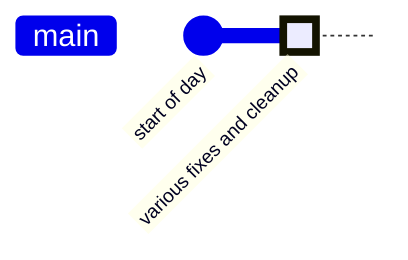
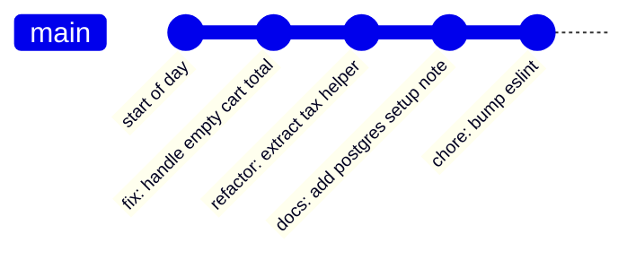

import Scenario from "../../../components/Scenario.astro";
import LevelIntro from "../../../components/LevelIntro.astro";
import PracticeCheck from "../../../components/PracticeCheck.astro";

export const unit = {
  track: "git-teamwork",
  unitSlug: "commit-conventions",
};

<Scenario label="Bisect found the commit. It still took two hours.">
  <Fragment slot="facts">
    

      
🐛 <strong>The bug</strong> — a production regression, cause unknown

      
🔍 <strong>git bisect</strong> — correctly narrows it to one specific commit

      
📦 <strong>That commit</strong> — titled "various fixes and cleanup," touching 14 files

    

  </Fragment>

A production bug appears with no obvious cause. An engineer runs `git
bisect`, which does exactly what it is supposed to do: it narrows the
search down to a single commit. That commit is titled "various fixes and
cleanup" and touches 14 files, bundling a dozen unrelated changes made over
an afternoon. Finding the line responsible still takes two more hours of
reading the diff. **`git bisect` did its job. Why didn't that solve the
problem?**

</Scenario>

<LevelIntro
  items={[
    "What an atomic commit is",
    "What a conventional message looks like",
    "Why bisect needs atomicity to be useful",
  ]}
/>

## What did bisect actually hand back?

**Is "the commit where it broke" the same thing as "the change that broke
it"?** Only if the commit holds one change. Compare the same afternoon of
work saved two ways:

Bisect can only ever point at a box in this picture. In the first history
the box contains everything; in the second, each box is one idea.

<PracticeCheck
  track={unit.track}
  unitSlug={unit.unitSlug}
  topicId="atomic-commit"
/>

## The shape of the problem

| Commit shape | Example message                            | What a future reader learns                                     |
| ------------ | ------------------------------------------ | --------------------------------------------------------------- |
| Atomic       | `fix: handle empty cart total`             | One bug fix about empty carts                                   |
| Atomic       | `docs: add setup note for local postgres`  | Documentation only                                              |
| Bundle       | `various fixes and cleanup`                | Almost nothing; open every changed file to learn the scope      |
| Bundle       | `feat: checkout updates` touching 14 files | Maybe a feature, maybe cleanup, maybe fixes, all mixed together |

The fix is not a smarter bisect. It is committing so that finding _the
commit_ is the same as finding _the change_.

## Key terms

- **Atomic commit** — exactly one logical change, complete and coherent on
  its own. It is about coherence, not about size.
- **Conventional commit** — a message shaped `type: short description`,
  such as `fix: correct off-by-one in pagination`, so history can be
  scanned without opening diffs.
- **git bisect** — a binary search over history: test the midpoint, answer
  "good or bad?", discard half, repeat.
- **Revert** — a new commit that undoes an earlier commit, leaving history
  intact.

## What the next levels cover

L2 shows how bisect's search narrows, what each commit type signals, and
why atomicity decides whether bisect's answer is actionable. L3 traces
bisect step by step on an atomic and a bundled history, then stress-tests
the idea with cases the example does not cover.
