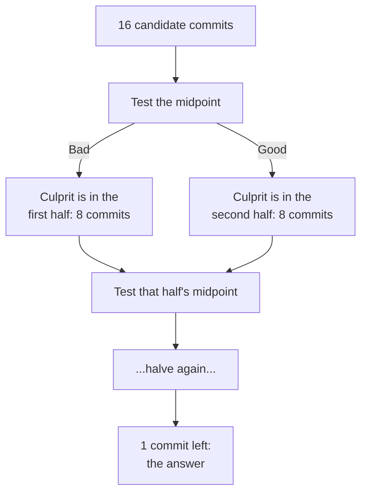
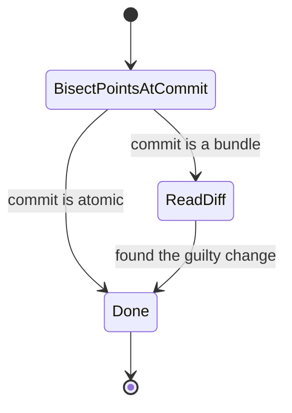

import LevelIntro from "../../../components/LevelIntro.astro";
import Checkpoint from "../../../components/Checkpoint.astro";
import PracticeCheck from "../../../components/PracticeCheck.astro";

export const unit = {
  track: "git-teamwork",
  unitSlug: "commit-conventions",
};

L1 named the problem: `git bisect` finds a commit, but a bundled commit
leaves a manual search inside it. L2 works out how bisect narrows down to
that commit, what a good message adds, and exactly why atomicity turns
"bisect found it" into "the investigation is done."

<LevelIntro
  items={[
    "How bisect's binary search narrows a range",
    "What each commit type and message signals",
    "Why atomic commits make every later task easier",
  ]}
/>

## How many commits does bisect really have to test?

**If 16 commits sit between the last known-good state and now, does bisect
test all 16?** No. It halves the remaining candidates at every step, like
finding a name in a sorted list.

Doubling the history adds exactly one test. That is why bisect stays
practical across years of commits.

<Checkpoint question="History grows from 16 commits to 128 between the last known-good state and now. Roughly how many more tests does bisect need, and why isn't it 8 times as many?">

Only 3 more: 4 tests for 16 commits versus 7 for 128. Each test halves the
remaining range no matter how large it is, so the count grows with the
exponent of the history size, not with the size. An 8x bigger haystack costs
a few extra tests, not 8x the work.

</Checkpoint>

<PracticeCheck
  track={unit.track}
  unitSlug={unit.unitSlug}
  topicId="bisect-binary-search"
/>

## What does a commit type tell you before you open the diff?

**Once bisect points at one commit, what makes it fast to understand?** A
message that states what kind of change it is:

| Type       | What it means                                       |
| ---------- | --------------------------------------------------- |
| `feat`     | A new feature or capability                         |
| `fix`      | A bug fix                                           |
| `refactor` | A change to code structure with no behavior change  |
| `docs`     | Documentation only                                  |
| `test`     | Adding or changing tests, no production code change |
| `chore`    | Tooling, dependencies, or other maintenance work    |

An optional scope narrows it (`fix(cart): handle empty total`), and a `!`
before the colon (`feat(api)!: drop v1 endpoints`) flags a breaking change
so release tooling can see it. The type is a promise about the diff: a
`refactor` that changes behavior is a lie that misleads every later reader.

<PracticeCheck
  track={unit.track}
  unitSlug={unit.unitSlug}
  topicId="conventional-types"
/>

## What separates a useful message from a vague one?

**Two commits both start with `fix:`. Why is one searchable and the other
not?**

| Team habit                               | Why it matters later                                                    |
| ---------------------------------------- | ----------------------------------------------------------------------- |
| One idea per commit                      | Bisect, review, and revert can point at one coherent change             |
| Specific description, not vague activity | `fix: reject expired invite token` is searchable; `fix: updates` is not |
| Type matches intent                      | A behavior fix belongs under `fix`, not hidden in `chore`               |
| Split unrelated work                     | Formatting, dependency bumps, and logic age better apart                |

The first line should finish the sentence "this commit will..." in the
imperative mood, short enough to read in a one-line log. Details of _why_
belong in the body below it.

<PracticeCheck
  track={unit.track}
  unitSlug={unit.unitSlug}
  topicId="message-habits"
/>

## Why does atomicity decide whether bisect's answer is actionable?

**If bisect points at the right commit, why isn't that enough?** Because
the answer is only as useful as what the commit contains. A commit bundling
twelve unrelated changes gives bisect one thing to point at, and finding
which of the twelve broke things is the manual search bisect was meant to
replace.

|                                 | Atomic commits                   | Bundled commits                                       |
| ------------------------------- | -------------------------------- | ----------------------------------------------------- |
| What bisect points to           | One logical change               | One commit holding several unrelated changes          |
| Work left after bisect finds it | None: the commit _is_ the change | Read the whole diff to isolate the culprit            |
| Commit message                  | Describes exactly what changed   | Vague, because it covers unrelated ground             |
| Reverting just the bad change   | `git revert` on that one commit  | Not cleanly possible: the good changes come along too |

<Checkpoint question="A teammate says: 'bisect pointed straight at the commit, so we're done.' When is that true, and when is it false?">

It is true only when that commit is atomic, so the commit _is_ the change
bisect was looking for. It is false once the commit bundles unrelated work:
bisect's job (which commit) and the team's job (which line inside a 14-file
diff) are two different searches, and bisect only solves the first. The
manual diff-reading just moves one level deeper.

</Checkpoint>

<PracticeCheck
  track={unit.track}
  unitSlug={unit.unitSlug}
  topicId="atomic-payoff"
/>

## Is this only about finding bugs?

No. Anyone who later has to understand or undo one change benefits:

| Later task          | What good commits make easier                                                |
| ------------------- | ---------------------------------------------------------------------------- |
| Code review         | The reviewer asks "is this one change correct?" instead of untangling a pile |
| Bad deploy rollback | `git revert` undoes one bad change without dragging good ones with it        |
| Release notes       | `feat`, `fix`, and `docs` messages summarize without rereading diffs         |

The `checkout` unit covers moving around history without confusing that
with rewriting it.
