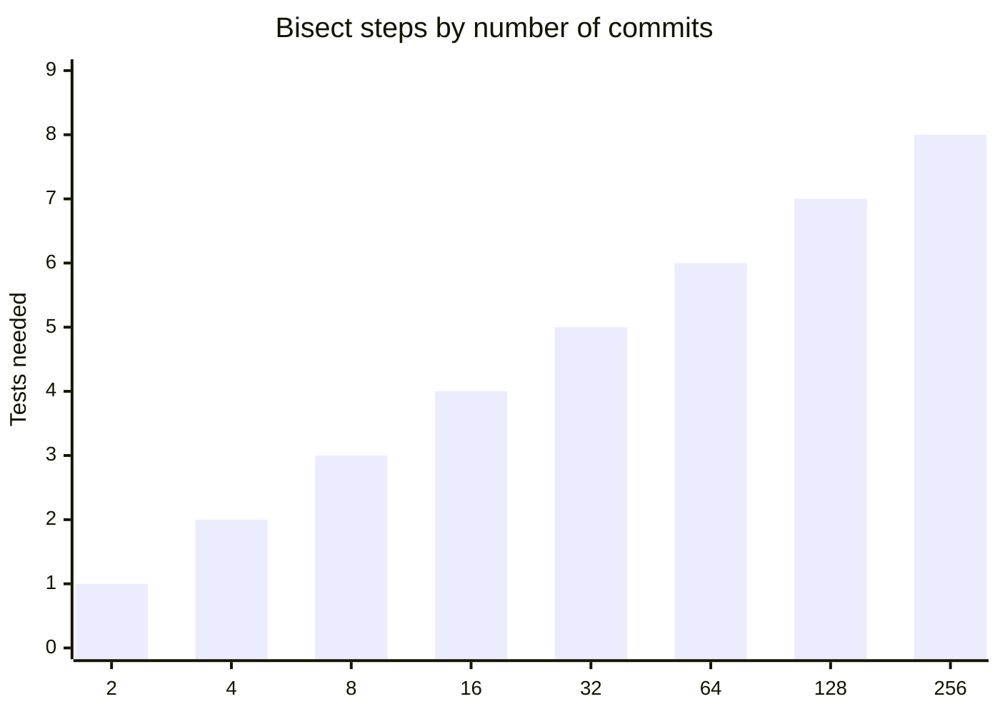
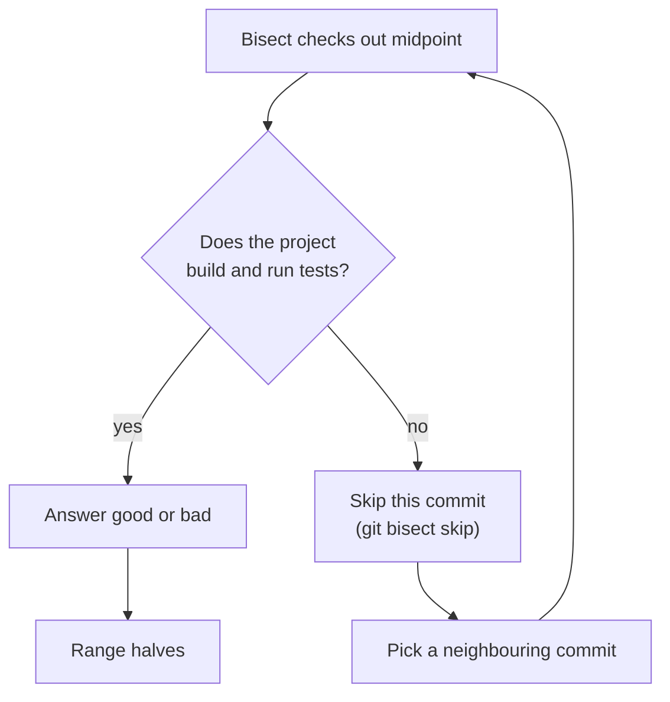

import Scenario from "../../../components/Scenario.astro";
import LevelIntro from "../../../components/LevelIntro.astro";
import Checkpoint from "../../../components/Checkpoint.astro";
import PracticeCheck from "../../../components/PracticeCheck.astro";

export const unit = {
  track: "git-teamwork",
  unitSlug: "commit-conventions",
};

<Scenario label="Same bug, two different commit histories">
  <Fragment slot="facts">
    

      
✅ <strong>Atomic history</strong> — 16 commits, one logical change each

      
📦 <strong>Bundled history</strong> — 8 atomic commits, plus 1 mega-commit covering what should have been 8 more

      
🎯 <strong>Goal</strong> — trace bisect on both and compare what it hands back

    

  </Fragment>

**Predict before reading on: bisect on 16 atomic commits needs about
`log2(16) = 4` tests. If 8 of those 16 changes get bundled into one
mega-commit (9 commits total), roughly how many tests will bisect need, and
will its answer still be as useful?**

</Scenario>

<LevelIntro
  items={[
    "A step-by-step bisect trace on both histories",
    "Why fewer steps is not a better outcome",
    "Where the atomic rule bends or breaks",
  ]}
/>

## What does bisect do on the atomic history?

Commits `c0` to `c15`, with `c0` known good, `c15` bad, and the bug introduced
at `c11`. Each step tests the middle of the remaining range:

| Step | Remaining range | Commit tested | Result | Next range   |
| ---- | --------------- | ------------- | ------ | ------------ |
| 1    | `c0`..`c15`     | `c7`          | good   | `c8`..`c15`  |
| 2    | `c8`..`c15`     | `c11`         | bad    | `c8`..`c11`  |
| 3    | `c8`..`c11`     | `c9`          | good   | `c10`..`c11` |
| 4    | `c10`..`c11`    | `c10`         | good   | `c11`        |

Four steps, matching `log2(16)`, and the answer is `c11`. Because every
commit is one logical change, `c11` is not just where the bug shows up: it
_is_ the change that caused it.

<Checkpoint question="Bisect returned c11 after 4 steps. Is any further investigation needed to know what caused the bug?">

No. `c11` holds exactly one logical change, so there is no diff to read line
by line and no ambiguity about which part is responsible. Atomicity makes
bisect's output and the answer to "what broke it" the same thing.

</Checkpoint>

## What does it do on the bundled history?

The same 16 changes, but changes 8 to 15 live inside one `megaCommit`. The
history is `c0`..`c7` plus `megaCommit` (9 commits), and the bug is somewhere
inside the mega-commit.

| Step | Remaining range    | Commit tested | Result | Next range         |
| ---- | ------------------ | ------------- | ------ | ------------------ |
| 1    | `c0`..`megaCommit` | `c4`          | good   | `c5`..`megaCommit` |
| 2    | `c5`..`megaCommit` | `c6`          | good   | `c7`..`megaCommit` |
| 3    | `c7`..`megaCommit` | `c7`          | good   | `megaCommit`       |

Three steps, one fewer than the atomic run, landing on `megaCommit`. Bisect
cannot search inside a single commit, so the 8 bundled changes still have to
be sorted out by hand.

<Checkpoint question="The bundled run finished in 3 steps instead of 4. Does that make it more useful? Why or why not?">

No. Step count measures how fast the search space shrinks, not how much work
is left when bisect stops. The 3 steps land on a commit that still holds 8
unrelated changes, so the manual diff-reading bisect was meant to replace
starts there. The atomic run's 4 steps look slower but leave nothing to do.
Step count and actionability are different axes.

</Checkpoint>

<PracticeCheck
  track={unit.track}
  unitSlug={unit.unitSlug}
  topicId="steps-vs-actionability"
/>

## How does the cost grow with history size?

**Does a longer history make bisect painful?** Not in steps. The cost is
`ceil(log2(n))`, so even a very long history needs only a handful of tests:

Going from 16 to 64 commits adds just 2 tests. The interactive demo for
this unit lets you drag the history size and watch the curve. What does not
shrink with a good algorithm is the cost of each test: if running the suite
takes 20 minutes, 8 steps is still nearly three hours, which is another
reason the answer should be exact rather than approximate.

## What breaks when a commit is atomic but not buildable?

**Bisect tests whole snapshots. What if the snapshot at the midpoint does
not even compile?** Then "good or bad?" has no honest answer, because the
test fails for an unrelated reason. This is the flip side of atomicity:
each commit must be a coherent, working state, not just one idea.

A history of half-finished atomic steps (a function added in one commit,
the caller fixed three commits later) forces skips, and enough skips make
bisect return a range of suspects instead of one commit.

<PracticeCheck
  track={unit.track}
  unitSlug={unit.unitSlug}
  topicId="bisect-prerequisites"
/>

## Where the rule bends

| Situation                                                          | What it teaches                                                                       |
| ------------------------------------------------------------------ | ------------------------------------------------------------------------------------- |
| Atomic does not mean small: a rename across 40 files is one change | Coherence is the test, not line count                                                 |
| A fix and its test belong together                                 | Splitting them leaves a commit that is not complete on its own                        |
| One file holds two unrelated edits                                 | Stage hunks separately (`git add -p`) so each commit stays one idea                   |
| Messy work in progress                                             | Tidy before sharing, so the shared history is atomic even if your private one was not |

The worked example above is a case, not the whole territory. It had one bug
and a clean split. Try extending it:

- **What if the bug needs two commits to appear** (a flag added in `c8`, read
  in `c11`)? Which commit does bisect blame, and is that fair?
- **What if the mega-commit were a pure formatting change** that the bug never
  touched? Would bundling still hurt?
- **What if the team squashes every pull request into one commit?** When is
  that atomic, and when is it a mega-commit with a nicer label?

<PracticeCheck
  track={unit.track}
  unitSlug={unit.unitSlug}
  topicId="atomic-boundaries"
/>

## Failure modes

| Failure mode                                                     | What it gets wrong                                                     |
| ---------------------------------------------------------------- | ---------------------------------------------------------------------- |
| Assuming "bisect found a commit" means the investigation is done | Only true if that commit is atomic                                     |
| Batching a work session into one commit for convenience          | Feels efficient, destroys what makes bisect, review, and revert useful |
| Writing a vague message because "the diff speaks for itself"     | Every future reader pays to open each diff                             |
| Treating types as a formatting rule with no effect               | The types are what make history scannable and release notes derivable  |
| Equating atomic with small                                       | Atomic means one logical change, which can still be large              |
| Atomic commits that leave the build broken                       | Bisect has to skip them and loses precision                            |
