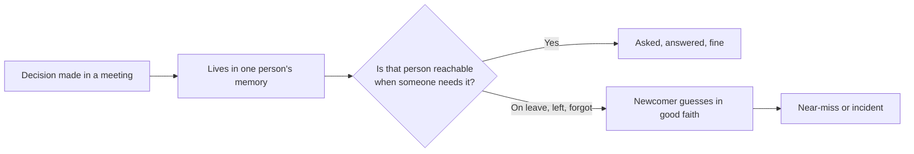

import Scenario from "../../../components/Scenario.astro";
import LevelIntro from "../../../components/LevelIntro.astro";
import PracticeCheck from "../../../components/PracticeCheck.astro";

export const unit = {
  track: "git-teamwork",
  unitSlug: "documentation-culture",
};

<Scenario label="The number nobody could explain">
  <Fragment slot="facts">
    

      
🗓️ Jordan, day 9 on the payments team

      
💳 Checkout retries a failed payment 3 times, backoff capped at 8 seconds

      
❓ Nobody on the team can say why 3 and 8s

      
⚠️ Jordan's fix would have double-charged customers

    

    
Where the answer actually lives

    

      
🧠 A decision made eight months ago, in a meeting

      
📝 Never written down in a place anyone would look

      
🚪 The engineer who made it has left the team

    

  </Fragment>

Jordan joins the payments team and, on day 9, picks up a ticket:
"checkout retries feel slow, bump the retry count." Jordan reads the code,
sees `maxRetries: 3` and `backoffCapMs: 8000`, and reasonably assumes they
are arbitrary defaults nobody tuned. Jordan opens a PR raising `maxRetries`
to 5.

A reviewer catches it: raising retries without an idempotency key (a unique
token that lets the payment provider recognize a repeated request as the same
attempt) lets a slow-but-successful payment be charged twice. That constraint
was decided eight months earlier in a meeting with no notes, by an engineer
who has since left. Nothing in the code, the README, or the PR that
introduced the retry logic says so.

**Jordan did nothing wrong. The code gave no sign that this number was
load-bearing. So where was this decision supposed to live?**

</Scenario>

Nowhere, and that is the actual bug. The decision existed only as a memory in
one person's head. It survived exactly as long as that person stayed
reachable, and it was invisible to everyone who joined after the meeting,
including Jordan reading the code in good faith.

<LevelIntro
  items={[
    "Tribal knowledge as a liability",
    "Where a decision can be recorded",
    "The narrow habit that survives turnover",
  ]}
/>

## What is tribal knowledge, and why does it bite?

Why did a perfectly competent newcomer nearly cause an incident? Because the
constraint existed, but only in a place Jordan could not search.

**Tribal knowledge** is any decision, constraint, or piece of context the team
depends on that lives only in people's heads. It is not a character flaw;
every fast-moving team accumulates some. The danger is what happens when the
holder leaves, forgets, or is simply unavailable at the moment someone needs
the answer.

<PracticeCheck
  track={unit.track}
  unitSlug={unit.unitSlug}
  topicId="tribal-knowledge"
/>

## Where can a decision be recorded, and which place actually works?

The team could have recorded the retry decision in several places. **Which of
them would have stopped Jordan before the PR was opened?**

| Where the decision lives | Findable by a newcomer?                             | Survives the decision-maker leaving?     | Explains "why", not just "what"?                                     |
| ------------------------ | --------------------------------------------------- | ---------------------------------------- | -------------------------------------------------------------------- |
| A meeting, no notes      | No                                                  | No                                       | No                                                                   |
| A chat thread            | Only if you know to search for it                   | Until the workspace's retention runs out | Sometimes, buried in the middle                                      |
| A code comment           | Yes, if you are reading that exact line             | Yes                                      | Rarely: comments say what, seldom why the alternatives were rejected |
| A decision record (ADR)  | Yes: one document per decision, listed in one place | Yes                                      | Yes, that is its whole job                                           |

An **ADR (Architecture Decision Record)** is a short, permanent document about
one decision: what was decided, why, what else was considered, and what it
costs. It is written when the decision is made, and it is not deleted when the
decision changes; a newer ADR replaces it and links back.

A comment wins on speed but loses on reach. It sits at one call site, so it
does nothing for a second retry loop added elsewhere, or for someone
investigating a graph rather than reading code. An ADR is listed by decision,
not by file path, so a person who does not yet know which file to open can
still find it.

<PracticeCheck
  track={unit.track}
  unitSlug={unit.unitSlug}
  topicId="where-it-lives"
/>

## Does documentation culture mean writing more docs?

No. **If it did, why would a wiki nobody updates be worse than no wiki?**
Because stale pages actively lie: a reader trusts them and acts. The culture
is a narrow habit: write down decisions that would be expensive to get wrong
twice, at the moment they are made, in a place future readers will actually
look.

| Worth a record                                 | Not worth a record                        |
| ---------------------------------------------- | ----------------------------------------- |
| Hard to reverse (data model, payment behavior) | Trivial and trivially reversible          |
| Constraint that is invisible in the code       | Obvious from reading the code             |
| Rejected alternative people keep re-proposing  | Style choices the linter already enforces |

<PracticeCheck
  track={unit.track}
  unitSlug={unit.unitSlug}
  topicId="narrow-habit"
/>

## What the next levels cover

L2 works out the lifecycle of an ADR, the five sections it needs, and why a
changed decision is superseded rather than edited. L3 follows Priya, the tech
lead, as she reconstructs the retry decision after the near-miss and writes
the ADR that should have existed all along.
