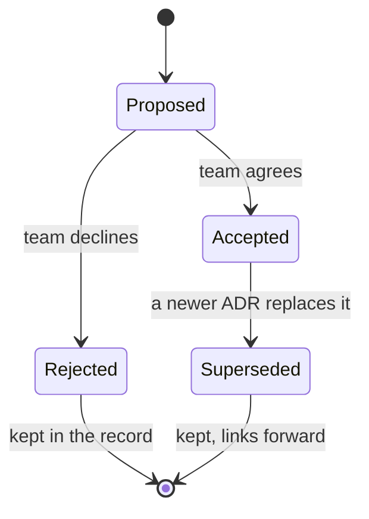
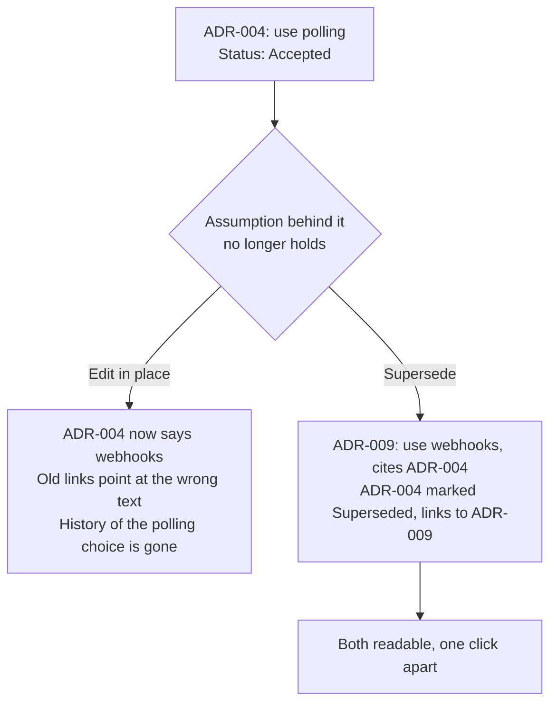

import LevelIntro from "../../../components/LevelIntro.astro";
import Checkpoint from "../../../components/Checkpoint.astro";
import PracticeCheck from "../../../components/PracticeCheck.astro";

export const unit = {
  track: "git-teamwork",
  unitSlug: "documentation-culture",
};

L1 named the problem, a decision that exists only in someone's head is
invisible to everyone who was not there, and the fix: a decision record
written at decision time and findable later. L2 works out the mechanics: the
states a record passes through, the sections it needs, and what happens when
the decision is revisited.

<LevelIntro
  items={[
    "Lifecycle: proposed, accepted, superseded",
    "The five sections of a useful record",
    "Superseding instead of editing",
  ]}
/>

## What stages take a decision from "talked about" to "findable"?

**If the goal is "findable and trustworthy", what must be true of a record at
each moment?** That a reader can tell, from the document alone, whether it is
still under discussion, in force, turned down, or replaced.

| Stage      | Meaning                                                   | Who reads it and why                                  |
| ---------- | --------------------------------------------------------- | ----------------------------------------------------- |
| Proposed   | Draft under discussion, not how the system behaves yet    | Reviewers deciding whether to accept it               |
| Accepted   | The current, load-bearing decision                        | Anyone building on or near this part of the system    |
| Rejected   | Considered and turned down, kept rather than deleted      | Anyone tempted to re-propose the same idea            |
| Superseded | No longer current; a newer record replaces it and says so | Anyone asking why the system used to work differently |

**Why keep a rejected record instead of deleting the proposal?** "We
considered this and said no" is information. It spares the next engineer from
rerunning the same debate and rediscovering the same reason. Deleting it
throws away the only thing that makes the rejection durable, which is the L1
failure all over again.

<Checkpoint question="Eight months after an ADR rejected an option, a new engineer proposes almost the same option. Did the ADR process fail?">

No. The record did its job by existing; what was missing was a pointer to it
at the moment the familiar-sounding idea came up. A record cannot stop someone
from proposing an idea they do not know has history. What it provides is a
fast, confident answer once someone looks: we considered this, here is why it
lost, and here is what would have to change for the answer to differ now. That
replaces a whole debate with a link. The remedy is the habit of linking the
relevant ADR when a proposal sounds familiar, not a longer ADR.

</Checkpoint>

<PracticeCheck
  track={unit.track}
  unitSlug={unit.unitSlug}
  topicId="adr-lifecycle"
/>

## Which sections does a record need?

**Must a decision record be long to do its job?** No. It needs to answer the
questions a future reader will actually have, and nothing more.

| Section      | Answers                                                    | What goes wrong if you skip it                                    |
| ------------ | ---------------------------------------------------------- | ----------------------------------------------------------------- |
| Context      | What situation forced this: the constraint, incident, need | Reader cannot tell whether the decision still applies             |
| Decision     | What was decided, stated as a plain fact                   | Reader cannot tell whether it is settled or still debated         |
| Alternatives | What else was considered, and why each lost                | A "better" idea that was already tried gets proposed again        |
| Consequences | What this costs, risks, or rules out                       | Reader assumes the decision was free and is surprised by its cost |
| Status, date | Proposed, accepted, rejected or superseded, and when       | Reader cannot tell if the record is current or historical         |

**Why does "consequences" matter as much as "decision"?** A decision without
its consequences reads as free. Jordan's team could have written "cap retries
at 3, backoff at 8s" and stopped, but the consequence ("a payment can still
fail permanently after 3 tries, and raising the cap widens the window for
duplicate charges until idempotency keys exist") is the exact fact that would
have told Jordan the number was load-bearing before the PR, not after a
reviewer caught it.

<PracticeCheck
  track={unit.track}
  unitSlug={unit.unitSlug}
  topicId="adr-sections"
/>

## When the decision changes, why not edit the record?

**Suppose the team now decides to replace polling with webhooks. Why not
rewrite the old ADR in place?** Because editing destroys what made the record
trustworthy: it is a statement of what was decided and when, not the team's
current best guess rewritten to look as if it had always been true.

A superseding record gets a new number and date. Its context says what the
earlier one decided and why that no longer holds, and the old one gets a status
update pointing forward. A reader arriving through an old link is one click
from the current answer.

<Checkpoint question="A comment in the code says 'see ADR-004'. Someone rewrites ADR-004 in place to describe webhooks. What breaks?">

Two things break at once. The code comment and any old incident report that
cite ADR-004 now point at a document that no longer justifies what they
describe, and nothing signals that the trail was cut. Worse, the record that
polling was ever a deliberate choice disappears, and with it the reasoning
(why polling, and what changed) that would help someone judge a future similar
call. Superseding costs one extra document number. Editing in place costs the
team's ability to trust that any ADR still says what it said when written.

</Checkpoint>

<PracticeCheck
  track={unit.track}
  unitSlug={unit.unitSlug}
  topicId="supersede-vs-edit"
/>
