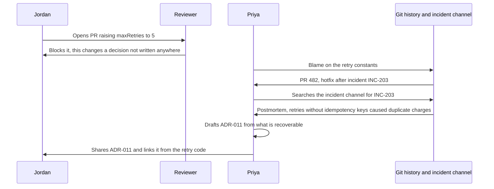

import Scenario from "../../../components/Scenario.astro";
import LevelIntro from "../../../components/LevelIntro.astro";
import Checkpoint from "../../../components/Checkpoint.astro";
import PracticeCheck from "../../../components/PracticeCheck.astro";

export const unit = {
  track: "git-teamwork",
  unitSlug: "documentation-culture",
};

<Scenario label="The near-miss, and the ADR it produced">
  <Fragment slot="facts">
    <div class="not-prose flex flex-col gap-1 text-sm text-slate-700 dark:text-slate-300">
      <div class="flex items-center gap-1.5"><span>🔍</span> Priya (tech lead) rebuilds the decision from git history and an old incident channel</div>
      <div class="flex items-center gap-1.5"><span>📄</span> ADR-011: cap checkout payment retries at 3, backoff at 8s</div>
      <div class="flex items-center gap-1.5"><span>🧩</span> Written two days after Jordan's PR, not eight months ago when it was decided</div>
      <div class="flex items-center gap-1.5"><span>✅</span> Status: accepted retroactively, first record of this decision</div>
    </div>
  </Fragment>

L2 described the lifecycle and the five sections in the abstract. This level
follows the actual document that closed Jordan's near-miss from L1: where its
reasoning came from when nobody had written it down, the text itself, and what
the team changed afterward.

**The decision was made eight months before Jordan's PR, with no notes.
Writing an ADR after a near-miss documents something that already happened.
Does that count as the same practice as writing one at decision time?**

</Scenario>

<LevelIntro
  items={[
    "Reconstructing an unrecorded decision",
    "The ADR, section by section",
    "Anti-patterns that defeat the habit",
  ]}
/>

## How do you reconstruct a decision nobody wrote down?

If the engineer who made the call has left, where does Priya start? Not from
memory: from the traces any future engineer could also search, the git history
first and the incident channel second.



The decision was not undocumented because nobody left evidence; the
postmortem existed the whole time. It was undocumented because that evidence
was indexed by incident number, not attached to the code it explained.

<Checkpoint question="Priya found the reasoning in an old postmortem. Wasn't the decision documented already, just in the wrong place?">

Not in any way that helped Jordan. A postmortem is indexed by incident and
written for the people who lived through it; it answers "what happened and how
did we respond", not "why does this code do this", which is the question a
future reader of the retry logic actually has. Jordan had no reason to search
for an incident that predates their time on the team, and the code offered no
pointer. Information existing somewhere in the company is different from a
decision being documented where the person making the next change will look.

</Checkpoint>

<PracticeCheck
  track={unit.track}
  unitSlug={unit.unitSlug}
  topicId="reconstruction"
/>

## What did the finished ADR say?

The document below is the worked example (names and numbers are invented for
the case).

```md
# ADR-011: Cap checkout payment retries at 3, backoff at 8s

Status: Accepted (reconstructed) — 2026-08-19
Owner: Priya Nair
Related: postmortem INC-203

## Context

Checkout used to retry failed payment attempts up to 6 times. During a
payment provider slowdown, a request that was slow but eventually succeeded
looked like a failure to our client, so it was retried while the first
attempt was still in flight. Some customers were charged twice. We send no
idempotency key, so the provider cannot recognize a retry as the same
attempt. The cap was shipped as a hotfix and never written up outside the
incident channel.

## Decision

Cap payment retries at 3 attempts, with backoff capped at 8 seconds. This
shortens how long a slow request can overlap with its own retries before we
stop and surface a failure to the customer.

## Alternatives considered

Retry more, otherwise unchanged. Rejected: this widens the overlap window
that caused the incident.

Add an idempotency key and retry as often as needed. The correct long-term
fix, because the provider can then dedupe repeated requests itself. Not
chosen yet: it needs provider support we have confirmed exists but have not
integrated. Tracked as follow-up.

No retries at all. Rejected: most payment failures are transient, so this
would turn recoverable blips into hard failures.

## Consequences

The cap reduces duplicate-charge risk but does not remove it; only an
idempotency key does. A payment can still fail permanently after 3 attempts,
so callers must handle that case instead of assuming retries eventually
succeed. Raising the cap before the key exists widens the exposure again.
Supersede this ADR once the idempotency work lands.
```

**Why does the alternatives section list the idempotency key as the better
fix, rather than only options that lost?** Because the record's job is to show
a future reader the whole picture, including the change that would make this
decision obsolete. Without it, the next person either re-derives the idea from
scratch or treats 3 as a permanent constant instead of a constraint tied to a
missing piece of infrastructure.

<Checkpoint question="The ADR admits the idempotency key is the better fix, yet the team shipped the cap. Does writing that down weaken the decision?">

It strengthens it. A decision presented as the final, ideal answer is the kind
that gets silently overridden later by someone who assumes the number was a
careful, permanent choice with no known better alternative, which is almost
exactly what Jordan did. Recording "right given current constraints, and here
is what would change the call" gives a future reader a legitimate, documented
path (build the key, then supersede this record) instead of two bad options:
trust 3 forever, or override it without knowing why it was there.

</Checkpoint>

<PracticeCheck
  track={unit.track}
  unitSlug={unit.unitSlug}
  topicId="adr-anatomy"
/>

## What quietly breaks a documentation habit?

Reconstructing ADR-011 closed one gap. **What stops the next twenty decisions
from ending up in the same state a year from now?** Avoiding habits that look
like documentation but produce no findable, trustworthy record.

| Anti-pattern                        | Looks like                                                     | Why it breaks the habit                                                    |
| ----------------------------------- | -------------------------------------------------------------- | -------------------------------------------------------------------------- |
| Decision buried in a PR description | "See PR 482 for context" instead of a standalone record        | PRs are indexed by code change; nobody searches them to ask "why is it so" |
| Write once, never revisited         | An ADR accepted, then silently wrong after the system moved on | A stale record misleads a reader who trusts it is current                  |
| No link from the code               | The ADR exists but the retry constants have no pointer to it   | The reader must already know it exists, the original failure again         |
| Documenting everything equally      | A record for every minor, reversible choice                    | Signal drowns in noise and the index stops being read                      |
| Retroactive only                    | Records written after incidents, never before a decision ships | Each gap costs a near-miss before it even surfaces                         |

<Checkpoint question="Priya added a one-line comment above maxRetries pointing at ADR-011. Why does that line matter as much as the ADR?">

The ADR only helps a reader who already knows to look for it, and the retry
code is exactly where a future Jordan will be standing. Writing the ADR fixed
"is this decision recorded anywhere"; the comment fixes the separate question
"will anyone find it". A perfectly written record that nothing points to is
functionally the same as the unwritten decision eight months earlier: correct
information a reasonable person has no way to discover before repeating the
mistake.

</Checkpoint>

<PracticeCheck
  track={unit.track}
  unitSlug={unit.unitSlug}
  topicId="habit-anti-patterns"
/>

## Beyond this one example

ADR-011 had one clean postmortem to trace and a clear owner. It is a case,
not the whole territory. **What changes if the decision had no postmortem at
all, say a database index added "temporarily" three years ago by someone who
left, with a commit message that only says "perf fix"? What changes if two
former teammates would give conflicting accounts of why a choice was made and
nobody remains to adjudicate?** The mechanics are the same (collect what
evidence exists, write from what is recoverable, link it from the code), but
honest archaeology means writing the context as a best reconstruction with
stated confidence, and treating the decision as open to revisiting, instead of
presenting a guess with the certainty of something a living person can vouch
for.
