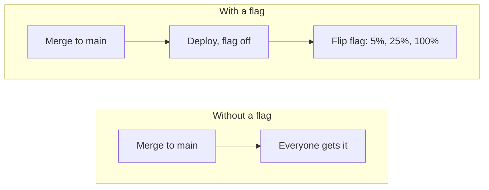

import Scenario from "../../../components/Scenario.astro";
import LevelIntro from "../../../components/LevelIntro.astro";
import PracticeCheck from "../../../components/PracticeCheck.astro";

export const unit = {
  track: "git-teamwork",
  unitSlug: "feature-flags",
};

<Scenario label="The nine-day checkout PR">
  <Fragment slot="facts">
    

      

        11 conflicts
        by day 9
      

      

        

      

    

    

      
📅 Day 1 — PR opened, 0 conflicts, 1,800 changed lines

      
📅 Day 5 — main moved 24 commits, 3 conflicts appear

      
📅 Day 9 — main moved 47 commits, 11 conflicts, still unmerged

      
🚫 Nobody wants to merge — half the new checkout flow isn't tested yet

    

  </Fragment>

A developer opens a pull request on Monday to rebuild checkout: new
pricing logic, a new address form, a new confirmation screen, 1,800
changed lines. By the following Wednesday it is still open. Main has
moved 47 commits since then and the branch has 11 merge conflicts.
Merging it wholesale would also put an untested confirmation screen in
front of every paying customer at once. **The team is stuck between two
bad options: keep the branch open while conflicts grow, or merge a
giant, mostly untested change straight into production. Is there a
third option?**

</Scenario>

There is, and one move fixes both symptoms: merge to main constantly, in
small pieces, and keep anything unfinished **switched off** instead of
**unmerged**.

<LevelIntro
  items={[
    "Merging versus releasing",
    "What a feature flag is",
    "The four kinds of flag",
  ]}
/>

## Why was the team stuck?

**What did "merge" and "release" mean for the checkout PR?** The same
thing: the moment the code reached main, every customer got it. That
coupling is the whole trap. When merging is also releasing, nobody dares
merge until the work is finished, so branches grow and conflicts pile up.

A **feature flag** is a runtime switch, checked in the code, that decides
whether a path runs. It cuts the coupling in two:

Merging becomes a cheap, routine git event. Releasing becomes a separate
decision you can make later, in stages, and undo.

<PracticeCheck
  track={unit.track}
  unitSlug={unit.unitSlug}
  topicId="merge-vs-release"
/>

## Are all flags the same?

**If a flag hides unfinished work, is a flag that hides a paid-plan
feature the same kind of thing?** No. Flags differ in why they exist and,
more importantly, in how long they should live.

| Kind              | Question it answers                      | Expected lifetime                |
| ----------------- | ---------------------------------------- | -------------------------------- |
| Release toggle    | Is this unfinished feature ready yet?    | Days to weeks, then deleted      |
| Ops toggle / kill | Can on-call switch this off right now?   | Long-lived, kept as a safety net |
| Experiment flag   | Which variant performs better?           | Weeks, deleted after the verdict |
| Permission toggle | Is this user's plan allowed to use this? | Long-lived, often permanent      |

This unit focuses on release toggles, because they are what lets main stay
releasable while a three-week feature is still being built. The lifetime
column matters later: a release toggle that outlives its feature turns
into debt.

<PracticeCheck
  track={unit.track}
  unitSlug={unit.unitSlug}
  topicId="flag-types"
/>

## What the next levels cover

L2 shows where the check lives in the code, what a flag's configuration
looks like (rules, not just on/off) and the lifecycle that ends with
deleting the flag. L3 works through ordered rule evaluation, a staged
rollout with a kill switch, and the cost of flags that never get removed.
