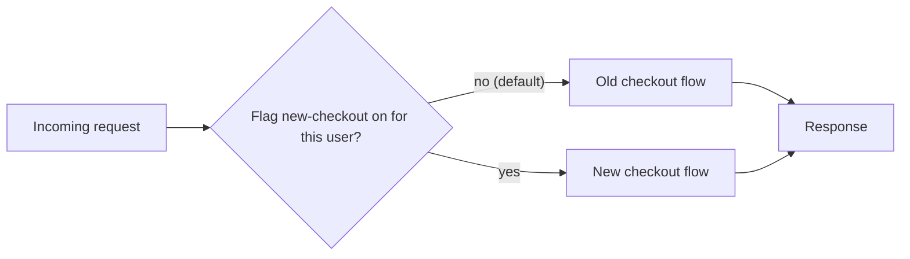
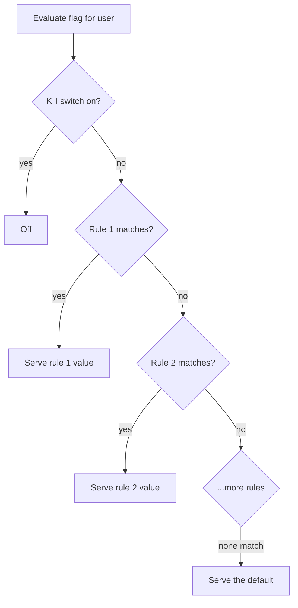
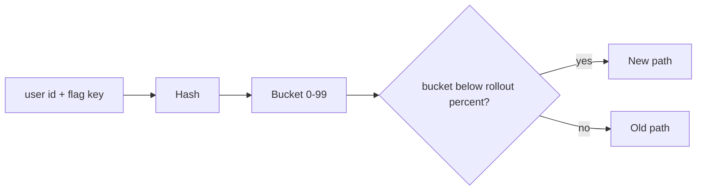

import LevelIntro from "../../../components/LevelIntro.astro";
import Checkpoint from "../../../components/Checkpoint.astro";
import PracticeCheck from "../../../components/PracticeCheck.astro";

export const unit = {
  track: "git-teamwork",
  unitSlug: "feature-flags",
};

L1 established that a flag separates merging from releasing. L2 works out
the mechanics: where the check sits in the code, what the flag's
configuration contains beyond on and off, and how a percentage rollout
keeps each user on one side.

<LevelIntro
  items={[
    "One history, two code paths",
    "Ordered targeting rules",
    "Sticky per-user rollout",
  ]}
/>

## Where does the unfinished version live?

**If everyone commits straight to `main`, where does the "not ready yet"
version of checkout actually sit?** Not in a git branch. It sits in the
running code, behind a check. There is one line of history containing
both the old path and the new path, and a runtime decision chooses
between them.

Both flows can be merged in small PRs and deployed repeatedly long before
the flag turns on for a real customer. Deploying stops being the risky
moment. Flipping the flag is, and that decision can be made separately,
scoped to a few users first, and reversed in seconds.

<Checkpoint question="A teammate says: 'We deploy straight from main and our branches are already short-lived, so we don't need flags.' Does short-lived branching make flags unnecessary?">

No, they solve two different halves of the problem. Short branches keep
_merging_ safe: small diffs review quickly and rarely conflict. But
merging is not releasing. Even a tidy PR can hold half of a multi-week
feature or a risky payment-path rewrite that you do not want live for
everyone yet. Without a flag, "merged" and "live" happen at the same
instant, which is the coupling that pushes teams to keep branches open
too long, recreating the nine-day PR.

</Checkpoint>

<PracticeCheck
  track={unit.track}
  unitSlug={unit.unitSlug}
  topicId="flag-check-location"
/>

## Is on/off enough to roll out checkout safely?

**If a flag can only be fully on or fully off, what have you gained over
the giant PR?** Very little: the release is still all-or-nothing, only
one step later. Real flags carry a small set of **targeting rules**,
evaluated against the current user, plus a **default** for everyone no
rule matches.

| Order | Rule                              | Serves | Purpose                          |
| ----- | --------------------------------- | ------ | -------------------------------- |
| 1     | user id is an internal QA account | on     | Staff try it first               |
| 2     | plan tier is enterprise           | off    | Hold back until support is ready |
| 3     | 5 percent rollout                 | on     | A small real-world slice         |
| -     | default                           | off    | Everyone else                    |

Rules are checked **top to bottom and the first match wins**. Order is
part of the meaning: the enterprise exclusion sits above the percentage
rule on purpose. Put it below and an enterprise account whose bucket
falls inside the 5 percent would match the rollout first, and the
exclusion would never run for them.

The same deployed code now serves different behavior to different people,
and widening the audience (internal, then 5 percent, then 25, then 100)
is a config change with no new deploy.

| Stage         | Who sees the new path   | What it checks for                          |
| ------------- | ----------------------- | ------------------------------------------- |
| 0 percent     | Nobody                  | It deploys and the old path is unharmed     |
| Internal only | QA and dogfooding users | Obvious bugs before any customer is exposed |
| 5 percent     | Small slice of users    | Real error rates, latency, edge cases       |
| 100 percent   | Everyone                | Confidence to delete the flag               |

<PracticeCheck
  track={unit.track}
  unitSlug={unit.unitSlug}
  topicId="targeting-rules"
/>

## Should a user flip between old and new on refresh?

**A 5 percent rollout is live. A user refreshes checkout five times. Do
they see the new flow on some loads and the old one on others?** They
must not. Checkout is a multi-step flow, and reaching the confirmation
screen of one version with cart state built by the other would break it.

<Checkpoint question="What would have to be true of the percentage rule for the same user to get the same answer on every refresh?">

The decision must depend only on stable inputs, not on chance at request
time. The usual approach hashes a stable id (the account id, combined
with the flag's own key) into a bucket from 0 to 99 and serves the new
path when the bucket is below the rollout percent. Same user, same flag,
same bucket, same answer every time. Rolling a die per request would
give "5 percent of requests", which is a different and unsafe thing.

</Checkpoint>

Two consequences fall out of this design. Widening 5 to 25 percent keeps
every user who already had the feature, because their bucket is still
below the larger number; nobody gets it taken away mid-rollout. And
mixing the flag key into the hash gives each flag its own independent
shuffle, so the same lucky users do not get every new feature first.

<PracticeCheck
  track={unit.track}
  unitSlug={unit.unitSlug}
  topicId="sticky-bucketing"
/>

## What does a flag cost?

Every active flag is a second code path to reason about. L3 puts a number
on that, along with the rule evaluation and the staged rollout, using
the checkout redesign from L1.
