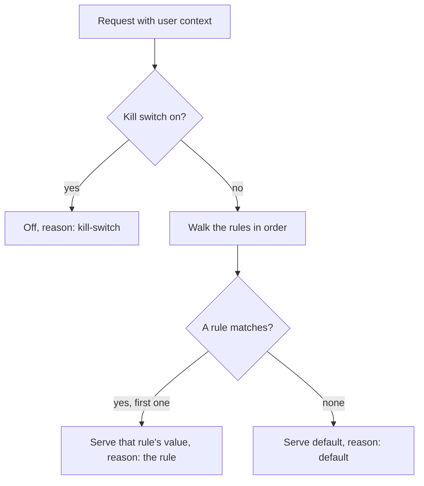
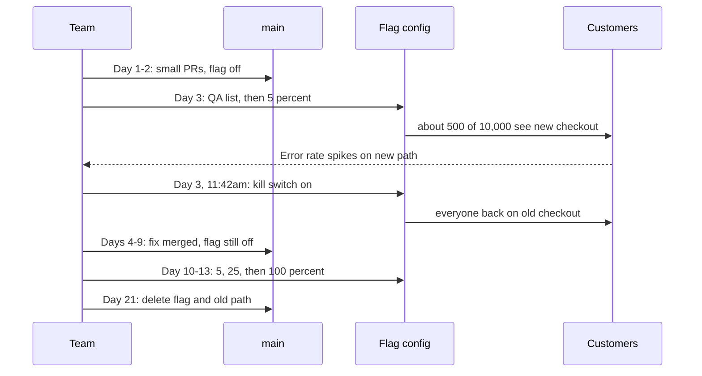
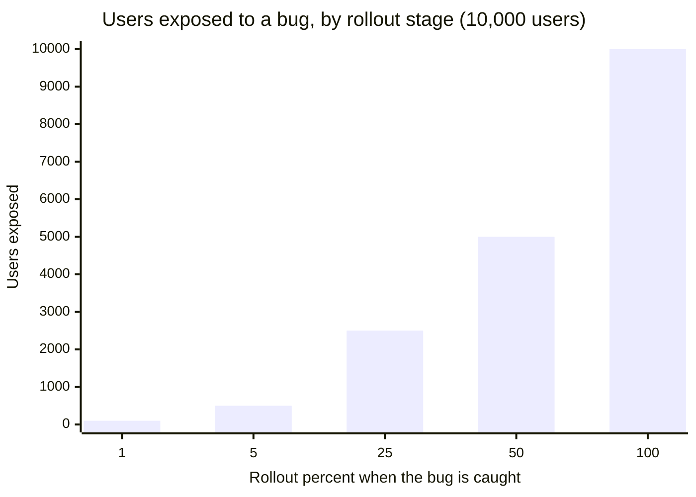
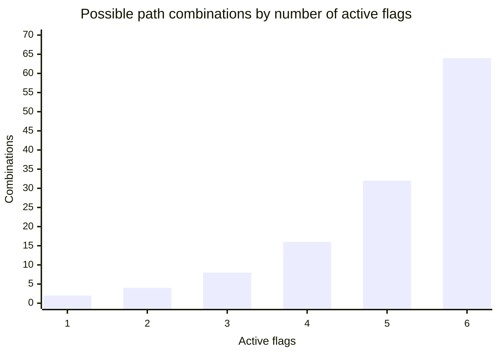
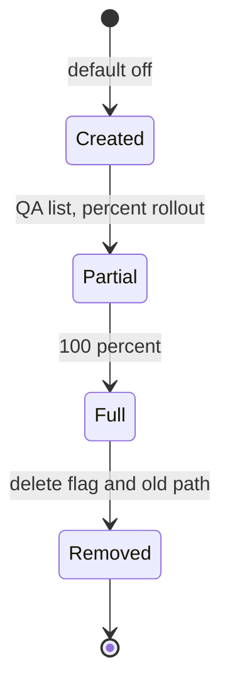

import Scenario from "../../../components/Scenario.astro";
import LevelIntro from "../../../components/LevelIntro.astro";
import Checkpoint from "../../../components/Checkpoint.astro";
import PracticeCheck from "../../../components/PracticeCheck.astro";

export const unit = {
  track: "git-teamwork",
  unitSlug: "feature-flags",
};

<Scenario label="Rolling out the checkout redesign, with flags this time">
  <Fragment slot="facts">
    

      
✅ Day 1 — flag created, default off, small PRs merge to <code>main</code> daily

      
📈 Day 3 — rollout widened to 5%; error rate on new path spikes

      
🛑 Day 3, 11:42am — kill switch flipped off in under a minute, <strong>no deploy needed</strong>

      
🔧 Day 10 — bug fixed, rollout resumes: 5% → 25% → 100% over four days

      
🧹 Day 21 — flag and the old checkout path both deleted

    

  </Fragment>

L1's checkout PR sat unmerged for nine days because merging felt like
releasing to everyone at once. **Given ordered targeting rules, a sticky
rollout percentage and a kill switch, what would the same weeks have
looked like?** Predict it before reading on. Not "the PR merges faster",
but something more specific about _when_ risk is discovered and _how
much of the customer base_ it can touch.

</Scenario>

<LevelIntro
  items={[
    "Evaluation order, precisely",
    "The staged rollout as a timeline",
    "The price of flags that stay",
  ]}
/>

## What exactly happens when the app asks "is this on for me?"

**Several things can say yes or no at once: a kill switch, a QA list, a
plan exclusion, a rollout percentage. Which one wins?** The evaluator
resolves them with a fixed precedence, and the whole safety story rests
on it.

Two properties matter. The kill switch is checked **before** any rule, so
no targeting mistake can keep a broken path alive during an incident. And
the evaluator returns a **reason** along with the boolean, so when
support asks "why does this customer see the new checkout?" the answer is
a recorded fact (QA list, rollout, default), not a guess.

<Checkpoint question="The config has the rollout rule above the enterprise-exclusion rule, and an enterprise customer's bucket falls inside the 5 percent. What do they see, and which rule decided it?">

They see the new checkout, decided by the rollout rule. First match wins,
so the evaluator stops at the rollout and never reaches the exclusion
that was meant to protect them. The exclusion is not wrong; it is
unreachable for anyone the rollout catches. This is why rule order is
reviewed like code, and why the reason field is useful: it would show
"rollout" for an account everyone assumed was excluded.

</Checkpoint>

<PracticeCheck
  track={unit.track}
  unitSlug={unit.unitSlug}
  topicId="evaluation-precedence"
/>

## What did the actual rollout look like?

Each step below was possible only because merging and releasing were
separate.

The bug was found at 5 percent, so roughly 500 of 10,000 users saw it,
for minutes. The nine-day PR would have shipped the same bug to all
10,000, with a rollback deploy as the only remedy. Because rollout
buckets are sticky and nested, the 500 affected users were a fixed group,
which also made the incident easy to scope and follow up on.

Exposure is just percent times user base, which the interactive demo on
this unit lets you drag. The percentage is not a guarantee of safety, it
is a dial on how much a bug can cost before someone notices.

<Checkpoint question="The team could have gone 0 to 100 percent on Day 3 and relied on the kill switch alone. What does the intermediate 5 and 25 percent stages add that the kill switch does not?">

The kill switch limits how _long_ a bug lives; gradual stages limit how
_many people_ it touches while it lives. Detection is never instant, so
the damage equals exposure times detection delay. A kill switch shortens
the second factor, staging shrinks the first. You want both, and staging
also gives monitoring a small, comparable population before the big one
arrives.

</Checkpoint>

<PracticeCheck
  track={unit.track}
  unitSlug={unit.unitSlug}
  topicId="gradual-rollout"
/>

## Why was Day 21 as important as Day 3?

**Once the flag is at 100 percent and stable, what is it still doing?**
Nothing useful, but it still costs. Each active flag is a place where a
request can go one of two ways, independently of every other flag, so
the number of combinations a change could meet grows as 2 to the power of
the number of flags.

| Active flags | Combinations | In practice                                      |
| ------------ | ------------ | ------------------------------------------------ |
| 1            | 2            | Test the old path, test the new one              |
| 3            | 8            | Testable by hand, easy to miss one               |
| 6            | 64           | Nobody verifies all of them before every release |

Not every combination is reachable or meaningful, because many flags
guard unrelated code. Treat 2 to the n as the ceiling that interacting
flags approach, and as the reason to delete release toggles when they
finish. Kill switches and permission toggles are the deliberate
exceptions: they are kept on purpose, with an owner.

<PracticeCheck
  track={unit.track}
  unitSlug={unit.unitSlug}
  topicId="flag-lifecycle"
/>

## Extend it yourself

This rollout is one case, not the whole territory. It had a single flag, a
bug found within minutes and a team that deleted the flag on schedule.
**What changes if the bug is subtle and only visible in a revenue report
two days later? What if the new checkout writes data in a new format that
the old path cannot read, so flipping the kill switch off leaves orphaned
records?** Think about which of the safety properties above still hold
(sticky buckets, instant off, small exposure) and which quietly stop
applying.

One way to think about it: a flag reverses _which code runs_, not _what
that code already wrote_. A kill switch is instant for behavior and does
nothing for data. Changes that alter stored data usually need a
compatible-read step first, so both paths can understand both formats,
and only then a flag. The same idea applies to the beta variation: to
offer checkout first to enterprise accounts that opted in, you would add a
rule that serves "on" for them _above_ the percentage rule, and the
evaluator itself would not change at all.
