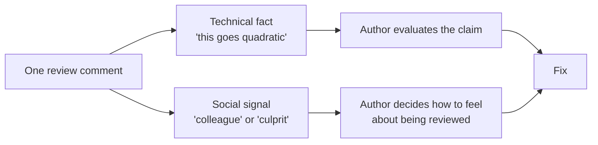
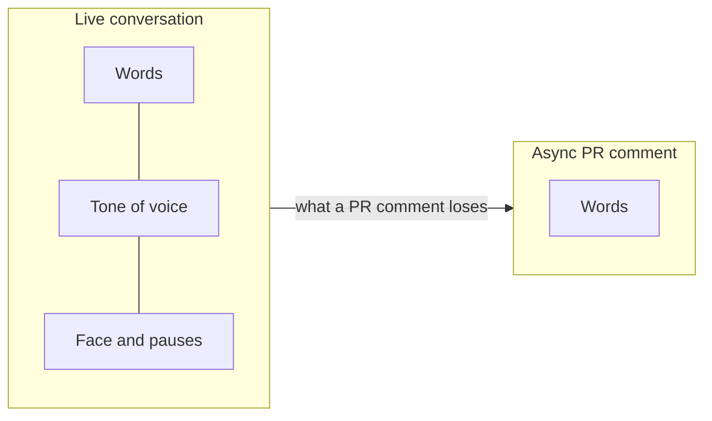

import Scenario from "../../../components/Scenario.astro";
import LevelIntro from "../../../components/LevelIntro.astro";
import PracticeCheck from "../../../components/PracticeCheck.astro";

export const unit = {
  track: "git-teamwork",
  unitSlug: "feedback-framing",
};

<Scenario label="Two comments, same bug">
  <Fragment slot="facts">
    

      
🐛 <strong>Same bug</strong> — a lookup inside a loop that goes quadratic; both reviewers spot it

      
😠 <strong>Comment A</strong> — "This is wrong, use a hashmap." Author goes quiet for 3 days

      
🙂 <strong>Comment B</strong> — names the line, explains the mechanism, asks. Author fixes it in 20 minutes

    

  </Fragment>

Two reviewers spot the exact same bug in the exact same kind of pull
request: a lookup inside a loop that will go quadratic once the input
list grows. Reviewer A comments **"This is wrong, use a hashmap."** The
author doesn't reply for three days, then answers with a defensive
explanation of why they did it that way, and the PR drags through
another round. Reviewer B, on a different PR with the identical bug,
comments **"This lookup runs inside the loop on line 42, so it'll go
quadratic once `items` grows past a few hundred. Worth swapping to a
`Map` here?"** The author replies in twenty minutes with a fix. **Same
bug, same technical correctness, same reviewer skill. So what cost
Reviewer A three days that Reviewer B didn't spend?**

</Scenario>

<LevelIntro
  items={[
    "The fact and the signal in a comment",
    "Where the hidden cost lands",
    "Why async review needs extra care",
  ]}
/>

## What does a review comment actually carry?

Every comment does two jobs at once, whether the reviewer means it or not.
It states a **technical fact** ("this will go quadratic"), and it sends a
**social signal** about how the reviewer sees the author: a colleague
solving a problem together, or someone who made a mistake. Reviewer A's
fact was right and the signal was wrong. The bug report was correct; the
delivery said "you did this wrong", which is a claim about a person, not
about code.

Getting the signal wrong doesn't make the review incorrect. It makes it
expensive, because the author has to deal with the signal before they can
get to the fact.

<PracticeCheck
  track={unit.track}
  unitSlug={unit.unitSlug}
  topicId="fact-vs-signal"
/>

## Where does the cost land?

Why was the cost three days and not a few minutes of annoyance? Because the
cost isn't the bug. It's whatever the author has to do that isn't fixing
the bug.

| What the comment looked like              | What the author does next                                      | Hidden cost                                      |
| ----------------------------------------- | -------------------------------------------------------------- | ------------------------------------------------ |
| Blunt and aimed at the person             | Drafts a defense before touching the code                      | Delay while they manage the feeling, not the fix |
| Vague ("this seems off")                  | Can't tell what to change, asks a clarifying question          | An extra round-trip before any fix starts        |
| Specific, aimed at the code, asked kindly | Reads a technical claim, checks it, fixes it                   | None: the fix lands in the same sitting          |
| Batched with nitpicks, nothing marked     | Can't tell blocking from optional, fixes everything to be safe | Time on low-value edits, the real issue buried   |

Better framing isn't about being nice. It's about not adding non-technical
work to a technical exchange.

<PracticeCheck
  track={unit.track}
  unitSlug={unit.unitSlug}
  topicId="hidden-cost"
/>

## Why does review make this worse than a conversation?

Say the same sentence across a table and the listener hears your face and
your voice with it. Pull request review has none of that. A comment sits
unanswered for hours, gets read out of context, and carries no tone at all.
Whatever the words alone imply is all the author gets.

So the words themselves have to carry what tone would have carried for free:
who the sentence is about, how precise it is, and whether it is a must-fix
or a suggestion.

<PracticeCheck
  track={unit.track}
  unitSlug={unit.unitSlug}
  topicId="async-medium"
/>

## What the next levels cover

L2 builds the model behind Reviewer B's comment: three levers (subject,
specificity, statement versus question) plus severity labels and
response-time norms for a whole batch of comments. L3 rewrites a real
comment step by step, shows where soft framing is the wrong tool (a
blocking defect), and says when to leave the text thread entirely.
