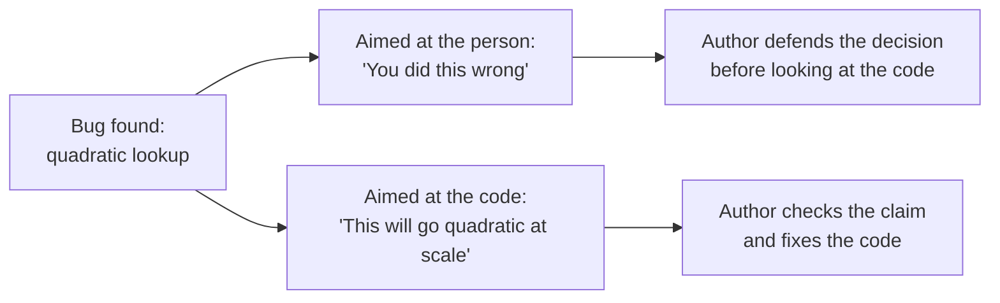
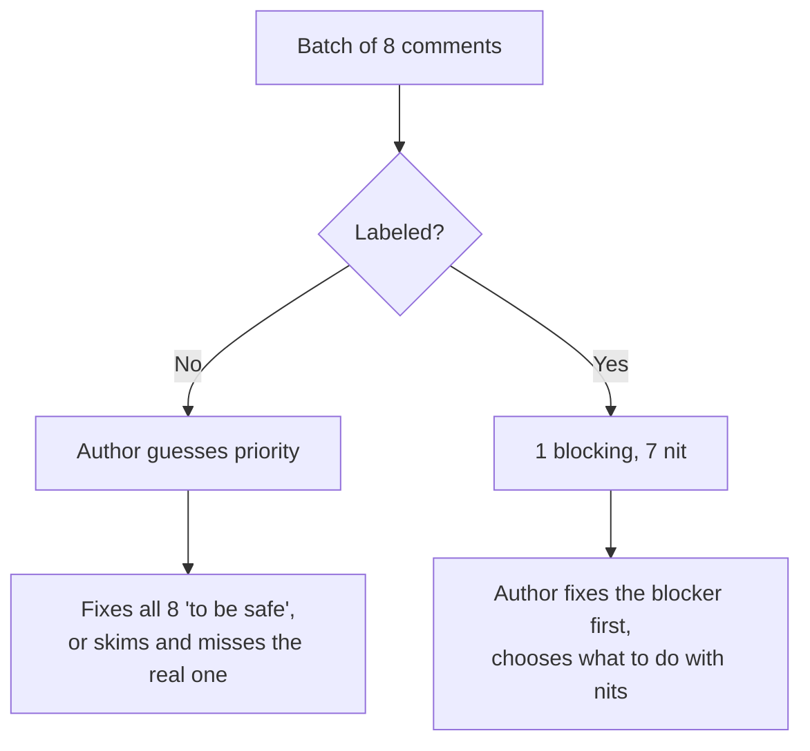
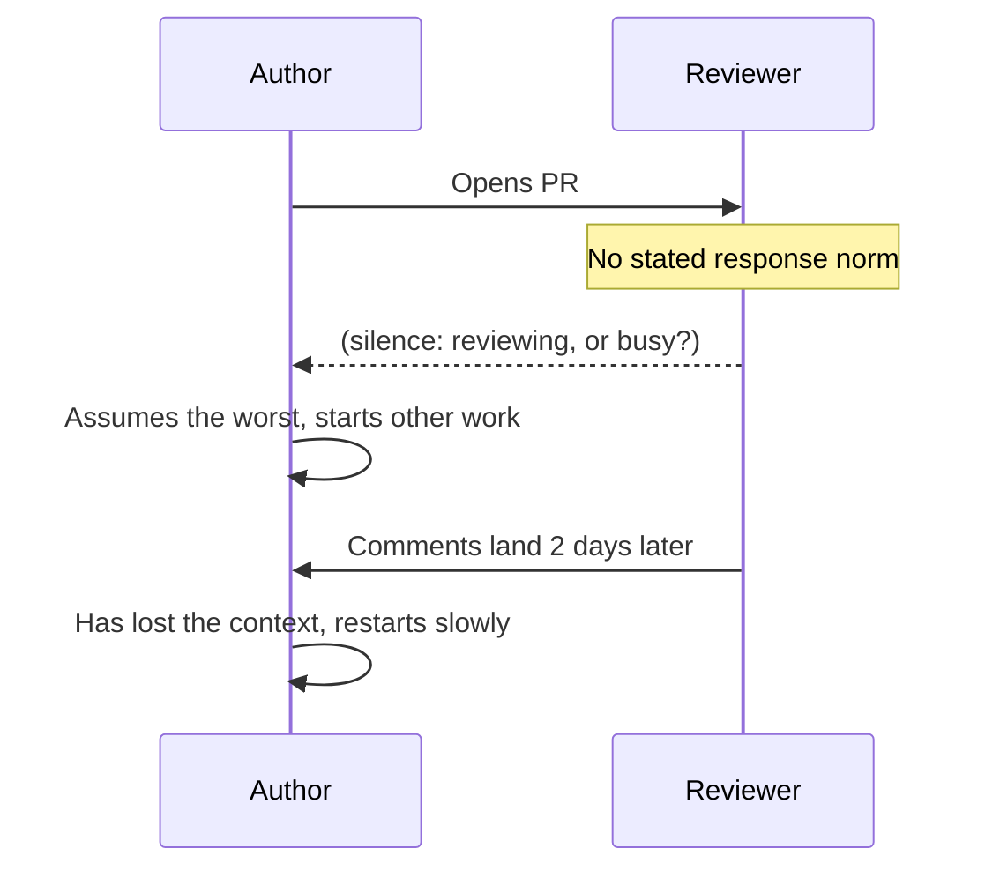

import Checkpoint from "../../../components/Checkpoint.astro";
import LevelIntro from "../../../components/LevelIntro.astro";
import PracticeCheck from "../../../components/PracticeCheck.astro";

export const unit = {
  track: "git-teamwork",
  unitSlug: "feedback-framing",
};

L1 showed that two reviewers caught the identical bug and got three days of
silence versus a twenty-minute fix, because every comment carries a fact and
a signal. L2 turns that into a repeatable model: three levers that change how
a single comment lands, then two habits that govern a whole batch of
comments read asynchronously.

<LevelIntro
  items={[
    "Three levers: subject, specificity, framing",
    "Severity labels across a batch",
    "Response-time norms",
  ]}
/>

## Lever 1: who is the grammatical subject?

"You did this wrong" and "This will go quadratic once `items` grows" point
at the same defect. **Which word in each sentence will the author hear as the
thing being judged?**

In the first, the author is the subject and "wrong" is a judgment attached to
them. In the second, the code is the subject: a behavior predicted from a
mechanism, with nobody named as having failed. The technical content is the
same. What differs is how much the author has to process before reaching the
step that matters.

This is not a claim that tone is everything, or that harsh news is never
warranted. It is narrower: for the same technical content, code-directed
wording removes a step (deciding whether you are being judged) that sits in
front of the step that matters (deciding whether the claim is correct).

<Checkpoint question="A reviewer writes: 'You forgot to handle the null case.' Move the subject from the person to the code without changing what is reported, and say what changed.">

"The null case isn't handled here. What happens if `user` comes back empty
from this lookup?" The subject moved from "you" (someone who forgot) to "the
null case" and "this lookup" (properties of the code). The report is the same
missing null check, but the sentence no longer accuses anyone of forgetting.
It describes a gap and invites the author to close it, so the author can judge
it on its technical merits instead of first deciding whether to accept a
verdict about themselves.

</Checkpoint>

<PracticeCheck
  track={unit.track}
  unitSlug={unit.unitSlug}
  topicId="subject-framing"
/>

## Lever 2: how specific is the ask?

"This seems off" and "line 42's lookup runs inside the loop, so it goes
quadratic once `items` grows" report the same worry at two resolutions.
**What does the author have to do differently for each?**

A vague comment makes the author do the reviewer's diagnostic work: reread the
code, guess what "off" means, maybe ask. A specific comment names the _where_,
the _what_ and the _why_, so the author can verify or dispute a diagnosis
instead of reconstructing one. Specific does not mean long. One sentence can
carry all three.

<PracticeCheck
  track={unit.track}
  unitSlug={unit.unitSlug}
  topicId="specificity"
/>

## Lever 3: statement or question?

"Use a hashmap" is an instruction. "Worth swapping to a `Map` here?" is the
same suggestion as a question. **Why would the same suggestion land
differently in these two forms?**

An instruction assumes the reviewer's solution is the only one worth
considering and makes the author the executor of someone else's decision. A
question leaves room for a reason the reviewer cannot see yet (maybe the
values must keep insertion order) without forcing the author to argue against
a directive just to mention it. A good question still states the concern and
the proposed fix. It only lets the author answer instead of merely comply.

| Lever       | Costly form          | Lower-cost form                                                        |
| ----------- | -------------------- | ---------------------------------------------------------------------- |
| Subject     | "You did this wrong" | "This will go quadratic at scale"                                      |
| Specificity | "This seems off"     | "Line 42's lookup runs inside the loop, so it goes quadratic at scale" |
| Framing     | "Use a hashmap"      | "Worth swapping to a `Map` here?"                                      |

<PracticeCheck
  track={unit.track}
  unitSlug={unit.unitSlug}
  topicId="question-framing"
/>

## Why do comments need severity labels?

The levers fix one comment. A real review is a batch of comments arriving at
once. **What could a reviewer get right on every single comment and still
make the review painful?** Telling the author which ones matter.

Eight comments with identical formatting give the author no way to tell a
data-loss bug from a blank-line preference. Everything gets treated as
blocking, which slows the merge down for optional polish, or the author learns
to skim and misses the comment that mattered. A short label (`nit:` for
optional polish, `blocking:` for must-fix before merge) replaces a guess with
information the reviewer already has.

<Checkpoint question="A reviewer leaves eight unlabeled comments: one flags a genuine data-loss bug and seven are style nits. What is the most likely outcome, and why does it happen even though every comment was correct?">

The author most likely spends real time on the seven style nits and treats
the data-loss bug with the same urgency as the rest, or the reverse: skims
all eight and underweights the one that mattered. No comment was wrong, but
correctness of each comment does not tell the author how to rank them.
Priority across a batch is a separate piece of information. If the reviewer
doesn't state it (through labels, or by putting the blocker in its own
comment first), the author has to guess, and a rushed guess tends to favor
whatever is quickest to fix instead of what matters most.

</Checkpoint>

<PracticeCheck
  track={unit.track}
  unitSlug={unit.unitSlug}
  topicId="severity-labels"
/>

## Why state a response-time norm?

In a live conversation, a pause means someone is thinking. In a PR thread,
silence is ambiguous. **Is the reviewer still looking, finished, or waiting on
the author?** Without a team norm (for example, "first pass within one
business day"), each side fills the gap with the worst assumption.

A stated norm, like a severity label, replaces something the other person
would have to guess with something you can simply tell them.

<PracticeCheck
  track={unit.track}
  unitSlug={unit.unitSlug}
  topicId="response-norms"
/>

L3 applies all of this to a real diff and a real stuck thread, including the
case where softening a comment into a question is exactly the wrong move.
