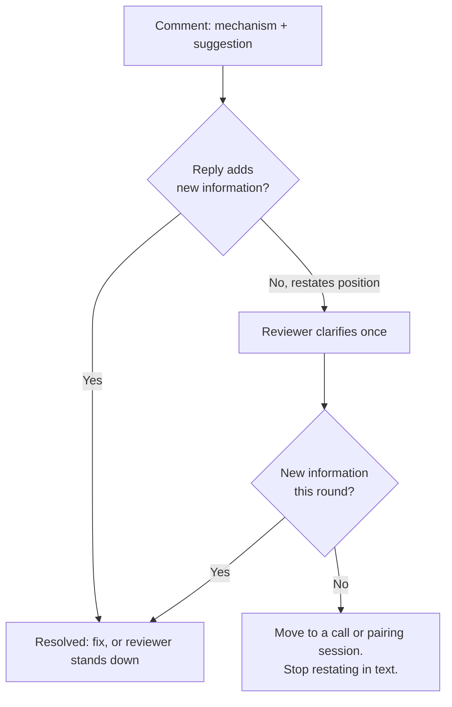

import Scenario from "../../../components/Scenario.astro";
import LevelIntro from "../../../components/LevelIntro.astro";
import Checkpoint from "../../../components/Checkpoint.astro";
import PracticeCheck from "../../../components/PracticeCheck.astro";

export const unit = {
  track: "git-teamwork",
  unitSlug: "feedback-framing",
};

<Scenario label="The thread that shouldn't have taken three rounds">
  <Fragment slot="facts">
    <div class="not-prose flex flex-col gap-2 text-sm text-slate-700 dark:text-slate-300">
      <div class="flex items-center gap-1.5"><span>1️⃣</span> <strong>Round 1</strong> — "This is wrong, just use a hashmap." No line reference.</div>
      <div class="flex items-center gap-1.5"><span>2️⃣</span> <strong>Round 2</strong> — Author pushes back defensively, no code changes.</div>
      <div class="flex items-center gap-1.5"><span>3️⃣</span> <strong>Round 3</strong> — Reviewer restates the same point more forcefully. Two days pass with the diff untouched.</div>
    </div>
  </Fragment>

Round 1: a comment with no line reference and no mechanism, just a verdict.
Round 2: the author, handed a verdict instead of a diagnosis, explains why they
chose what they chose and doesn't touch the code. Round 3: the reviewer,
annoyed that the "obvious" fix hasn't landed, says the same thing louder. Two
days pass and the diff hasn't changed. The reviewer was right about the bug;
**nothing in the first comment let the author act on it directly.** So how do
you rebuild that comment, and when is rebuilding it the wrong response?

</Scenario>

<LevelIntro
  items={[
    "A comment rewritten lever by lever",
    "Where soft framing is the wrong call",
    "Leaving a stuck async thread",
  ]}
/>

## What is actually under review?

The diff behind the thread is a discount lookup inside a loop over incoming
orders:

```python
def apply_discounts(orders, discount_codes):
    for order in orders:
        match = None
        for dc in discount_codes:      # line 4: full scan per order
            if dc["code"] == order.code:
                match = dc
                break
        if match:
            order.total *= 1 - match["percent"] / 100
```

`discount_codes` is scanned in full for every order, so the work is orders
times codes. With eight test orders and three codes nobody notices. With
thousands of orders and dozens of active codes, it matters.

## How does the rewrite improve step by step?

Reviewer A wrote: **"This is wrong, use a hashmap."** Applying the L2 levers
one at a time shows what each one buys:

| Step                | Comment                                                                                                                                                                                   | What is still missing                               |
| ------------------- | ----------------------------------------------------------------------------------------------------------------------------------------------------------------------------------------- | --------------------------------------------------- |
| Original            | "This is wrong, use a hashmap."                                                                                                                                                           | No location, no mechanism, aimed at the person      |
| + Subject: the code | "This inner loop is the problem, use a hashmap."                                                                                                                                          | Still no location, still a bare instruction         |
| + Specificity       | "The inner loop over `discount_codes` (line 4) rescans the whole list for every order, so work grows as orders times codes."                                                              | An unsoftened statement with no invitation to reply |
| + Question framing  | "The inner loop over `discount_codes` (line 4) rescans the whole list for every order, so work grows as orders times codes. Worth building a lookup keyed by code once, before the loop?" | Nothing: all three levers applied                   |

The final version is longer than the original but cheaper to act on. It names
the line, the mechanism and a concrete fix, and it is phrased so the author can
say "yes, doing that" and push in the same sitting. Length was never the
problem; missing information was.

<Checkpoint question="The rewritten comment ends with a question. Suppose the author has a real reason not to build the lookup (the code list is changed in the middle of the loop by a promo-stacking rule the reviewer hasn't seen). Does the question still do its job, or does it just postpone the same instruction by a round-trip?">

It does its job, and this is the case the question exists for. A bare
instruction gives the author nothing to push back with except the reviewer's
authority, and disagreeing feels like defying a directive. A question opens a
legitimate slot for the information the reviewer lacked: "can't cache it, the
list is changed on line 11 by the stacking rule." That settles the thread in
one reply and leaves the reviewer better informed, where two rounds of "do it"
and "no" would have settled nothing. When the author is right, the question is
no slower than the instruction. When the reviewer is the one missing context,
it is the only form that doesn't waste a round-trip.

</Checkpoint>

<PracticeCheck
  track={unit.track}
  unitSlug={unit.unitSlug}
  topicId="comment-rewrite"
/>

## When is soft framing the wrong tool?

The levers don't mean "phrase everything as a gentle question." Consider a
different diff:

```python
def load_user_preferences(user_id):
    query = f"SELECT * FROM preferences WHERE user_id = {user_id}"
    return db.execute(query)
```

`user_id` is pasted straight into the query text, which is a SQL injection
hole. Applying the same rewrite mechanically yields "Worth using a
parameterized query here, in case `user_id` isn't always trustworthy?" The
wording is fine; the _framing_ is the mistake. It presents a must-fix security
defect as an option the author may decline, and a reader skimming a batch has
every reason to treat "worth considering" as low priority.

The fix keeps the first two levers and swaps the third for an explicit
severity: **"`blocking:` this interpolates `user_id` directly into the query,
which allows SQL injection. It needs a parameterized query before merge."**
Still aimed at the code, still specific, but stated as a fact with a marker. The
technique removes _unnecessary_ friction. It does not remove directness from
feedback that genuinely needs it.

| Situation                                          | Right framing                                | Why                                                                 |
| -------------------------------------------------- | -------------------------------------------- | ------------------------------------------------------------------- |
| Style or performance polish, not urgent            | Question, `nit:` if truly optional           | Author may know something you don't; low cost either way            |
| Design disagreement where reasonable people differ | Question that invites the author's reasoning | The answer isn't settled, so stating it as fact overclaims          |
| Security defect, data loss, correctness bug        | Statement, `blocking:`, no softening         | Not a matter of opinion; softening reads as optional and is skipped |

<PracticeCheck
  track={unit.track}
  unitSlug={unit.unitSlug}
  topicId="softening-limits"
/>

## What if the thread is stuck anyway?

Better wording fixes the _first_ round-trip. It cannot fix a thread where
both sides already understand each other and still disagree. **What tells you a
comment should leave the thread instead of being rewritten once more?**

Not a single disagreement; that is normal and often ends with the next reply.
The signal is **two round-trips with no new information on either side**: the
same positions restated, not refined. At that point the medium is the
obstacle. Text strips out the real-time back-and-forth that would settle the
question in a minute of talking, and each extra round costs a response cycle
(hours, or a day across time zones) for nothing new.



Escalating isn't the technique failing. It is the technique recognizing its own
limit: wording cannot create information that has not yet been exchanged.

<Checkpoint question="A reviewer and author have gone two rounds on a design disagreement (one function or two) with no new information either time. The reviewer wants to write one more, even more carefully worded comment. Based on the flowchart, is that the right move?">

No. The flowchart's condition is already met, so the move is out of text, not
more polish inside it. A third comment assumes the first two weren't clear
enough, but here both sides understand each other's position and still
disagree. The bottleneck is the medium, not the wording. A short call lets
each person ask a follow-up at once, often settling in minutes what another
async round would spend a day on, with no guarantee it lands better than the
first two.

</Checkpoint>

<PracticeCheck
  track={unit.track}
  unitSlug={unit.unitSlug}
  topicId="stuck-thread"
/>

## This worked example is a case, not the whole territory

Everything above assumed one reviewer, one author and one thread. Real reviews
are messier. Try extending it yourself:

- **What if there were three reviewers** commenting independently on
  overlapping lines, each unaware of the others? Does "two rounds with no new
  information" mean the same thing when the author is juggling three threads?
  What batch-level habit, beyond severity labels, would stop the author from
  having to reconcile three opinions by hand?
- **What if the news were worse**, for example a design that must be reworked
  from scratch? Which of the three levers still apply, and which severity label
  would you use?
- **What if the author were brand new to the team**, or you were new and
  reviewing a long-standing owner's code? What would change about how much
  context to include, and what would stay the same?
