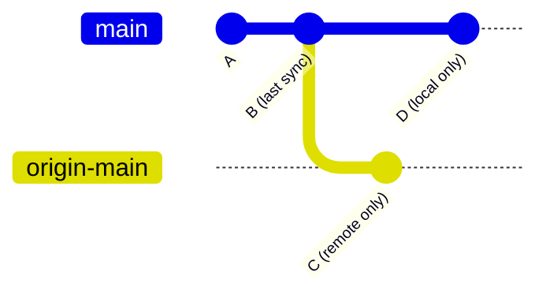
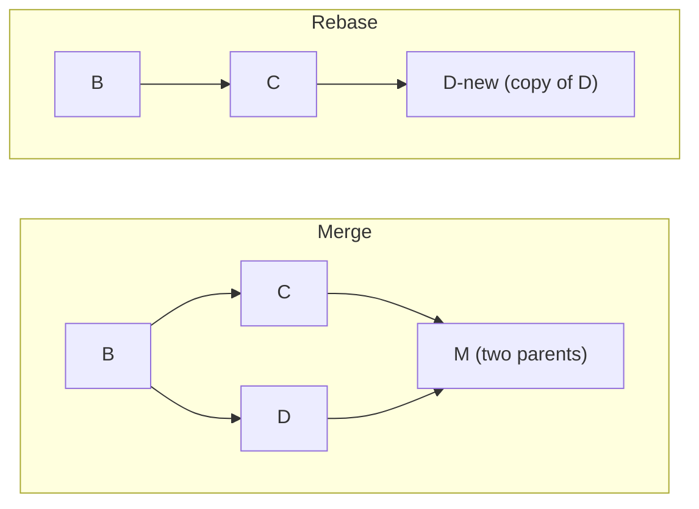

import Scenario from "../../../components/Scenario.astro";
import LevelIntro from "../../../components/LevelIntro.astro";
import PracticeCheck from "../../../components/PracticeCheck.astro";

export const unit = {
  track: "git-teamwork",
  unitSlug: "merge-rebase",
};

<Scenario label="One command, two very different outcomes">
  <Fragment slot="facts">
    

      
✅ <strong>Monday's pull</strong> — clean, no extra commit, history stays a straight line

      
😕 <strong>Tuesday's pull</strong> — same command, but git adds a commit titled "Merge branch 'main' of ..."

      
❓ <strong>Nobody wrote it</strong> — no one typed that commit message, and no code in it belongs to either person

    

  </Fragment>

An engineer runs `git pull` on Monday. It finishes cleanly, no extra
commits, history stays a straight line. On Tuesday, the exact same
command on the exact same branch adds a new commit nobody wrote:
"Merge branch 'main' of ...". **Same command, same person, same repo.
What changed between Monday and Tuesday that made git decide a new
commit was needed this time?**

</Scenario>

<LevelIntro
  items={[
    "Local, remote, and divergence",
    "The four things a pull can do",
    "Merge vs. rebase at a glance",
  ]}
/>

## What does it mean for two copies of history to diverge?

Start with the picture. Monday and Tuesday differ by exactly one thing:
whether the engineer committed something locally before pulling.

On Monday the `D` commit does not exist, so remote is simply further
along the same line. On Tuesday both sides moved on from `B` and now
each has a commit the other lacks. That state is called **divergence**.

- **Local** is your copy of the repository on your machine.
- **Remote** is the shared copy, usually hosted on GitHub, GitLab, or
  another server.
- A **commit** is one saved snapshot, identified by a 40-character hash.
- A **branch** is a movable label pointing at one commit.
- **HEAD** is the commit your current branch points at right now.
- **Divergence** means each side has at least one commit the other does
  not, counted from their last common commit.

<PracticeCheck
  track={unit.track}
  unitSlug={unit.unitSlug}
  topicId="divergence-vocab"
/>

## What can a pull actually do?

`git pull` is two steps glued together: **fetch** the remote's new
commits, then **reconcile** them with your local branch. Which
reconciliation happens depends on the shape of history, and that shape
is what you can read off the result:

| What you see after `git pull`                   | What it usually means                                                                | What to do next                                                               |
| ----------------------------------------------- | ------------------------------------------------------------------------------------ | ----------------------------------------------------------------------------- |
| It finishes quietly, with no merge commit       | Your local commit was already behind remote, so git fast-forwarded your branch       | Keep working; history stayed linear because only remote had moved             |
| An editor opens for a `Merge branch ...` commit | Both local and remote had new commits, so git is recording that the histories joined | Confirm the merge if the combined code is correct; resolve conflicts if asked |
| Git reports conflicts                           | Both histories touched overlapping content that git could not combine automatically  | Edit the files, choose the correct combined result, then complete the merge   |
| You pulled with rebase and see replay messages  | Git is copying your local commits on top of remote's latest commit                   | Check each replayed commit; conflicts can still happen one commit at a time   |

One caution about the table: recent git versions refuse to guess when
history has diverged and you have configured nothing. They stop and ask
you to choose merge, rebase, or fast-forward-only. The merge commit on
Tuesday means merging was the configured (or chosen) behavior.

<PracticeCheck
  track={unit.track}
  unitSlug={unit.unitSlug}
  topicId="pull-outcomes"
/>

## Merge or rebase: the one-line difference

Once histories have diverged there are two ways to combine them:

- **Fast-forward** is when your branch's tip is an ancestor of the
  remote's tip. Git only slides the label forward. No new commit.
- **Merge commit** is a new commit with two parents that records "these
  two histories were joined here." Existing commits are untouched.
- **Rebase** replays your commits one by one on top of the remote's
  latest commit. The copies get new hashes, and the old ones are
  abandoned.

## What the next levels cover

L2 pins down the exact condition for a fast-forward and what merge and
rebase each do to the commit graph, including why rewriting hashes is
risky on shared history. L3 shows how git actually decides (walking
parent pointers) and follows a multi-commit rebase through conflicts.
