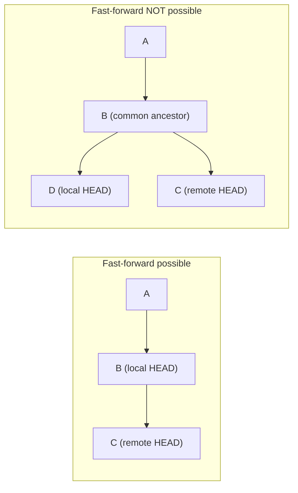
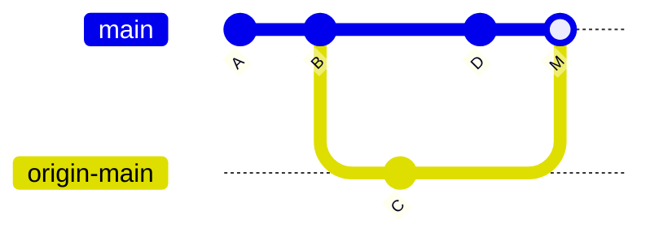
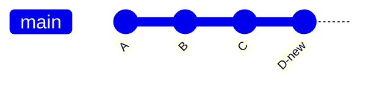
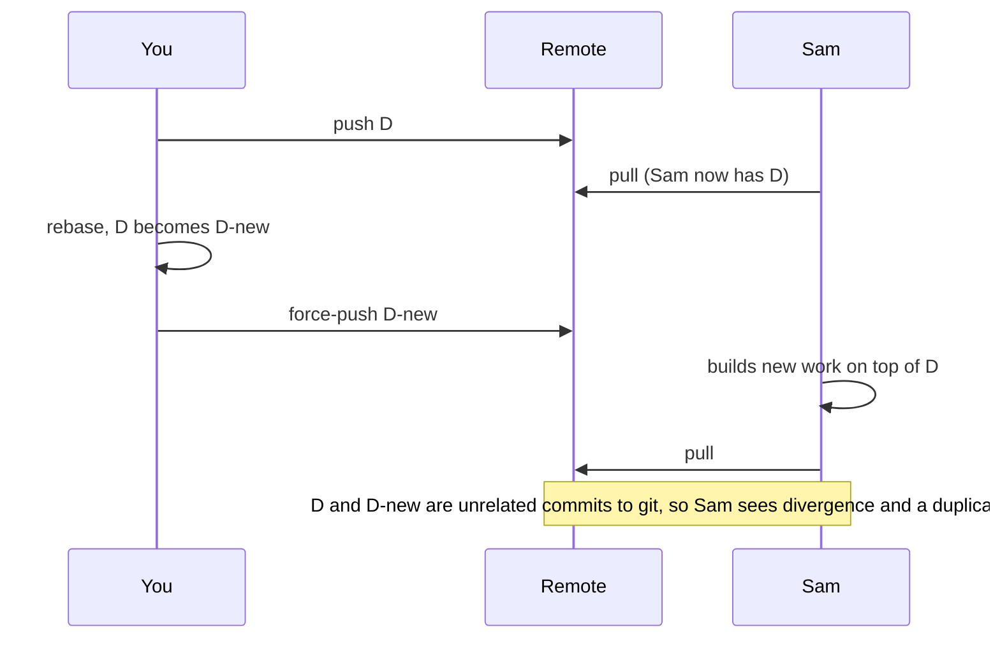

import LevelIntro from "../../../components/LevelIntro.astro";
import Checkpoint from "../../../components/Checkpoint.astro";
import PracticeCheck from "../../../components/PracticeCheck.astro";

export const unit = {
  track: "git-teamwork",
  unitSlug: "merge-rebase",
};

L1 named the possible outcomes of a `pull` (clean fast-forward, merge
commit, rebase replay) without showing what decides which one happens. L2
works out that decision precisely, then what merge and rebase each do
once divergence has occurred.

<LevelIntro
  items={[
    "The exact fast-forward condition",
    "What a merge commit records",
    "What rebase replays, and why it is risky when shared",
  ]}
/>

## What is the exact condition for a fast-forward?

**Is a fast-forward just "whatever happens when there are no
conflicts"?** No. It is a narrow structural condition: your current
commit must be an ancestor of the remote's commit. Nothing new was
committed locally since the two sides last agreed, so "merging" is just
moving your pointer forward along a line that already exists.

| Moment  | Local branch sees | Remote branch sees | Fast-forward possible?                         |
| ------- | ----------------- | ------------------ | ---------------------------------------------- |
| Monday  | `A -> B`          | `A -> B -> C`      | Yes. Local `B` is already inside remote's line |
| Tuesday | `A -> B -> D`     | `A -> B -> C`      | No. `C` and `D` are different children of `B`  |

On Tuesday, `B` has two children and neither `C` nor `D` is an ancestor
of the other. No pointer move can keep both sides' work.

<Checkpoint question="Local has made zero new commits since the last sync, but remote now has three new commits. Is a fast-forward possible?">

Yes. The condition only asks whether local's tip is an ancestor of
remote's tip, not how many commits remote added. Local never moved, so it
still sits inside remote's line, and git slides the pointer to remote's
tip. The size of the gap is irrelevant; only whether local branched off
on its own matters.

</Checkpoint>

<PracticeCheck
  track={unit.track}
  unitSlug={unit.unitSlug}
  topicId="fast-forward-condition"
/>

## What does a merge commit record?

**If a fast-forward is impossible, what does a normal merge create?** A
new commit with **two parents**, one pointing at your last commit (`D`)
and one at remote's last commit (`C`). It is git's honest record that
two histories were reconciled.

`D` and `C` keep their hashes and content. The merge commit `M` is added
after them and points back at both. The graph keeps the branching, which
is useful history: it shows that work really happened in parallel. A
merge commit that appears on Tuesday is not an error; it is the record of
Tuesday's divergence.

<Checkpoint question="A merge commit has two parents. Does creating it change or rewrite the original local and remote commits D and C?">

No. The merge commit is brand new and sits after both. `D` and `C` keep
their hashes, their content, and their parents. Merge only adds; it never
rewrites. That is the detail that makes rebase different, because rebase
is the operation that produces replacement commits with new hashes.

</Checkpoint>

<PracticeCheck
  track={unit.track}
  unitSlug={unit.unitSlug}
  topicId="merge-commit"
/>

## What does rebase do instead?

**Is there a way to avoid the extra commit even when divergence
happened?** Yes. Rebase takes your commits (`D`) and replays them, one at
a time, on top of remote's latest commit (`C`). Each replayed commit has
the same author, message, and change, but a different parent, so it has
a **new hash**.

The history is a straight line `A, B, C, D-new`, as if you had started
your work from `C`. The original `D` is not edited. It is simply no
longer reachable from your branch (it lingers in the reflog for a
while).

| Question                          | Merge                                  | Rebase                                          |
| --------------------------------- | -------------------------------------- | ----------------------------------------------- |
| Extra commit created?             | Yes, one merge commit with two parents | No merge commit                                 |
| New copies of your commits?       | No, originals stay where they are      | Yes, each local commit is replayed as a new one |
| Resulting history shape           | Shows the branch and the join point    | Straight line                                   |
| Original commit hashes preserved? | Yes, all of them                       | No, replayed commits get new hashes             |
| Where can conflicts appear?       | Once, when creating the merge commit   | Possibly at each replayed commit                |

Rebase still reconciles content. It just records the result differently,
and conflicts can still stop it partway through.

<Checkpoint question="After a rebase, the replayed commit has the same message and the same change as before. Why does it still get a different hash?">

A commit's hash is computed from everything in the commit object,
including its parent pointer. The replayed commit has the same content but
sits on a different parent (`C` instead of `B`), so the object is
different and so is its hash. This is also why "identical-looking"
commits before and after a rebase are, to git, two unrelated objects.

</Checkpoint>

<PracticeCheck
  track={unit.track}
  unitSlug={unit.unitSlug}
  topicId="rebase-replay"
/>

## Is merge vs. rebase just taste?

**Why do teams have rules like "never rebase shared branches"?** Because
rewritten hashes change the coordinates other people may already be using.

Merge never rewrites existing commits, so it is safe on history others
already have. Rebase gives a cleaner line but is safest on commits only
you have. The trade-off is a tidy history against a small risk of
breaking someone else's copy. The `shared-history` unit takes that risk
on directly.

<Checkpoint question="You rebased a branch that you never pushed. Who could possibly be affected by the new hashes?">

Nobody. The old hashes only ever existed in your own repository, so no one
else holds a reference to them. Rewriting purely local commits is exactly
the safe use of rebase, and it is how people tidy a branch before sharing
it. The danger begins the moment someone else has fetched the old commits.

</Checkpoint>

<PracticeCheck
  track={unit.track}
  unitSlug={unit.unitSlug}
  topicId="merge-vs-rebase-risk"
/>

## The generalizable lesson

The same structural question governs every merge git performs, whether
from `pull`, an explicit `git merge`, or a merged pull request: **did the
two sides diverge, or does one simply have more history?** Everything
visible (clean update, merge commit, replay) follows from the answer.
