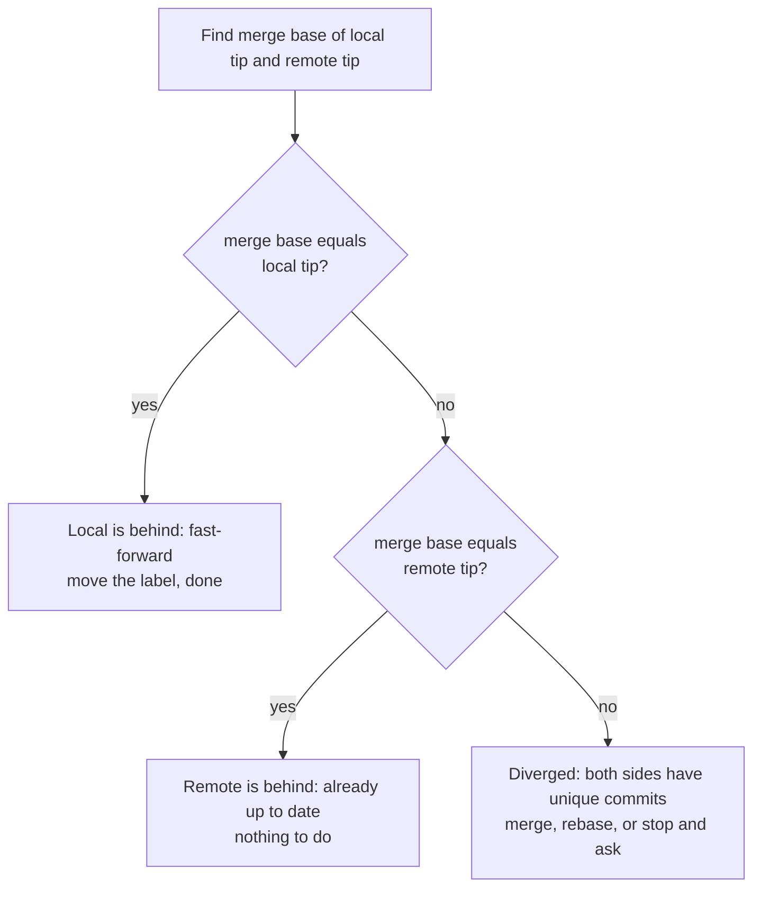
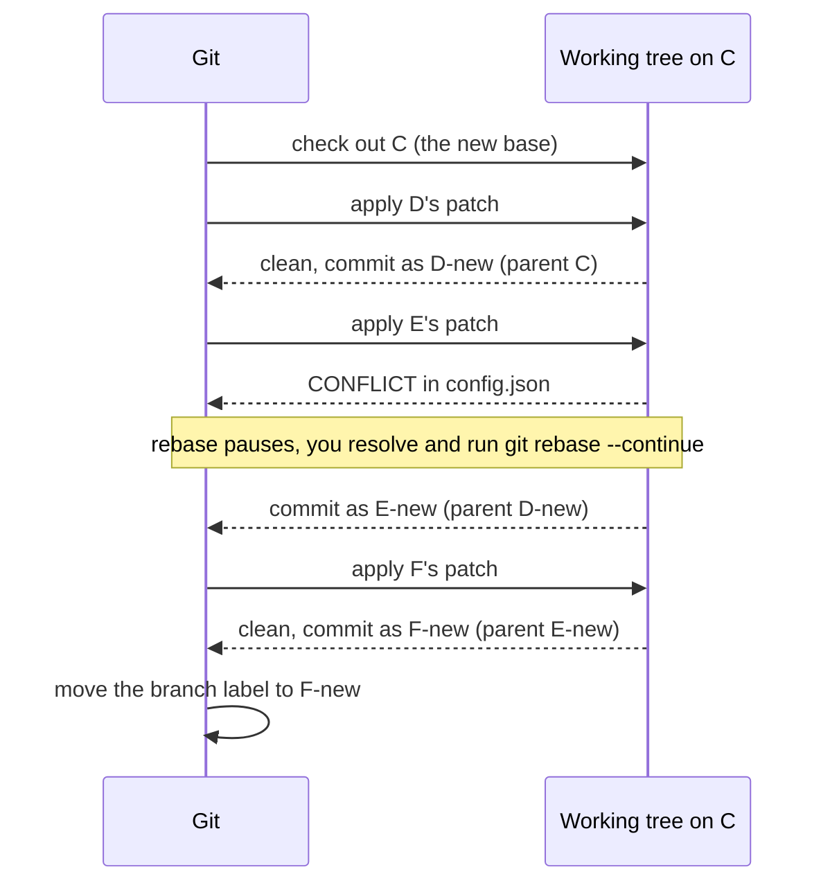
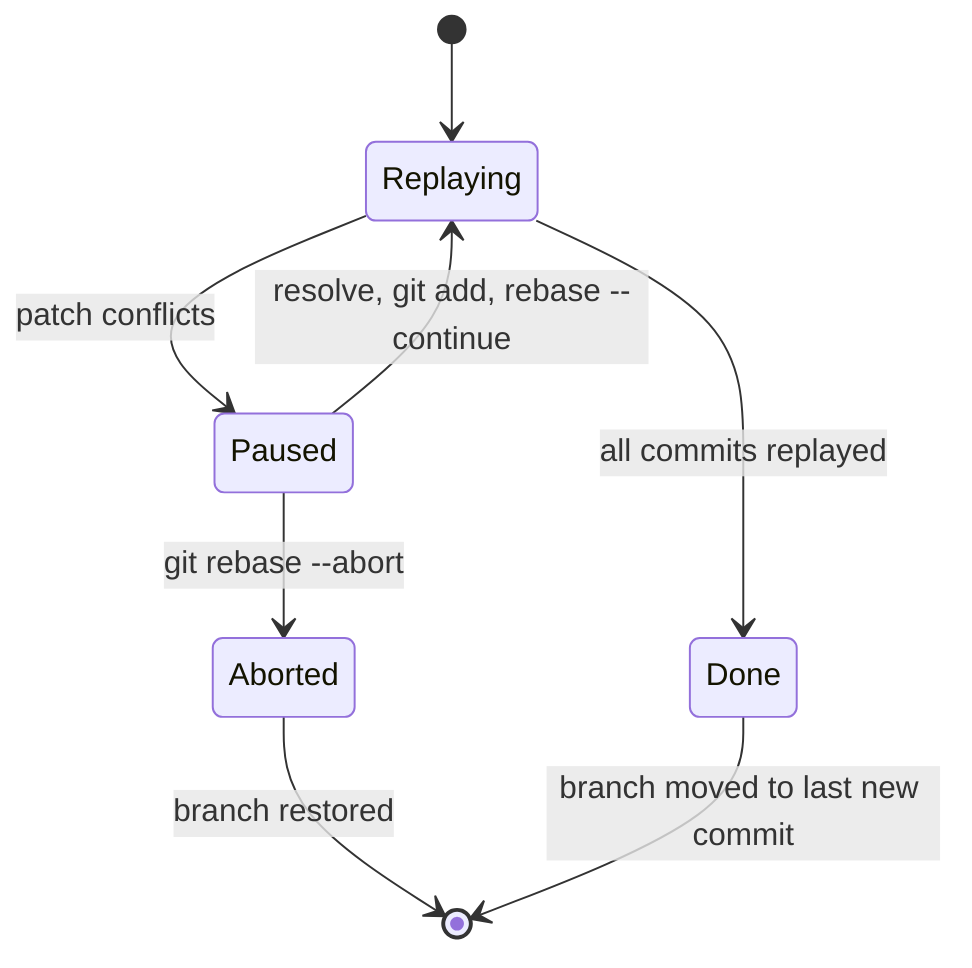

import Scenario from "../../../components/Scenario.astro";
import LevelIntro from "../../../components/LevelIntro.astro";
import Checkpoint from "../../../components/Checkpoint.astro";
import PracticeCheck from "../../../components/PracticeCheck.astro";

export const unit = {
  track: "git-teamwork",
  unitSlug: "merge-rebase",
};

<Scenario label="Three local commits, one new remote commit">
  <Fragment slot="facts">
    

      
🌳 <strong>Last sync</strong> — both sides agree up to <code>B</code>

      
☁️ <strong>Remote</strong> — one new commit <code>C</code> touching <code>config.json</code>

      
💻 <strong>Local</strong> — three commits <code>D</code>, <code>E</code>, <code>F</code>; only <code>E</code> also touches <code>config.json</code>

      
🔁 <strong>Plan</strong> — <code>git pull --rebase</code>

    

  </Fragment>

Before reading further, predict. Rebase will replay `D`, `E`, `F` on top of
`C`. **Where will it stop, what will it ask of you, and what will the
history look like when you finish?** Also: while it is stopped, which
side does git call "ours"?

</Scenario>

<LevelIntro
  items={[
    "How git walks history to decide",
    "A rebase replay, step by step",
    "Conflicts mid-rebase and ours vs. theirs",
  ]}
/>

## How does git know whether a fast-forward is possible?

**There is no "pull mode" flag. How does git decide?** It follows parent
pointers. Every commit records its parent (a merge commit records two),
so "is X an ancestor of Y" means "can I reach X by walking back from Y."
The question git really asks is about the **merge base**, the best common
ancestor of the two tips.

This also explains the two counters `git status` reports after a fetch:
commits only you have (ahead) and commits only the remote has (behind).
Fast-forward is "ahead is zero." Divergence is "both are non-zero," and
git literally says "have diverged, and have 1 and 1 different commits
each."

| Ahead | Behind | State           | Pull behaves as                           |
| ----- | ------ | --------------- | ----------------------------------------- |
| 0     | 0      | Up to date      | Nothing to do                             |
| 0     | 3      | Strictly behind | Fast-forward                              |
| 2     | 0      | Strictly ahead  | Nothing to pull (you may push)            |
| 2     | 3      | Diverged        | Merge commit, rebase, or refusal to guess |

<Checkpoint question="Local is 2 commits ahead and 0 behind. Would git pull create a merge commit?">

No. Zero behind means the remote has nothing local lacks, so the remote
tip is already an ancestor of local. The merge base equals the remote
tip, and git reports "Already up to date." A merge commit needs unique
commits on both sides. The same symmetry shows that "ahead only" is a
push situation, not a pull one.

</Checkpoint>

<PracticeCheck
  track={unit.track}
  unitSlug={unit.unitSlug}
  topicId="reachability-walk"
/>

## What does a multi-commit rebase actually do?

**What happens to three commits instead of one?** Git first sets your
branch aside, moves to the new base (`C`), then replays your commits
**oldest first**, each on top of the previous replayed one.

Three things matter here. Only `E` collides because only `E` touched the
same lines as `C`, so git stops exactly there. `F-new` is parented on
`E-new`, so every commit after the first rewrite also gets a new hash,
even if it was clean. And the branch label only moves once the whole
replay succeeds, which is why `git rebase --abort` can put you back
exactly where you were.

<Checkpoint question="E conflicts and you resolve it. Does D-new, the commit already replayed before the conflict, get redone?">

No. `D-new` is already committed on top of `C` and stays as it is. The
rebase resumes from `E` with your resolution and continues to `F`. But
`F-new` will be parented on your resolved `E-new`, which is why a conflict
in the middle changes the hashes of everything after it, not before it.

</Checkpoint>

<PracticeCheck
  track={unit.track}
  unitSlug={unit.unitSlug}
  topicId="rebase-in-practice"
/>

## Which side is "ours" while you resolve a rebase conflict?

**Surprise: it is reversed.** In a merge, "ours" (the `HEAD` side of the
markers) is your branch. In a rebase, git builds the new history on top of
the upstream commit, so `HEAD` is the base you are replaying onto, and
the commit being applied is "theirs."

| Operation             | "ours" / `HEAD` side of markers         | "theirs" side of markers          |
| --------------------- | --------------------------------------- | --------------------------------- |
| `git merge other`     | Your branch                             | `other`                           |
| `git rebase upstream` | `upstream` plus commits replayed so far | The commit being replayed (yours) |

So in the pulled-rebase scenario above, the half of the marker block
labelled `HEAD` holds the remote's content from `C`, and the lower half
holds your commit `E`. Picking "ours" in a rebase means keeping the
remote's version, which is the opposite of what most people mean.

## This example is a case, not the whole territory

The scenario had one new remote commit and one conflicting local commit.
Stretch it:

- **What changes if the remote had five new commits and all three of yours
  conflicted?** You would resolve up to three times, once per replayed
  commit, where a merge would have asked once. A very conflict-heavy
  branch can make merge the lower-effort choice.
- **What changes if you had already pushed D, E, F before rebasing?** The
  new hashes diverge from the pushed ones. Updating the remote needs a
  force push (preferably with a lease check), and anyone who fetched the
  old commits has to recover.
- **What changes if a commit in the middle became empty because the remote
  already contained the same change?** Rebase notices the patch is
  already applied and drops it or asks you, so the replayed count can be
  smaller than the original.
- **What changes if your branch contains a merge commit?** Plain rebase
  flattens it away by default, which can silently change history shape.

<Checkpoint question="You rebased commits you had already pushed, then plain git push is rejected. Is git broken?">

No, git is protecting the remote. Your new commits are not descendants of
the pushed ones, so the push would not be a fast-forward of the remote
branch and git refuses it. Forcing it with a lease check (which fails if
someone else pushed meanwhile) is the deliberate, narrower alternative to
a blind force push, and it should only be done on a branch nobody else
builds on.

</Checkpoint>

## Failure modes

| Failure mode                                                  | What it gets wrong                                                                       |
| ------------------------------------------------------------- | ---------------------------------------------------------------------------------------- |
| Assuming a merge commit means something went wrong            | It is the correct record that real divergence happened                                   |
| Rebasing commits already pushed and pulled by someone else    | Rewrites hashes, leaving others with history that diverges from the new one              |
| Treating merge vs. rebase as purely aesthetic                 | Rewritten hashes carry real risk on shared history that merge structurally avoids        |
| Assuming fast-forward depends on how big the local change was | It depends only on the ancestor relationship; one trivial local commit forces divergence |
| Confusing "no merge commit" with "nothing was reconciled"     | Rebase still reconciles content and can hit conflicts at every replayed commit           |
| Choosing "ours" mid-rebase thinking it means your own work    | During rebase, "ours" is the upstream you replay onto; your commit is "theirs"           |
| Resolving a mid-rebase conflict and forgetting to continue    | The rebase stays paused; the branch label has not moved yet                              |
