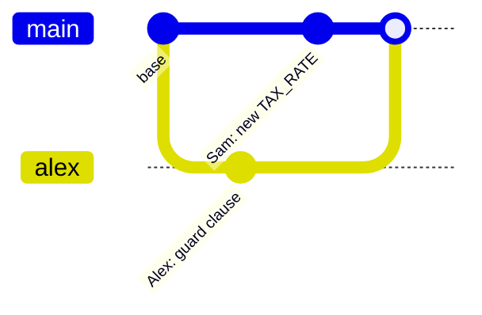

import Scenario from "../../../components/Scenario.astro";
import LevelIntro from "../../../components/LevelIntro.astro";
import PracticeCheck from "../../../components/PracticeCheck.astro";

export const unit = {
  track: "git-teamwork",
  unitSlug: "merge",
};

<Scenario label="Two branches, one shared file">
  <Fragment slot="facts">
    

      
🌿 <strong>Alex's branch</strong> — adds a null-check guard inside <code>calculateTotal</code>

      
🌿 <strong>Sam's branch</strong> — changes the <code>TAX_RATE</code> constant, same file

      
🌳 <strong>Shared ancestor</strong> — the commit both branches started from

    

  </Fragment>

Alex and Sam both branched off the same commit of `cart.js` this morning.
Alex added a guard clause; Sam changed a constant. Neither has seen the
other's work. **When Sam runs `git merge alex-branch`, does git need a
human to sort this out, or can it figure it out alone?**

</Scenario>

<LevelIntro
  items={[
    "What decides auto-merge vs. conflict",
    "Merge base and three-way merge",
    "The minimum loop for resolving a conflict",
  ]}
/>

## Same file, two histories

The two branches share one starting commit, then each moves on its own.
Editing the **same file** is not what causes trouble. What decides
"auto-merge" or "human, please look" is **which exact lines** each side
touched.

## Key terms

- **Merge base** — the last commit both branches share. It is the
  "before" picture that lets git tell "Alex added this line" from "this
  line was always there."
- **Three-way merge** — compare the merge base against _both_ branches
  (not the two branches against each other). This lets git credit each
  change to whoever made it.
- **Auto-merge** — the branches changed different lines, so git combines
  both changes with no questions.
- **Conflict** — both branches changed the _same_ line to _different_
  content. Git cannot guess, so it stops and asks.
- **Conflict markers** — `<<<<<<<`, `=======`, `>>>>>>>` — git writes both
  versions into the file so you can see and settle them.
- **Fast-forward** — one branch is simply ahead of the other, with no
  divergence. Git just moves the pointer, so nothing can conflict.

<PracticeCheck
  track={unit.track}
  unitSlug={unit.unitSlug}
  topicId="merge-base-three-way"
/>

## When does git ask for help?

Here is Alex and Sam's file as three columns. Only the last row is a
problem:

| Line                         | Base         | Alex's branch | Sam's branch | Result       |
| ---------------------------- | ------------ | ------------- | ------------ | ------------ |
| guard                        | _(no guard)_ | guard added   | _(no guard)_ | take Alex's  |
| `TAX_RATE`                   | `0.08`       | `0.08`        | `0.0825`     | take Sam's   |
| `TAX_RATE` (second scenario) | `0.08`       | `0.0825`      | `0.075`      | **conflict** |

In the last row both people edit the same constant, differently.

Two edits that land on different lines combine. Two different edits to
the same line cannot be combined by a machine, because only a person knows
which one is right.

<PracticeCheck
  track={unit.track}
  unitSlug={unit.unitSlug}
  topicId="conflict-vs-automerge"
/>

## When git asks for help

A conflict is not git destroying work. It is git refusing to guess. The
minimum human loop:

1. Open each conflicted file.
2. Read the sections between `<<<<<<<`, `=======`, and `>>>>>>>`.
3. Decide the final content: one side, both, or a better version.
4. Delete the markers.
5. Run the relevant test, build, or manual check.
6. Stage the file with `git add`, then finish the merge.

Deleting markers fixes the file's shape, not its logic, so the check in
step 5 is part of the merge.

## What the next levels cover

L2 shows _why_ three versions (not two) make auto-merge possible and how
auto-merge, conflict, and fast-forward are one mechanism. L3 walks one
conflict from markers to resolution and then looks at what a line-based
merge cannot see.
