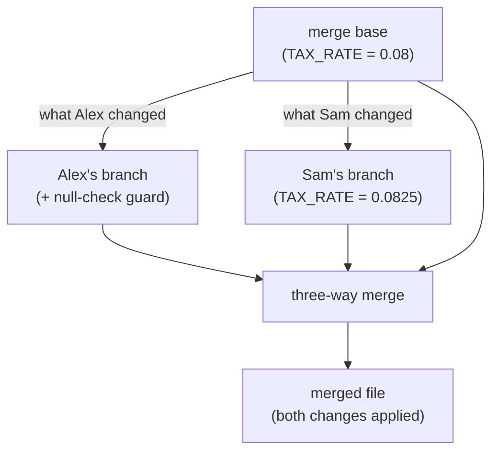
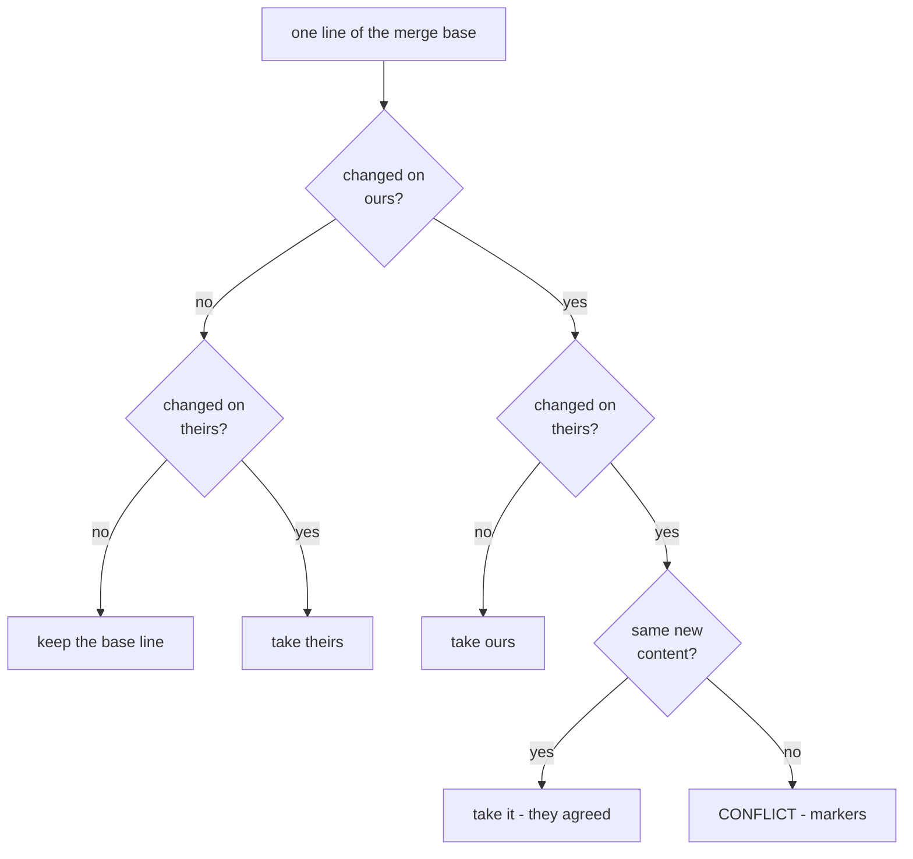

import LevelIntro from "../../../components/LevelIntro.astro";
import Checkpoint from "../../../components/Checkpoint.astro";
import PracticeCheck from "../../../components/PracticeCheck.astro";

export const unit = {
  track: "git-teamwork",
  unitSlug: "merge",
};

L1 named the pieces — merge base, three-way merge, conflict markers —
without showing _why_ three versions beat two. L2 works through that
reasoning, and shows that auto-merge, conflict, and fast-forward are
outcomes of one mechanism.

<LevelIntro
  items={[
    "Why two files alone can't be merged safely",
    "The per-line decision git makes",
    "Auto-merge, conflict, fast-forward as one mechanism",
  ]}
/>

## Why not just compare the two branches?

**If Alex's file and Sam's file differ, why not merge whatever is
different?** Picture two photos of the same room. One shows a new lamp,
the other shows the sofa moved. Looking at them side by side you see two
differences, but you cannot tell whether the lamp was _added_ in one photo
or _removed_ in the other. You need the original photo. Git uses the
original — the merge base — and compares each branch against it
separately:

Base→Alex is Alex's change list; base→Sam is Sam's. Now git can compare
the two change lists _to each other_, and that is the question that
decides everything: do they touch the same lines?

<Checkpoint question="Why can't a plain two-way comparison between Alex's file and Sam's file tell git whether it is safe to merge them?">

A two-way comparison only shows that the files disagree at some line. It
has no record of who changed it and who left it alone, because it never
saw the original. Without the merge base git can't tell "Alex changed
this and Sam didn't" from "Sam changed this and Alex didn't" from "both
changed it differently," and those need three different outcomes.
Comparing each side to the same starting point recovers exactly that
missing information.

</Checkpoint>

<PracticeCheck
  track={unit.track}
  unitSlug={unit.unitSlug}
  topicId="line-decision"
/>

## The decision git makes for each line

**For one line of the base file, what does git do?** It asks two
questions — did ours change it? did theirs change it? — and the answers
decide everything:

Only one leaf of this tree needs a person. Names to keep straight:

| Name   | Plain picture                              | In the scenario                                    |
| ------ | ------------------------------------------ | -------------------------------------------------- |
| Base   | The original photo before anyone edited it | The morning commit both branches started from      |
| Ours   | The photo from the branch you are on       | Sam's branch while running `git merge alex-branch` |
| Theirs | The photo from the branch being brought in | Alex's branch                                      |

Lines _inserted_ between two base lines are handled the same way,
anchored to the nearest base line that survives.

<Checkpoint question="Alex and Sam both independently change TAX_RATE to 0.0825 — the exact same value. Is that a conflict?">

No. The only path in the tree that reaches a human is "both changed it
and the new content differs." When both changes are identical there is no
disagreement to resolve, even though two independent edits happened, so
git simply takes the shared result.

</Checkpoint>

## One mechanism, three outcomes

**Are auto-merge, conflict, and fast-forward three different features?**
No. The same comparison produces all three; only what it finds differs:

| Situation                                                         | What the two change lists look like | Outcome                              |
| ----------------------------------------------------------------- | ----------------------------------- | ------------------------------------ |
| Alex adds a guard clause; Sam changes an unrelated constant       | Different lines on each side        | **Auto-merge**: both applied         |
| Both edit `TAX_RATE`, to different numbers                        | Same line, different content        | **Conflict**: a person decides       |
| Both change `TAX_RATE` to the same new number                     | Same line, identical content        | **Auto-merge**: they agreed          |
| Sam's branch has no commits since branching; Alex has moved ahead | One side's change list is empty     | **Fast-forward**: pointer just moves |

Fast-forward is the degenerate case: if the branch receiving the merge
hasn't moved since the split, there is nothing to reconcile, so git slides
its pointer forward and creates no merge commit. That is why `git merge`
sometimes makes a merge commit and sometimes doesn't. The `merge-rebase`
unit goes deeper.

<PracticeCheck
  track={unit.track}
  unitSlug={unit.unitSlug}
  topicId="merge-outcomes"
/>

## Why short-lived branches conflict less

**Is "keep branches short" just folklore?** It follows from the mechanism:
the more lines a branch touches, and the longer it lives while others keep
touching the file, the likelier some line lands in _both_ change lists
with different content. Conflict risk comes from accumulated line-level
overlap, not from the number of people in the repo.
