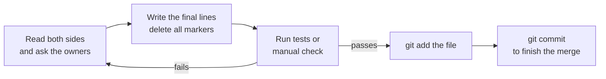

import Scenario from "../../../components/Scenario.astro";
import LevelIntro from "../../../components/LevelIntro.astro";
import Checkpoint from "../../../components/Checkpoint.astro";
import PracticeCheck from "../../../components/PracticeCheck.astro";

export const unit = {
  track: "git-teamwork",
  unitSlug: "merge",
};

<Scenario label="The merge stops, and the file now looks broken">
  <Fragment slot="facts">
    <div class="not-prose flex flex-col gap-2 text-sm text-slate-700 dark:text-slate-300">
      <div class="flex items-center gap-1.5"><span>📄</span> <strong>Base</strong> — <code>TAX_RATE = 0.08</code></div>
      <div class="flex items-center gap-1.5"><span>🌿</span> <strong>Ours (Sam)</strong> — <code>0.0825</code></div>
      <div class="flex items-center gap-1.5"><span>🌿</span> <strong>Theirs (Alex)</strong> — <code>0.075</code></div>
      <div class="flex items-center gap-1.5"><span>🛑</span> <strong>Result</strong> — git stops with markers in <code>cart.js</code></div>
    </div>
  </Fragment>

Sam runs `git merge alex-branch`. Git reports a conflict in `cart.js` and
the file now contains lines Sam never wrote. **Which text belongs to whom,
what exactly is left for Sam to decide, and how does Sam know the finished
file is right and not merely tidy?**

</Scenario>

<LevelIntro
  items={[
    "Reading a marker block line by line",
    "Resolving, then proving the result",
    "What a line-based merge cannot see",
  ]}
/>

## What is in a marker block?

**Which side is which?** The three marker lines split the block into two
labelled halves:

```text
<<<<<<< HEAD
const TAX_RATE = 0.0825;
=======
const TAX_RATE = 0.075;
>>>>>>> alex-branch
```

| Part                               | Meaning                                                 |
| ---------------------------------- | ------------------------------------------------------- |
| `<<<<<<< HEAD` to `=======`        | **Ours**: the branch you are on (Sam's `0.0825`)        |
| `=======` to `>>>>>>> alex-branch` | **Theirs**: the branch being merged in (Alex's `0.075`) |
| Anything outside the markers       | Already merged cleanly; leave it alone                  |

Markers are plain text that git inserted. They are a question, not an
answer, and the file will not compile or pass lint until they are gone.

The decision for every line of the file is as simple as this (shown as
the one function that matters; real git works on blocks, but the logic
per line is the same):

```js
function mergeLine(base, ours, theirs) {
  if (ours === theirs) return ours; // agreed, or nobody changed it
  if (ours === base) return theirs; // only theirs changed it
  if (theirs === base) return ours; // only ours changed it
  return null; // both changed it differently: conflict
}
```

<PracticeCheck
  track={unit.track}
  unitSlug={unit.unitSlug}
  topicId="conflict-resolution"
/>

## Resolving and proving it

**Does deleting the markers resolve the conflict?** It removes the
_symptom_. The sequence has two halves, and the second is easy to skip:



Git cannot know whether finance wanted `0.0825`, `0.075`, or a third
number. Whichever is chosen, the file now has one valid line:

```js
const TAX_RATE = 0.0825; // confirmed with finance
```

`git add` tells git "this file is settled"; it does not tell git the
choice was _right_. Only the check in the middle does that.

<Checkpoint question="Sam deletes the markers, keeps 0.0825, stages the file, and git lets the merge finish. Is the merged code now known to be correct?">

Not at all. Git's job in a conflict is structural: it stopped because it
found lines it could not reconcile, and it considers its part done once
the markers are gone and the file is staged. Whether `0.0825` is the
right tax rate is a business question git has no way to check. That is
why the loop runs a test or a manual check after the edit: removing the
markers proves the conflict is gone, not that the decision made while
resolving it was good.

</Checkpoint>

## What can a line-based merge miss?

**If git reports no conflict, is the result guaranteed to work?** No.
Git compares lines, so it only sees collisions at the line level:

| Case                                                         | What git sees                     | What can go wrong                                          |
| ------------------------------------------------------------ | --------------------------------- | ---------------------------------------------------------- |
| Alex renames a function; Sam adds a new call to the old name | Different lines: clean auto-merge | Merged code calls a function that no longer exists         |
| Alex edits line 10, Sam edits line 11                        | Adjacent lines, may be flagged    | A conflict even though the edits are logically independent |
| Alex reformats whitespace; Sam changes logic on those lines  | Same lines changed                | A noisy conflict that hides the real change                |
| Both add the same rule in two different spots                | Different lines: clean auto-merge | The rule now runs twice                                    |

The first row is the important one: a **semantic conflict** — two changes
that are each fine but wrong together — merges cleanly. A clean merge
means no line collided; only tests can say the program still works.

<Checkpoint question="Why can a merge with zero conflicts still produce broken code?">

Because git's definition of "conflict" is purely about lines: two sides
changed the same place in different ways. Two edits in different places
never collide in that sense, even when one depends on something the other
removed or renamed. The merge machinery is blind to meaning, so the safety
net for meaning is running the test suite on the merged result, which is
why teams run CI on the merge, not only on each branch.

</Checkpoint>

<PracticeCheck
  track={unit.track}
  unitSlug={unit.unitSlug}
  topicId="merge-limits"
/>

## This example is a case, not the whole territory

Everything above used one file, two branches, and one constant. Try
stretching it:

- **What changes if a third teammate also edited `TAX_RATE`?** One merge
  only reconciles two sides against one base, so you merge in steps. The
  second merge's "base" is a result that never existed as a single commit,
  which is why juggling many long-lived branches produces confusing
  conflicts.
- **What changes if Alex had deleted the whole function Sam edited?** A
  delete on one side and an edit on the other is a conflict too, and the
  question for the human becomes "should this code exist at all?"
- **What changes if the edits were in different files?** Nothing for git,
  yet the semantic risk in the table above is still there.

## Failure modes

| Failure mode                                          | What goes wrong                                               |
| ----------------------------------------------------- | ------------------------------------------------------------- |
| Comparing two branches directly instead of via a base | Can't tell who changed what, so nothing is safe to auto-merge |
| Treating "same line touched" as always a conflict     | Misses the case where both made the identical edit            |
| Deleting markers and committing without a check       | Git is satisfied; the logic may be wrong                      |
| Committing a file with a marker line left in          | Broken build, or markers shipped in the source                |
| Assuming a clean merge is a working merge             | Semantic conflicts slip through unseen                        |
| Letting a branch live for weeks                       | Overlap accumulates and conflicts get large and hard to read  |
