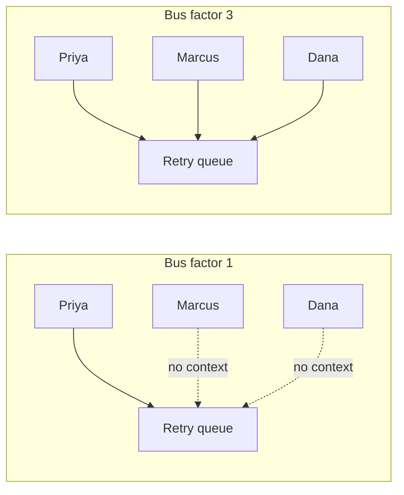
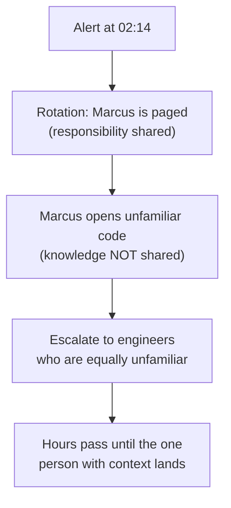

import Scenario from "../../../components/Scenario.astro";
import LevelIntro from "../../../components/LevelIntro.astro";
import PracticeCheck from "../../../components/PracticeCheck.astro";

export const unit = {
  track: "git-teamwork",
  unitSlug: "ownership",
};

<Scenario label="One person, one system, one bad night">
  <Fragment slot="facts">
    

      
🧑‍💻 <strong>Priya</strong> — wrote the payments-retry queue alone, 8 months ago; nobody else has touched it since

      
✈️ <strong>Tonight</strong> — Priya is on a 10-hour flight, unreachable

      
🚨 <strong>02:14</strong> — the queue starts double-charging customers; Marcus is on-call and has never opened this code

      
⏱️ <strong>Outcome</strong> — fixed at 04:54, 4 minutes after Priya landed and read one log line

    

  </Fragment>

Marcus is on-call. At 2:14 AM an alert fires: the payments-retry queue is
re-submitting charges that already succeeded, and customers are being billed
twice. Marcus opens the code and recognizes none of it. Priya wrote the whole
thing alone eight months ago, and nobody else has ever needed to change it.
Marcus pages two more engineers who don't know the code either, and the team
guesses at fixes while charges keep duplicating. When Priya lands and reads
one log line, she names the cause and ships a fix in four minutes. **The fix
wasn't hard. What actually cost the team nearly three hours?**

</Scenario>

<LevelIntro
  items={[
    "Bus factor as a team risk",
    "Why a pager schedule is not shared knowledge",
    "Where the incident time actually went",
  ]}
/>

## Whose problem was it, really?

Marcus didn't lack skill. He lacked **access to what Priya already knew**,
and that knowledge lived in exactly one head. When that head was on a plane,
the team's ability to fix its own system dropped to nearly zero. The outage
was a knowledge-distribution problem that had been building for eight months
before it showed up as an incident.

| What looked like the problem               | What was actually the problem                   |
| ------------------------------------------ | ----------------------------------------------- |
| Marcus was slow to find the bug            | Marcus had never seen this code before tonight  |
| The team escalated too many times          | Nobody else had context to escalate _to_        |
| The fix took almost three hours            | The fix took 4 minutes; discovery took the rest |
| Priya is "just really good" at this system | Priya is the _only_ input to this system        |

The measure of this risk has a name. **Bus factor** is the number of people
who could disappear (quit, fall ill, board a flight) before the system can no
longer be maintained. Here it was 1.

<PracticeCheck
  track={unit.track}
  unitSlug={unit.unitSlug}
  topicId="bus-factor"
/>

## Doesn't a pager rotation already fix this?

Marcus was on the rotation, after all. **If sharing the pager shares the
problem, why did sharing it change nothing?** Because a rotation answers
_who gets woken up_, not _who understands the system_. Marcus was paged
correctly and arrived with nothing.

Key terms for the rest of the unit:

- **Single-owner model**: one person is the default owner of an area;
  changes and incident response route through them.
- **Collective ownership**: anyone on the team changes any part of the code;
  no single bottleneck, but depth must be maintained on purpose.
- **Runbook**: a written, checked-in procedure for one class of alert, usable
  by whoever is on-call, not only by the author.

<PracticeCheck
  track={unit.track}
  unitSlug={unit.unitSlug}
  topicId="rotation-vs-knowledge"
/>

## What the next levels cover

L2 weighs the two ownership models honestly (each has a real cost) and shows
what a rotation needs beyond a schedule: a runbook and a real escalation
path. L3 walks the full incident, the runbook and co-owner the team built
afterward, and a second case where spreading ownership across everyone was
the mistake.
