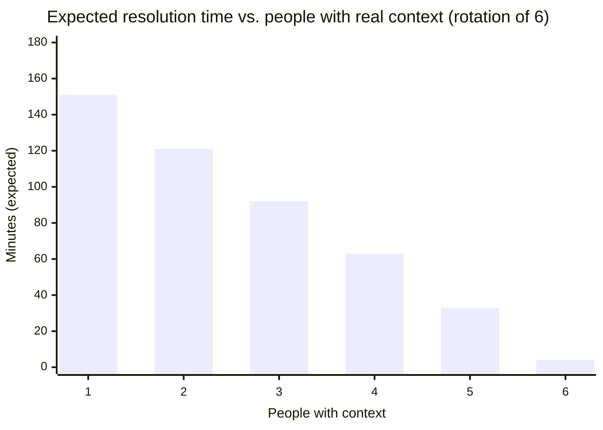
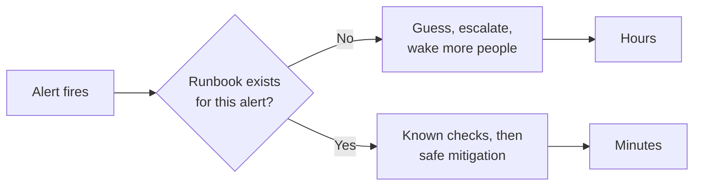

import LevelIntro from "../../../components/LevelIntro.astro";
import Checkpoint from "../../../components/Checkpoint.astro";
import PracticeCheck from "../../../components/PracticeCheck.astro";

export const unit = {
  track: "git-teamwork",
  unitSlug: "ownership",
};

L1 named the 2:14 AM failure as a knowledge-distribution problem, not a skill
problem. L2 works out the trade-off between ways of distributing ownership,
and what must exist beyond a rotation schedule for on-call to work when the
original author is unreachable.

<LevelIntro
  items={[
    "Single-owner vs. collective ownership trade-off",
    "How much shared context shortens an incident",
    "Runbook and escalation path as stand-ins for the author",
  ]}
/>

## Was making Priya the sole owner the mistake?

**If sole ownership caused the outage, should the team never have allowed
it?** Not necessarily. One person who has touched every corner of a system
builds intuition that is hard to replicate by committee, and for a complex,
high-stakes component that depth can mean fewer bugs day to day. The mistake
was not choosing single ownership. It was doing nothing for eight months to
raise the bus factor it created: no pairing, no written notes, no second
reviewer with real context.

|                                          | Single-owner                      | Collective ownership                                 |
| ---------------------------------------- | --------------------------------- | ---------------------------------------------------- |
| Bus factor                               | 1 (or the number of named owners) | Whole team                                           |
| Depth of expertise per person            | High in one place                 | Lower per person unless maintained deliberately      |
| Consistency of decisions                 | High: one set of judgment calls   | Needs active alignment (review, conventions)         |
| Incident response when the owner is away | Fails unless a runbook exists     | Degrades gracefully: someone has _some_ context      |
| Ongoing cost                             | Low effort, concentrated risk     | More effort (pairing, docs, review), spread-out risk |

Neither column wins in the abstract. The deciding question is how costly it is
if the one owner is unreachable at the worst moment. A batch script run once a
quarter on request can stay single-owned forever. A system that pages someone
at 2 AM cannot, because the premise of on-call is that _someone other than the
author_ can act.

<Checkpoint question="The team adds a second engineer to the pager rotation for the retry queue, but that engineer has never opened its code. Has the bus-factor-1 problem been fixed?">

No. Adding a name to the rotation changes who gets woken up, not who
understands the system. The new engineer would receive the alert and then open
unfamiliar code, exactly as Marcus did, and lose the same hours rediscovering
what Priya already knew. A schedule distributes the responsibility to respond;
it does nothing to distribute the knowledge required to respond well, so a
bus factor only rises when a second person genuinely builds context.

</Checkpoint>

<PracticeCheck
  track={unit.track}
  unitSlug={unit.unitSlug}
  topicId="ownership-tradeoff"
/>

## How much does shared context actually buy?

**Is spreading context worth the effort, or is one expert plus a pager
enough?** Take the incident's rough numbers: someone with context applies the
known fix in about 4 minutes; someone without it needs about 180 minutes to
diagnose from scratch. If the person paged is effectively random among a
six-person rotation, the expected resolution time falls steadily as more of
the rotation gains real context (the interactive demo for this unit lets you
drag this yourself).

Two cautions on reading this. The numbers are illustrative inputs, not
measurements, and the model assumes the paged person is chosen at random. The
shape is the point: each person who truly gains context removes a similar slice
of expected delay, and the first one matters most because it moves a team from
"only one possible fix" to "some chance of a fast one."

## What does the rotation need besides a schedule?

The gap to close is specific: whoever is paged needs something close to the
author's context without the author present. Three things close it, and a bare
schedule provides none of them.

- **A runbook** for this class of alert: what it means, what to check first,
  a safe mitigation, and when to stop and escalate. Without one, on-call's only
  tool is reading source cold at 2 AM.
- **A real escalation path**: a named order of people to contact and what each
  one knows, so escalating adds context instead of just adding people who are
  equally unfamiliar.
- **Knowledge sharing before the incident**: pairing, rotating reviewers,
  a recorded walkthrough. Context cannot be built once the alert has fired.

<Checkpoint question="A runbook for the retry queue was written from memory two years ago and never re-checked against the code. Does merely having it solve the problem?">

Only partly, and assuming otherwise is risky. A stale runbook can be worse
than none, because it sends on-call down steps that matched the system two
years ago with the false confidence of an official document. The time lost
following an out-of-date fix comes on top of the time lost before anyone
realizes the document is the problem. A runbook closes the knowledge gap only
while it stays current, which means keeping it current must be someone's
explicit, recurring responsibility.

</Checkpoint>

<PracticeCheck
  track={unit.track}
  unitSlug={unit.unitSlug}
  topicId="runbook-and-escalation"
/>

## Does this only apply to on-call?

No. The same question appears whenever one person's absence (vacation, illness,
leaving) would stop the team: who alone understands the deploy pipeline, the
billing reconciliation job, or the migration script that runs once a year.
On-call just makes the cost visible fastest, because a customer is waiting.
L3 walks the full incident and shows where even the fix itself can go wrong.
