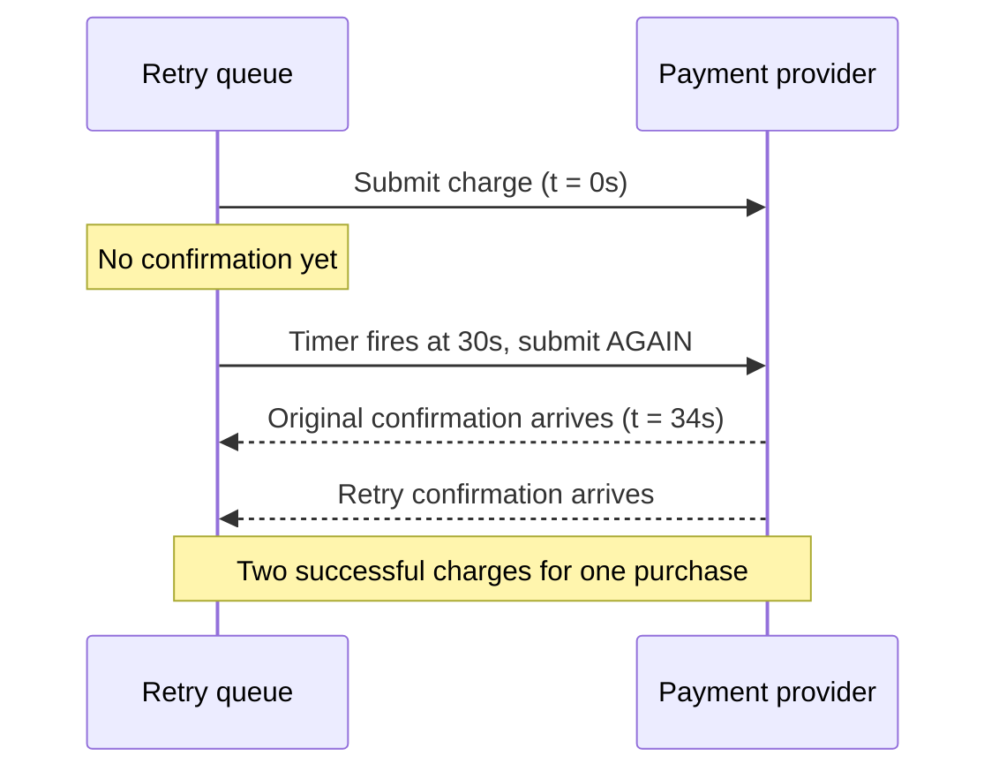
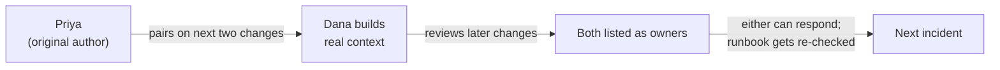
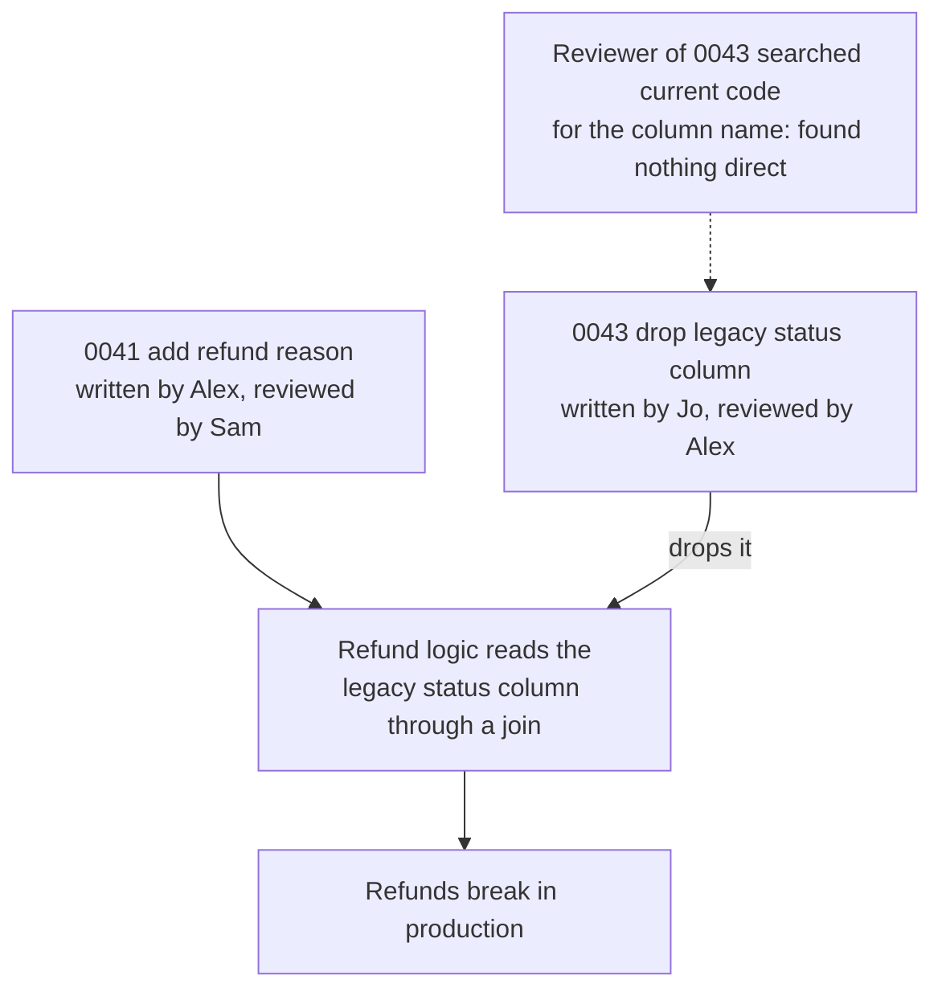

import Scenario from "../../../components/Scenario.astro";
import LevelIntro from "../../../components/LevelIntro.astro";
import Checkpoint from "../../../components/Checkpoint.astro";
import PracticeCheck from "../../../components/PracticeCheck.astro";

export const unit = {
  track: "git-teamwork",
  unitSlug: "ownership",
};

<Scenario label="The full incident timeline">
  <Fragment slot="facts">
    

      
02:14 alert fires: duplicate charges detected

      
02:19 Marcus opens the code, recognizes nothing

      
02:41 first escalation: two engineers who also don't know this code

      
04:50 Priya lands, reads one log line, names the cause

      
04:54 fix shipped, 4 minutes after Priya had the right context

    

  </Fragment>

Look at the timeline: 160 minutes pass between the alert and the fix, and all
but 4 of them are spent without the one piece of knowledge that made the fix
trivial. **Where exactly did the time go, and is there a point where a written
artifact, rather than a smarter person, would have closed the gap?** This level
walks the bug, the runbook the team wrote afterward, how they raised the bus
factor, and a second case where the opposite move (spreading ownership across
everyone) was itself the mistake.

</Scenario>

<LevelIntro
  items={[
    "The race behind the duplicate charges",
    "The runbook and the co-owner built afterward",
    "A case where collective ownership failed",
  ]}
/>

## What was the actual bug?

The retry queue re-submits a charge if no confirmation arrives within 30
seconds, assuming the first attempt died silently. It did not handle a
confirmation that arrives _late_: at 34 seconds, say. The slow original attempt
still succeeds, but the retry already fired at the 30-second mark and also
succeeds. Both charges go through. This is a race between a retry timer and a
slow-but-real confirmation, not a vague "something broke."

Priya saw the symptom in one log line because she remembered writing the
30-second timeout and recognized duplicate charges with two valid confirmations
as exactly what a late confirmation crossing a retry looks like. Marcus saw the
same line with no history and reasonably suspected the payment provider's API:
a plausible read, just the wrong one, and he had no prior model of the file to
rule it out quickly.

<Checkpoint question="Marcus spent over two hours suspecting the payment provider instead of the retry timer. Was that a bad diagnostic instinct?">

Not really. Duplicate successful charges are also a plausible symptom of a
flaky upstream API, so starting there was sensible for someone seeing this
design for the first time. The cost came from reasoning from scratch, under
time pressure, on a system the author could reason about from memory. The
remedy is therefore not to make Marcus a sharper detective but to remove the
need to rediscover the design at 2 AM at all.

</Checkpoint>

<PracticeCheck
  track={unit.track}
  unitSlug={unit.unitSlug}
  topicId="runbook-and-escalation"
/>

## What did the runbook have to contain?

After the incident the team wrote the runbook that would have turned a
three-hour search into a short, mechanical check. Its sections matter more than
its wording:

| Section              | What it holds                                                                                    | What problem it removes                                      |
| -------------------- | ------------------------------------------------------------------------------------------------ | ------------------------------------------------------------ |
| What the alert means | Almost always a confirmation arriving after the 30-second retry timer, not a provider-side bug   | The wrong first hypothesis                                   |
| First checks         | Look for two successful confirmations for the same original charge, both later than 30 seconds   | Guessing whether this is the known failure                   |
| Known mitigation     | Disable retries for the affected payment method with a feature flag; no code deploy needed       | Needing deep code context to stop the bleeding               |
| Escape hatch         | If the checks do not match, stop and escalate immediately instead of guessing further            | Following a known fix on an unknown problem                  |
| Escalation and owner | Priya as primary; Dana, who has paired on recent changes, as a second contact; a named doc owner | Paging people who are equally lost, and a document that rots |

The point of this shape: the first checks let a stranger to the code confirm
_this specific known failure_ without understanding the whole system, and the
mitigation needs only a flag flip. A runbook's job is not to teach on-call the
whole system under pressure. It compresses the one likely path into something
executable correctly by someone who has never seen the code, and its escape
hatch keeps it honest about what it does not cover. Note too that a flag flip
only stops new duplicates; the real defect still needs the owners to fix it
properly, for example by making the resubmitted charge safe to repeat.

## How does a second person become a real co-owner?

A runbook is a snapshot and will drift. The team therefore also changed who
could respond. Dana paired with Priya on the next two changes to the retry
queue, reviewed the ones after that, and only then was added as a second
reviewer in the repository's `CODEOWNERS` file for that directory.

The order is the lesson. Dana was listed _after_ gaining context, not instead
of it. A line in `CODEOWNERS` naming someone who has never worked in the code
raises no bus factor; it adds a name that will also reason from scratch at
2 AM.

<PracticeCheck
  track={unit.track}
  unitSlug={unit.unitSlug}
  topicId="real-coowner"
/>

## Is the answer always "spread ownership wider"?

No. Here is a case from the same company where the opposite happened: the
database migrations directory had no owner at all. Anyone could add a
migration, on the theory that a shared, reviewed directory avoids the
bus-factor-1 problem above.

Migration 0043 dropped a column that 0041's refund logic still read, through a
join one file away from where the reviewer looked. Every change had _a_
reviewer, and each review was locally reasonable. What nobody had was the
accumulated picture across 0041, 0042 and 0043 that a long-term owner of the
directory would have built by reviewing them in sequence.

|                    | Payments-retry queue (single-owner)     | Migrations directory (collective)                              |
| ------------------ | --------------------------------------- | -------------------------------------------------------------- |
| What failed        | On-call could not act without the owner | Nobody held cross-cutting context                              |
| What made it worse | Eight months of zero knowledge sharing  | "Someone reviewed it" felt sufficient                          |
| The fix            | Runbook plus a second real co-owner     | A named owner of cross-cutting review, on top of per-PR review |

Both models fail the same way underneath: nobody held enough context to catch
the specific failure. Single ownership concentrates context where it may be
unreachable. Collective ownership without a coordinator spreads review but not
accumulated understanding, so each change looks fine while nobody sees the
pattern.

<Checkpoint question="Every migration PR had a reviewer. Why was that not enough to catch the conflict between 0041 and 0043?">

Per-PR review checks one change against the code as it exists at that moment.
It does not require anyone to hold the history of related changes across PRs.
The reviewer of 0043 correctly searched the current code and saw no direct
reference to the dropped column; what was missing was the memory that 0041's
refund path reached it through a join, and no single person had reviewed the
whole sequence. A named cross-cutting owner (even a rotating one) supplies
exactly that memory without returning to one-person ownership.

</Checkpoint>

<PracticeCheck
  track={unit.track}
  unitSlug={unit.unitSlug}
  topicId="collective-failure"
/>

## This worked example is a case, not the whole territory

Two incidents do not cover every shape ownership can take. Push on them
yourself. **If the retry queue had three equally experienced co-owners from day
one, does the bus-factor problem vanish, or does it just take a worse night
(all three unreachable, say at a company offsite) to reproduce?** And for the
migrations case: if the team had named a single rotating migration owner for one
quarter at a time, what new single point of failure would that create, and is
it a better trade than the one that actually caused the outage? A third
variation to try: what changes if the system is rarely touched and rarely pages
anyone? Does the same investment in pairing and runbooks still pay off?

## Failure modes

| Failure mode                                           | What it gets wrong                                                                        |
| ------------------------------------------------------ | ----------------------------------------------------------------------------------------- |
| Treating bus factor as only about people quitting      | It applies whenever the owner is unreachable: vacation, a flight, another fire            |
| Writing a runbook once and never revisiting it         | A stale runbook sends on-call down steps that no longer match the system                  |
| Assuming a pager rotation spreads knowledge            | It spreads who responds, not what they know                                               |
| Assuming collective ownership has no bus-factor risk   | It swaps "nobody can act" for "nobody holds the cross-cutting picture"                    |
| Listing owners who have no working history in the code | A name without context adds no response capacity at 2 AM                                  |
| Treating the fix as a one-time post-incident task      | Without ongoing pairing and rotating reviewers, the effective bus factor drifts back to 1 |
